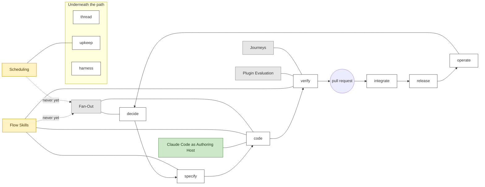

# AI Adoption Map

```meta
rating: adopted
index: root
type: adoption-map
```

This repository is itself built with AI. The assets it ships are the product, described in
`.devbook/arc42`; what follows is only how the work gets done here. Each practice has one chapter in
a usage file; this file is the map.

**Files**

Three files group the usages the way work happens for a repository whose product is
Markdown: an asset is written, a change is carried to a commit, and the result is checked. A
file is a reading unit and places nothing; each chapter says its own stages and layers.

| File | Covers |
| --- | --- |
| [01-author.md](01-author.md) | Writing an asset in the host that loads it. |
| [02-deliver.md](02-deliver.md) | Carrying a change end to end: the flow skills, the unused fan-out lane, and scheduling. |
| [03-verify.md](03-verify.md) | Checking an asset does what it says: plugin evaluation and journeys. |

**Adoption Picture**



Shading is `status`. `integrate`, `release`, and `operate` hold no usage because nothing here
uses AI there: the product is Markdown, so there is no deploy, and a release is a version bump
a person makes. Scheduling is the upkeep loop, which lands its work as pull requests at
`integrate`. The `thread` and `harness` layers are empty because no chapter here is placed in
them yet. Scheduling reaches fan-out and the `schedule-*` entry points, never a flow: the
missing edge to `Flow Skills` is the [decision](../arc42/adr/plugin-boundaries.md), not an
omission.

**How to Read It**

`status` reuses the `tech/` ladder (`candidate`, `trial`, `adopted`, `hold`, `retired`) and
rates a way of working, not a tool. One chapter is `adopted` because it is how every change
here has been made. Two are `trial`: the flow skills because everything they need has landed
and nothing has used them, and scheduling because its first local runs have published here.
Three are `candidate` because the honest first use is somewhere else, or has not happened.
Journeys are among them, since this repository adopts no `domain/` and runs no application.

Each chapter's `date` is the day its current rating was set, and its `evidence` how much that
rating rests on. Every `trial` or `candidate` chapter says what moves it up.

The picture above is the hand-drawn form of the adoption view a tool draws from the same
fields. At each stage and layer sit the chapters whose `stage` or `layer` names it, shaded by
rating and carrying the `tech/` chapter their `depends-on` names. Two usages rest on the Claude
Code plugin API, one on the CLI, and one on
[Scheduled Routines](../tech/hosts.md#scheduled-routines), the scheduler here, which draws
Scheduling as scheduled. The other two name none, the normal case for a practice. No chapter
here hands work to another yet, so none carries `feeds`.

To add a practice:

1. Write its `##` chapter in the file where it reads best, with `status`, `type`, `stage` or
   `layer`, `date`, and the fields the chapter template asks for.
2. Attach its node to its stages and layers in the picture above in the same change.

To promote one:

1. Change the rating and the `date` in the chapter and the `class` line here together.
2. Say in the chapter what the evidence was.
