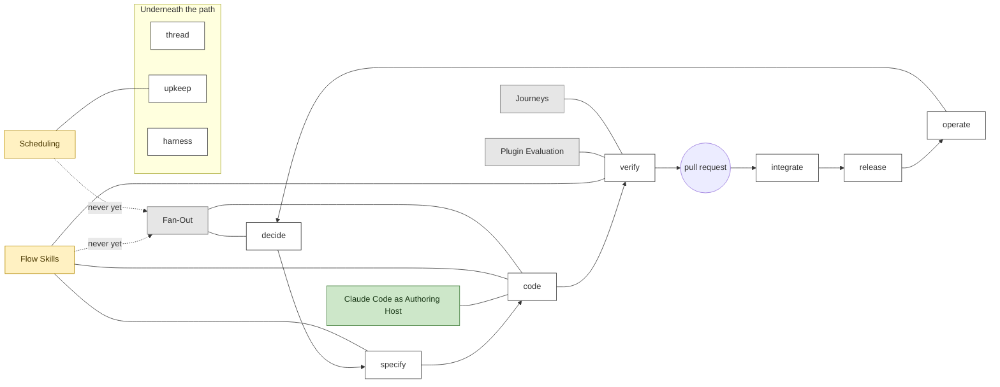

# AI Adoption Map

```meta
status: adopted
index: root
type: adoption-map
```

How this repository is itself built with AI. The assets it ships are the product and are
described in `.devbook/arc42`; what follows is only how the work gets
done here. The practices live one chapter each in the usage files; this file is the map.

**Files**

Three files group the usages the way work happens for a repository whose product is
Markdown: an asset is written, a change is carried to a commit, and the result is checked. A
file is a reading unit and places nothing — each chapter says its own stages and layers.

| File | Covers |
| --- | --- |
| [01-author.md](01-author.md) | Writing an asset in the host that loads it. |
| [02-deliver.md](02-deliver.md) | Carrying a change end to end: the flow skills, the fan-out lane nothing here has used, and scheduling. |
| [03-verify.md](03-verify.md) | Checking an asset does what it says: plugin evaluation, and the journeys the devbook skills write, derive, and run. |

**Adoption Picture**

The seven stages of the delivery path, the pull request between `verify` and `integrate`, and
the three layers beneath, with each chapter attached to the stages and layers it lists.
Shading is `status`. `integrate`, `release`, and `operate` hold no usage because nothing here
uses AI there: the product is Markdown, so there is no deploy, and a release is a version bump
a person makes. Scheduling is the upkeep loop, which lands its work as pull requests at
`integrate`. The `thread` and `harness` layers are empty because no chapter here is placed in
them yet. Scheduling reaches fan-out and the `schedule-*` entry points, never a flow — the
missing edge to `Flow Skills` is the [decision](../arc42/adr/plugin-boundaries.md), not an
omission.



**How to Read It**

`status` reuses the `tech/` ladder — `candidate`, `trial`, `adopted`, `hold`, `retired` — and
rates a way of working, not a tool. One chapter is `adopted` because it is how every change
here has been made. Two are `trial`: the flow skills because everything they need has landed
and nothing has used them, and scheduling because its first local runs have published here.
Three are `candidate` because the honest first use is somewhere else, or has not happened —
journeys among them, since this repository adopts no `domain/` and runs no application.
Each chapter's `date` is the day its current rating was set, its `evidence` how much that
rating rests on, and every `trial` or `candidate` chapter says what moves it up.

The picture above is the hand-drawn form of the adoption view a tool draws from the same
fields: the seven stages in path order and the three layers beneath, and at each the chapters
whose `stage` or `layer` names it, shaded by rating and carrying the `tech/` chapter their
`depends-on` names. Two usages rest on the Claude Code plugin API and one on the CLI; the
other three name none, which is the normal case for a practice. No chapter here hands work to
another yet, so none carries `feeds`.

To add a practice, write its `##` chapter in the file where it reads best, with `status`,
`type`, `stage` or `layer`, `date`, and the fields the chapter template asks for, then attach
its node to its stages and layers in the picture above in the same change. To promote one, change the rating
and the `date` in the chapter and the `class` line here together, and say in the chapter what
the evidence was.
