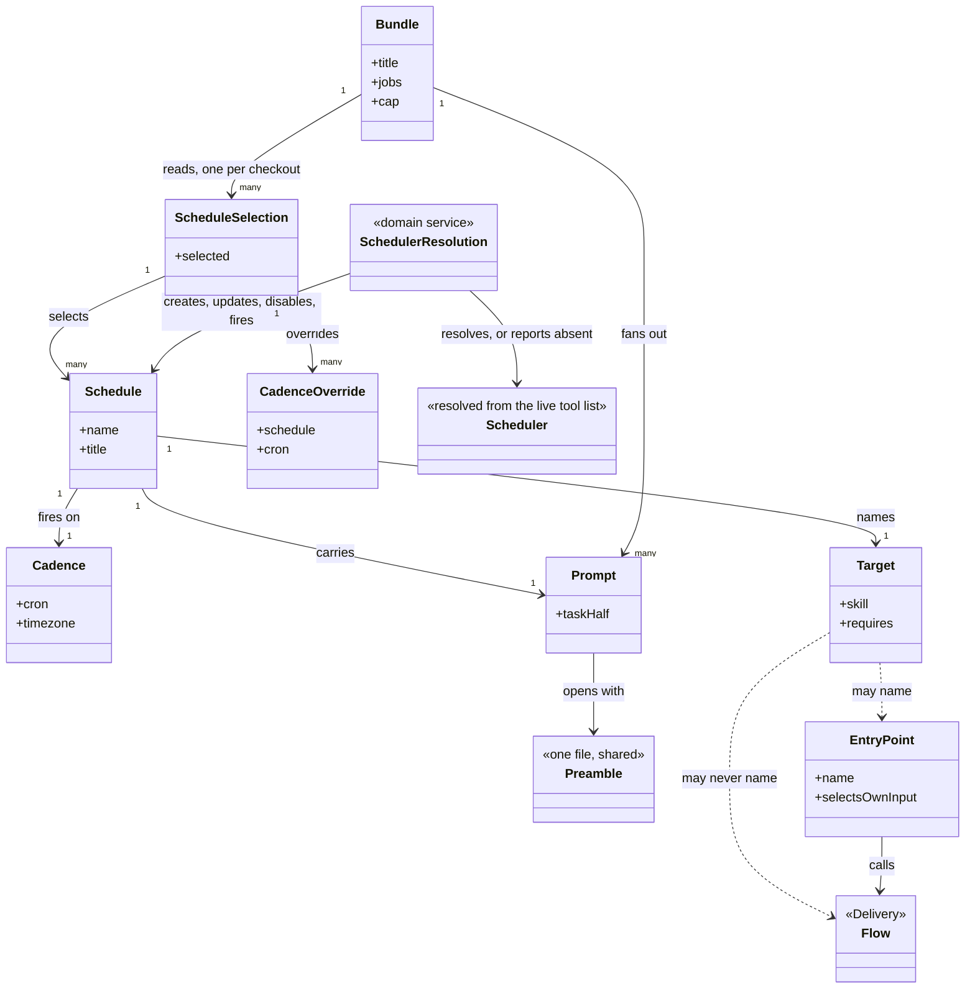
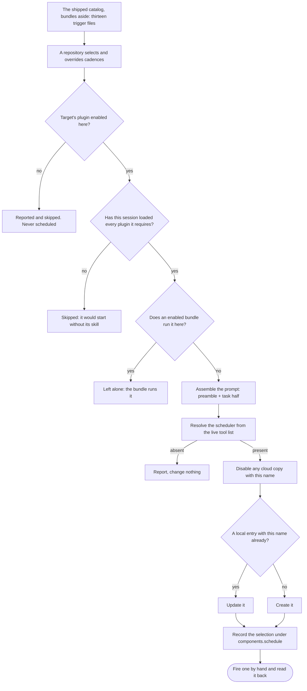
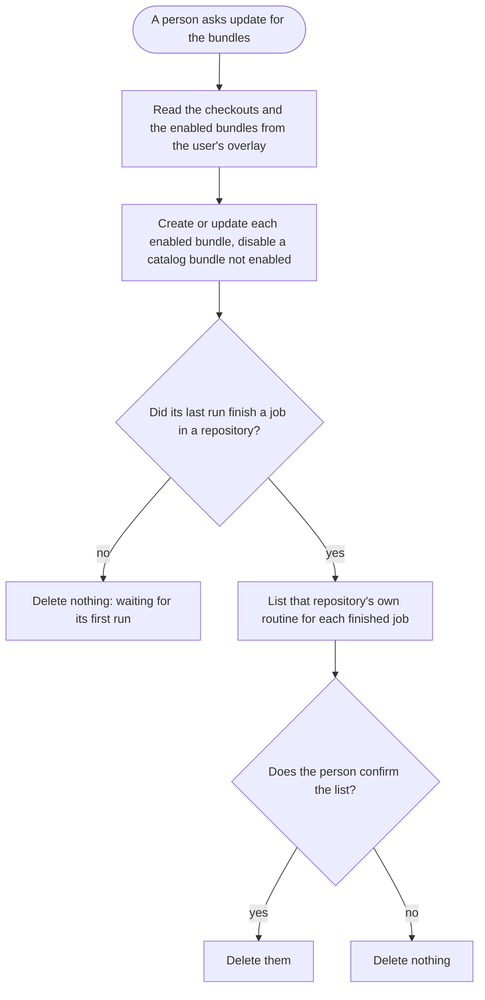
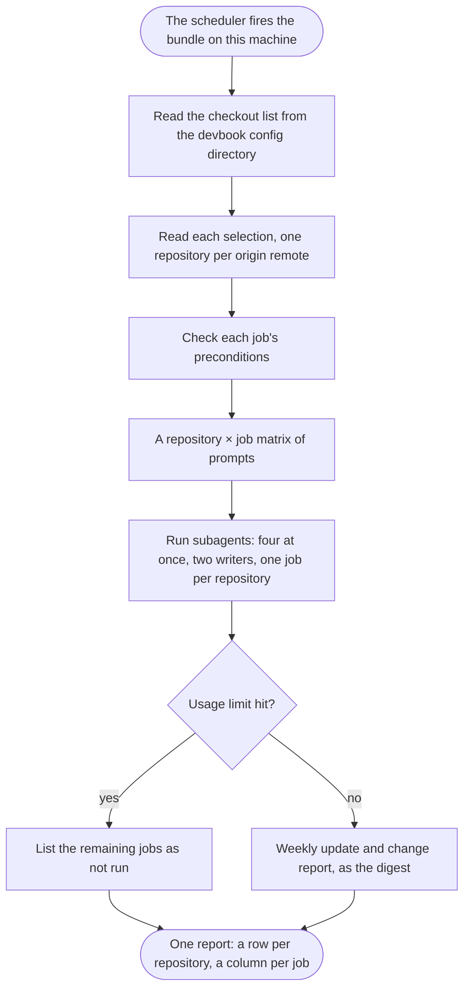

# delivery-schedule

```meta
related: [".devbook/arc42/building-blocks/README.md", ".devbook/arc42/building-blocks/delivery-schedule-entry-points.md", ".devbook/arc42/building-blocks/delivery.md#dependencies", ".devbook/arc42/adr/plugin-boundaries.md", ".devbook/arc42/05-building-block-view.md#schedule-plugin"]
c4: ["marketplace.delivery-schedule"]
code: ["plugins/delivery-schedule"]
```

Work that runs with nobody watching, and the catalog of triggers that fires it. This block
guarantees that a procedure can run in a session nobody is watching without passing a gate,
merging anything, or carrying anything personal into the repository.

**Owns**

- The catalog of triggers that fires the entry points
- The preamble every unattended prompt starts with
- The selection a repository records
- The bundles that run catalog jobs across every repository on a machine
- How the entry points go through the scheduler

**Nested blocks**

- [delivery-schedule-entry-points](delivery-schedule-entry-points.md): the entry points that pick their own input

| Concern outside it | Owner |
| --- | --- |
| The flows the entry points call | [delivery](delivery.md) |
| The scheduler itself, resolved from the live tool list and never named | The host |
| Anything a target delegates to | A binding the consuming repository makes |

## Interfaces

```meta
```

The block exposes nineteen skills in three groups: fourteen entry points that pick their own
input, each with the `report.md` template its report follows, one bundle skill that runs those
entry points across every repository on the machine, and four that put a trigger in the
scheduler and read it back. A person can run every one by hand, which is how a cadence gets
proved before it is trusted.

| Interface | Kind | Reached by |
| --- | --- | --- |
| `schedule-devbook-validate` through `schedule-whats-new`, fourteen entry points | skills | The scheduler, on a cadence, or a person by hand |
| `schedule-bundle`, one skill for every [bundle](#bundle) | skill | The scheduler, weekly, or a person by hand |
| `init` | skill | A person, or `devbook-config:init` during a fan-out |
| `update` | skill | A person, or `devbook-config:update` during a fan-out |
| `schedule-status`, `schedule-run` | skills | A person, from a session |
| `resources/schedules/*.schedule.md` | catalog, the shipped trigger files | `init` and `update`, reading a repository's selection against it |
| Eight contracts, listed below | contracts | The skills, by path |
| `scripts/resolve-issue.workflow.js` | work script | The issue sweep, and another plugin's sweep resolving an item the same way, per `draft-pr-contract.md` |
| `skills/schedule-bundle/bundle.workflow.js` | work script | `schedule-bundle`, through the host's workflow tool |
| `tools/schedule-catalog/check.mjs` | tool | Run before committing a catalog change |
| `migrations/001-weekend-cadence/` | migration | `update`, in its first step: names the routines whose catalog default moved, which its step 6 re-times |
| `migrations/002-retired-schedules/` | migration | `update`, in its first step: names the retired schedules a stamp still carries |
| `SessionStart` hook | hook | Either host, at session start |
| `components.schedule` | stamp in the stack config | Written by `init` and `update` alone, read by [devbook-config](devbook-config.md) |

The contracts hold:

- `schedule-catalog-contract.md`: the schedule file and the stamp
- `machine-sync.md`: how `update` syncs the bundles at machine level, and the record it reads
- `schedule-preamble.md`: the preamble every prompt opens with
- `report-contract.md`: where a report goes, the frame every `report.md` fills, and how every entry point runs by hand or unattended and reports to a surface
- `change-window-contract.md`: the change window `schedule-weekly-update` and `schedule-whats-new` share
- `findings-contract.md`: the review checklist, severity, ranked table, and issue the review entry points share
- `instruction-tightening.md`: the tightening standard `schedule-instruction-review` applies
- `draft-pr-contract.md`: how a sweep lands one item as a draft pull request, its five parameters the caller's

The work script runs a `flow-code` kind through the host's workflow tool: Scope; Implement, a
failing test first; Build & Test with bounded repair; Review, two lenses. The weekend-cadence
migration keys on the stamped `pluginVersion`, since the routine lives in the scheduler. The
hook's routing text sends recurring unattended work here and says never to schedule a flow.

[delivery-schedule-entry-points](delivery-schedule-entry-points.md#interfaces) describes each
entry point. The rest are below.

### init and update

```meta
```

- **Does:** `init` asks which schedules to enable and stamps the answer; `update` reads the
  selection from that stamp. Both create or update the selected schedules through whatever
  scheduler the live session exposes, disable the deselected, and record the selection under
  this component's stamp: the [Schedule Selection](#schedule-selection) aggregate, drawn under
  [From Catalog to Scheduler](#from-catalog-to-scheduler).
- **Refuses:** `init` where `components.schedule` exists, and `update` where it does not.
- **Skips:** a schedule whose `requires` names a plugin the syncing session has not loaded, and
  names the plugin, since a routine from the same checkout loads the same set.
- **Stops:** a sync from a worktree, since the routine would keep a folder removed with it.
- **Local routines only:** a routine runs on this machine, in the repository's main checkout,
  with the plugins installed there. It works in a fresh worktree of its own: the one the host
  starts it in, since the routine's worktree option is on by default, or one the run adds when
  the option is off.
- **Never:** creates a routine through a cloud scheduler, because a cloud session starts on a
  clone without this marketplace's plugins and cannot reach its skill. Every sync disables an
  enabled cloud copy carrying the repository's name, so a schedule never fires twice.
- **Matches:** entries by `<owner>/<repo> · <title>`, so a second sync updates rather than
  duplicates. No scheduler id has to be written into the repository, which keeps anything
  personal out of it.
- **Bundles:** one routine for the whole machine, matched by `All repos · <title>`. `update`
  syncs them at machine level when a person asks for the bundles, from any folder that is not a
  worktree, and needs no stamp. It reads the checkouts and the enabled bundles from the user's
  devbook config directory, so no sync writes a path into a repository.
- **Retires:** once a bundle's run has finished a job in a repository, machine level deletes
  that repository's own routine for the job, after the person confirms the list. While a bundle is
  enabled, a repository's own sync leaves a covered job alone. It neither creates nor updates
  that routine, and the job stays in the selection the bundle reads.

### schedule-status

```meta
```

- **Does:** lists the schedules with their last runs, what each published, and the log where one
  failed, through [Scheduler Resolution](#scheduler-resolution) like the other two catalog skills.

### schedule-run

```meta
```

- **Does:** fires one schedule now and reports the run, through
  [Scheduler Resolution](#scheduler-resolution).
- **Why:** the first run is the proof, not the creation. An unfired cadence is a guess about
  somebody else's environment.

## Structure

```meta
related: [".devbook/arc42/05-building-block-view.md#schedule-plugin", ".devbook/arc42/adr/plugin-boundaries.md"]
```


Four aggregates, two services, and one event cover the triggers, the things they fire, the
bundles that fire many at once, and the line between what a repository commits and what stays
personal. The model draws all of it.
[delivery-schedule-entry-points](delivery-schedule-entry-points.md#structure) describes the
Entry Point aggregate and the Schedule Report Published event.

### Model

```meta
related: [".devbook/arc42/building-blocks/delivery-surface-dashboard.md"]
```



- **`Target ..> Flow` is the one forbidden association, and it is drawn on purpose.** A flow ends
  at a gate and an unattended run parks where a gate would be, so scheduling a flow schedules a
  park. The catalog checker turns that sentence into a failing build.
- **`EntryPoint → Flow` is allowed and is the whole design.** The entry point is the adapter: it
  picks the input a flow would otherwise need a person for, then calls the flow.
- **`Preamble` is one file associated by every prompt.** Restating the unattended rules per
  schedule would put six copies of the most safety-critical prose in the plugin, drifting
  independently.
- **`ScheduleSelection` sits in the consuming repository, `Scheduler` sits in the host, and
  nothing joins them but a name.** Matching by `<owner>/<repo> · <title>` removes the need to
  write a scheduler id anywhere. An id would be personal, and personal facts do not go in a
  committed file.
- **`Scheduler` is dashed and terminal.** It is resolved at run time and no scheduler is a normal
  outcome, the same shape a [surface](delivery-surface-dashboard.md) has, for the same reason.
- **The two halves share only `Target`.** The catalog is host-neutral data and the entry points
  are procedures. The plugin holds both because they are one subject, work that runs with nobody
  watching, not because either needs the other's internals.
- **`Bundle` fans out `Prompt` and never reaches `EntryPoint` directly.** Each job runs from the
  prompt its own schedule would carry, so a bundle adds no procedure to keep in step.

### Schedule

```meta
related: [".devbook/arc42/05-building-block-view.md#schedule-plugin", ".devbook/arc42/12-glossary.md#catalog"]
```

Also called: routine, automation, trigger, cron entry.

One trigger: a cadence, a target, the plugins that target needs, and a prompt self-contained
enough to run with nobody watching. It is the consistency boundary because those four are only
meaningful together. A cadence with a target the repository has not enabled is a session that
starts with nothing to run.

**A schedule is a trigger and never a procedure.** The `schedule-*` entry point is what runs;
the schedule is what asks. That separation is why every entry point is also runnable by hand,
and why a trigger can be created, disabled, and re-created without touching what it fires.

| Invariant | Enforced at | Evidence |
| --- | --- | --- |
| A target is an entry point or a read-and-report skill — never a flow | `check.mjs` | untested |
| A cron expression that could fire more than hourly is rejected | `check.mjs` | untested |
| The `requires` list names the target's own plugin | `check.mjs` | untested |
| Every prompt begins with the preamble, stated once and not restated per schedule | prompt assembly | untested |
| A `result: session` run does no work while an earlier run of the same schedule is unarchived and did not skip; a `result: github` run never waits | pickup gate, prompt assembly | untested |
| Every schedule declares `result` as `session` or `github` | `check.mjs` | untested |
| A trigger whose target plugin the repository has not enabled is reported and skipped, never scheduled | `init`, `update` | untested |
| Schedules are matched by name, so a second sync updates rather than duplicates | `init`, `update` | untested |
| No placeholder the contract does not name appears in a prompt | `check.mjs` | untested |
| A schedule's `maxResolve` is the default its README catalog row and its target skill state | `check.mjs` | untested |

The value objects it holds:

- **Cadence:** when the trigger fires, as a cron expression in UTC. The local scheduler
  evaluates it in the machine's own timezone, so the sync converts it and reports both. Hourly
  is the ceiling: anything that could fire more often is rejected, because an unattended run
  that overlaps its own previous run cannot notice it. A repository changes a cadence in its own
  selection rather than in the catalog, which keeps the shipped
  [catalog](../12-glossary.md#catalog) readable as the default rather than as somebody's current
  setting.
- **Target:** the skill a trigger fires, plus the plugins it needs to be present. Three kinds are
  admissible: an [entry point](delivery-schedule-entry-points.md#entry-point), a fan-out skill
  such as a [bundle](#bundle)'s, and a read-and-report skill. A flow is not, for the reason under [Model](#model).
- **Prompt:** what the scheduled session is given, assembled from the shared
  [preamble](../12-glossary.md#preamble) and the schedule's own task half. It has to be
  self-contained: the session starts with nothing but the repository, so it cannot remember
  anything the prompt does not say. The preamble's first rule puts the run on a fresh worktree
  of the base branch, the host's own when the worktree option is on and one it adds otherwise.
  The checkout the routine starts from is therefore never the one it edits.

### Schedule Selection

```meta
related: [".devbook/arc42/08-crosscutting-concepts.md#stamp", ".devbook/arc42/05-building-block-view.md#stack-config"]
```

It records which schedules this repository chose and any cadence or `maxResolve` it overrode,
under `components.schedule` in the stack config. This block's `init` and `update` alone write it.

The split is by who the fact belongs to. The selection and the overrides are repository facts
and are committed. The checkout's path, the approved tools, and the scheduler's own ids are
personal and stay in the scheduler. Matching by name makes writing them down unnecessary. A
[bundle](#bundle)'s list of checkouts is personal as well. It lives in the user's own overlay
under the devbook config directory, beside the machine's choice of bundles.

| Invariant | Enforced at | Evidence |
| --- | --- | --- |
| Nothing personal is written into the repository | `init`, `update` | untested |
| The selection is written by this block's `init` and `update` and by nothing else | `init`, `update` | untested |
| A deselected schedule is disabled rather than deleted, so re-selecting it does not duplicate | `init`, `update` | untested |
| A job an enabled bundle covers keeps its place in the selection, and its routine is neither created nor updated | `update` | untested |
| A retired name is dropped and its routine disabled, never a failure | `update` | `migrate.test.mjs`, the drop only |
| A routine whose title is no catalog or retired schedule is left alone | `update` | untested |
| A schedule that would start without its skill is refused rather than created | `init`, `update` | untested |

The value object it holds:

- **Cadence Override:** a repository's replacement for a catalog cadence. It is a value in the
  selection rather than an edit to the catalog file, so an upgrade can move the shipped default
  without silently reverting or silently keeping somebody's choice.

### Bundle

```meta
related: [".devbook/arc42/adr/plugin-boundaries.md", ".devbook/arc42/08-crosscutting-concepts.md#schedule", ".devbook/arc42/building-blocks/delivery-schedule-entry-points.md#in-a-bundle"]
```

Also called: cross-repository routine.

One schedule that runs several catalog jobs across every repository on this machine, one
subagent per repository and job. Its skill runs them through the host's workflow tool and never
starts a session. Each subagent gets the prompt `update` assembles for that repository and job,
built by the same rule when the bundle runs, so the bundle carries no procedure of its own.
One skill, `schedule-bundle`, runs every bundle. Its workflow script names each job's
precondition and whether the job writes, and one read-only plan agent gathers the facts about
each checkout that the script decides on.

| Bundle | Fires, local time | Jobs, in order |
| --- | --- | --- |
| Saturday code health | Saturday 05:00 | `devbook-update`, then `package-update` and `security-review` |
| Sunday devbook review | Sunday 04:00 | `devbook-validate`, `tech-update`, `devbook-verify`, `prose-check`, `instruction-review`, then `weekly-update` and `change-report` as the digest |

Merge review, issue sweep, weekly retro, and every job not about the repositories stay one
routine each. The reasons are in [the plugin boundaries record](../adr/plugin-boundaries.md).

| Invariant | Enforced at | Evidence |
| --- | --- | --- |
| At most four subagents run at once, at most two of them jobs that write | bundle skill | `unit:node:plugins/delivery-schedule/skills/schedule-bundle/bundle.workflow.test.mjs` |
| No two jobs run in the same repository at once, reader or writer | bundle skill | `unit:node:plugins/delivery-schedule/skills/schedule-bundle/bundle.workflow.test.mjs` |
| A repository's jobs start in the bundle's order, so Saturday's stack update starts before package update and security review | bundle skill | `unit:node:plugins/delivery-schedule/skills/schedule-bundle/bundle.workflow.test.mjs` |
| At the plan's usage limit, no new job starts and the rest are reported as not run | bundle skill | `unit:node:plugins/delivery-schedule/skills/schedule-bundle/bundle.workflow.test.mjs` |
| Every job that changes files lands as a draft pull request and opens no issue | bundle skill, the prompt it passes | untested |
| A repository is run once, however many checkouts carry its selection, deduplicated by `origin` | bundle skill | `unit:node:plugins/delivery-schedule/skills/schedule-bundle/bundle.workflow.test.mjs` |
| A job's preconditions are checked before any subagent starts | bundle skill | `unit:node:plugins/delivery-schedule/skills/schedule-bundle/bundle.workflow.test.mjs` |
| No pickup check holds a bundle back | prompt assembly | `unit:node:plugins/delivery-schedule/skills/schedule-bundle/bundle.workflow.test.mjs` |
| The list of checkouts is never written into a repository | bundle skill, `update` | untested |
| A per-repository routine is deleted only once a bundle's run has finished its job in its repository, and only after the person confirms | `update` at machine level | untested |

The value objects it holds:

- **Job:** one catalog schedule run for one repository, from that schedule's own prompt. It
  succeeds or fails as one cell of the bundle's report.
- **Checkout list:** the main checkouts on this machine, kept under
  `ext.delivery-schedule.checkouts` in the user's overlay in the devbook config directory. Each
  one's `components.schedule` selection says which jobs it gets.
- **Bundle choice:** which bundles this machine runs, under `ext.delivery-schedule.bundles` in the
  same file. Absent, the machine runs none.

Inside a bundle, `prose-check` runs
[`schedule-prose-check`](delivery-schedule-entry-points.md#schedule-prose-check) in its bundle
mode, which opens a draft pull request with its edits, one commit per chapter, and skips an edit
an earlier closed pull request rejected. Its own catalog entry carries no editor, so the bundle
is the one place prose check writes. Once a bundle's first run passes,
the per-repository routines it replaces are deleted, so no job fires twice.

### Scheduler Resolution

```meta
related: [".devbook/arc42/12-glossary.md#scheduler", ".devbook/tech/hosts.md#scheduled-routines"]
```

It finds the [scheduler](../12-glossary.md#scheduler) the live session exposes, and creates,
updates, disables, reads, or fires an entry through it. It deletes one in a single case: a
per-repository routine whose job a bundle has run in that repository.

Invocation semantics: command-invoked, by the four catalog skills. **No scheduler is a normal
outcome:** the operation reports it and stops without failing anything, the same shape a surface
takes.

It is a service rather than behaviour on [Schedule](#schedule) because it is the one place the
block touches a host capability. Everything else here is host-neutral data, and keeping the
resolution in one place makes that true.

| Invariant | Enforced at | Evidence |
| --- | --- | --- |
| The scheduler is resolved from what the live session exposes, never from a hardcoded tool name | scheduler resolution | untested |
| No scheduler is a normal outcome: the operation reports it and stops without failing anything | scheduler resolution | untested |
| A host capability is touched here and nowhere else in the block | scheduler resolution | untested |
| A schedule is created only through a local scheduler; a cloud one is used only to disable a copy | scheduler resolution | untested |

### Catalog Check

```meta
related: [".devbook/arc42/12-glossary.md#catalog"]
```

It checks the shipped catalog for:

- a malformed entry
- a cron that could fire more than hourly
- a target that is a flow or does not exist
- a `requires` list omitting the target's plugin
- a placeholder the contract does not name

Invocation semantics: command-invoked, and run before committing. It alone enforces the rule
that a schedule may not target a flow, otherwise a sentence in a document nobody re-reads.

## Runtime

```meta
related: [".devbook/arc42/building-blocks/delivery.md"]
```

A trigger becomes a run below.
[An Unattended Run](delivery-schedule-entry-points.md#an-unattended-run) shows where it stops.

### From Catalog to Scheduler

```meta
```



Four skills read the catalog, and all four resolve the scheduler rather than naming one. No
scheduler is a normal outcome at every step.

**Refusing beats creating something that cannot run.** A routine loads the plugins installed on
this machine for the checkout, so one this session has not loaded is a skill the run would not
reach. That is also why no schedule is a cloud session: a cloud clone installed none of them.

### A Machine Sync

```meta
related: [".devbook/arc42/building-blocks/delivery-schedule.md#bundle"]
```



The sync writes nothing into any repository, because every fact it reads belongs to the
machine. A deleted routine cannot be restored, so the list waits for the person's answer.
Retiring is judged per repository and job, so a job that failed or never started inside the
bundle keeps its own routine until the bundle has run it.

### A Bundle Run

```meta
related: [".devbook/arc42/building-blocks/delivery-schedule.md#bundle", ".devbook/arc42/building-blocks/delivery-schedule-entry-points.md#in-a-bundle"]
```



A job's failure is one cell of the report, and the run carries on. Each job that changed files
leaves a draft pull request from its own `schedule/<name>/<date>` branch, which the report links.

## Dependencies

```meta
related: [".devbook/arc42/building-blocks/delivery.md#dependencies", ".devbook/arc42/adr/plugin-boundaries.md", ".devbook/arc42/08-crosscutting-concepts.md#layer"]
```

It is an [L1](../08-crosscutting-concepts.md#layer) extension over the engine it calls, and the
one plugin here whose subject is a host capability, a divergence on purpose.

### Outbound

```meta
```

| Depends on | Pattern | Mechanism | Contract | Why |
| --- | --- | --- | --- | --- |
| [delivery](delivery.md#dependencies) | Customer-Supplier, declared `delivery >=1.0.0 <2.0.0` | Its entry points call the engine's flows and phases | `resources/flow-phases.md`, `resources/engine-contract.md`, `resources/surface-contract.md`, the parking rule at a gate | The entry points are adapters onto flows. This real dependency is the only declared one. |
| [devbook](devbook.md#dependencies) | Separate Ways | Four wrappers invoke `devbook:validate`, `devbook:verify-change`, `devbook:tech-update`, and `devbook:prose-check`; `schedule-devbook-verify` lists units with the vendored `units.mjs` | The skill names alone | Naming is not depending: a trigger whose target plugin is not enabled is reported and skipped, never scheduled. |
| [devbook-skills](devbook-skills.md#dependencies) | Separate Ways | `draft-pr-contract.md` names `pr-body` for a sweep's draft pull request body; `schedule-merge-review` reads its door; `schedule-weekly-retro` names `retro` for lenses | The skill name alone | A reviewer weighs a merge by whether it can be walked back; a retro's lenses are written once. |
| [devbook-config](devbook-config.md#dependencies) | Separate Ways | `schedule-devbook-update` invokes `devbook-config:update`, and `schedule-devbook-validate` its `doctor` where installed | The skill names alone | As with devbook, naming is not depending: not enabled, the trigger is reported and skipped. |
| The host's scheduler | Conformist, resolved at run time | The [scheduler](../12-glossary.md#scheduler) the live session exposes, for a local routine; a cloud one only to disable a copy | Resolution by capability, never by name | One capability has two host names, Routines and Automations, and adopting either would name a host. |
| The host's workflow tool | Conformist, a recorded host fact | A bundle's skill and the issue sweep run their subagents through it | Named in `schedule-catalog-contract.md` | Fan-out without a second session needs it. |
| A machine's devbook config directory | Separate Ways | A bundle reads the list of checkouts from it | The directory's location, per `AGENTS.md` | Which folders a machine holds is personal. |
| GitHub, through `gh` | A host fact, not a binding: the block consults no tracker binding | Pull requests from dated branches, and the issues a skill opens for a finding | The preamble's publishing rules | A change reaches a person as a pull request; the report stays in the run's session. |
| [The plugin kernel](../08-crosscutting-concepts.md) | Shared Kernel | Plugin folder, two manifests, marketplace entry, `resources/` contracts, the `components.schedule` stamp | [Chapter 8](../08-crosscutting-concepts.md) | It is packaged, installed, and stamped like everything else here. |
| A consuming repository | Customer-Supplier, this block supplying | `components.schedule` in the stack config: the selection and any cadence overrides | The stamp shape, and the schedule names | The selection is a repository fact; anything personal about a schedule stays in the scheduler or a machine's own overlay. |

Without `pr-body`, the contract's body still states the door, and the review finds a one-way diff
from the diff itself. Without `retro`, the weekly retro reads through its own three lenses. This
block writes to GitHub only, whatever tracker the repository binds for the engine's flows.

### Inbound

```meta
```

| Consumer | Pattern | Mechanism | Contract | What it relies on |
| --- | --- | --- | --- | --- |
| [devbook-config](devbook-config.md#dependencies) | Conformist, read-only | Reads this plugin's `skills/` folder to report which `schedule-*` procedures the copy on disk ships, and reads `components.schedule` | The `schedule-` prefix and the stamp shape | That the prefix keeps its meaning and the stamp keeps its shape. It writes neither. |
| A maintainer, later | Customer-Supplier, this block supplying | The run's report on the scheduler's page, and a pull request from `schedule/<name>/<date>` | `report-contract.md` and the branch convention | That every run reports in the same shape, and the next updates its pull request rather than duplicating it. |
| Backlog's `backlog-tools` | Conformist, read-only | Its devbook sweep reads three of this plugin's files by path | `report-contract.md`, `draft-pr-contract.md`, `scripts/resolve-issue.workflow.js` | That the paths stay, and that `update` leaves its routine alone. |

**Naming a target is deliberately weaker than depending on one.** Four entry points wrap a
`devbook` skill, and the plugin declares one dependency. A target that is not
enabled costs that trigger and nothing else, the way the engine degrades rather than fails for a
role.

**The host-capability divergence is recorded, not hidden.** Nothing else in this marketplace
names a host capability as its subject. The catalog itself stays host-neutral data and only the
scheduler resolution knows a tool answered, per
[the plugin boundaries record](../adr/plugin-boundaries.md).

**This block owns no flow, holds no gate, and adds no phase.** That makes it an extension rather
than a second engine: everything it runs, the engine already had.

**The line between committed and personal is the one to hold.** Per
[Schedule Selection](#schedule-selection), nothing in the committed file would be wrong for the
next person who opens it.
