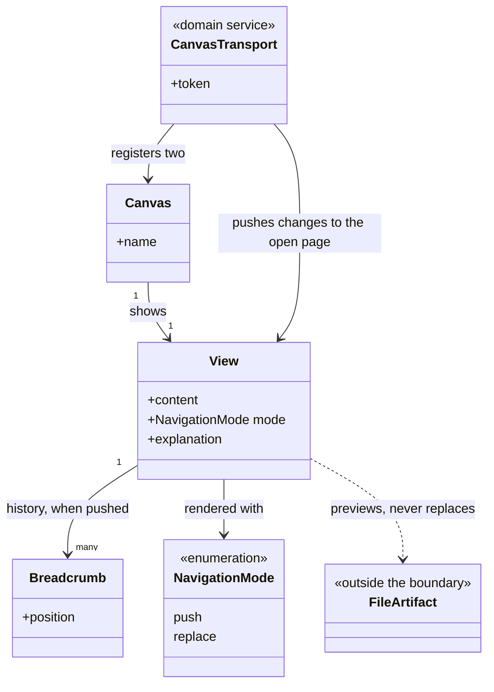
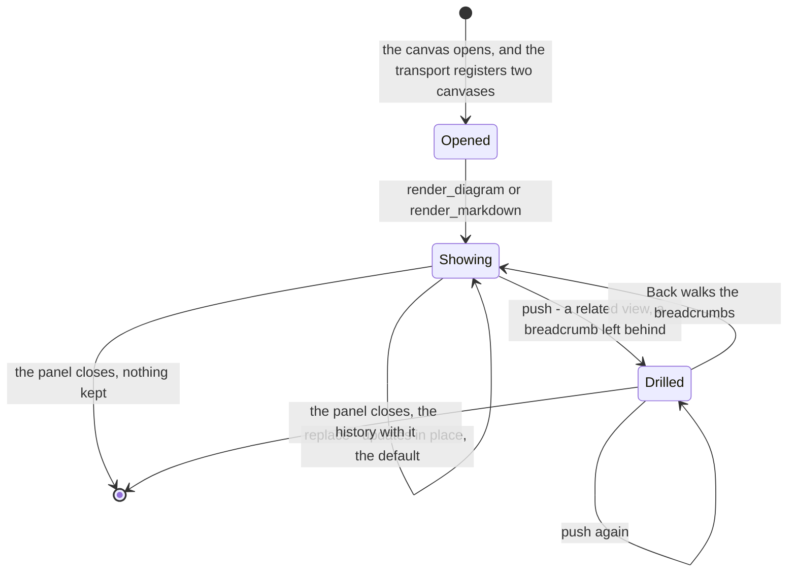
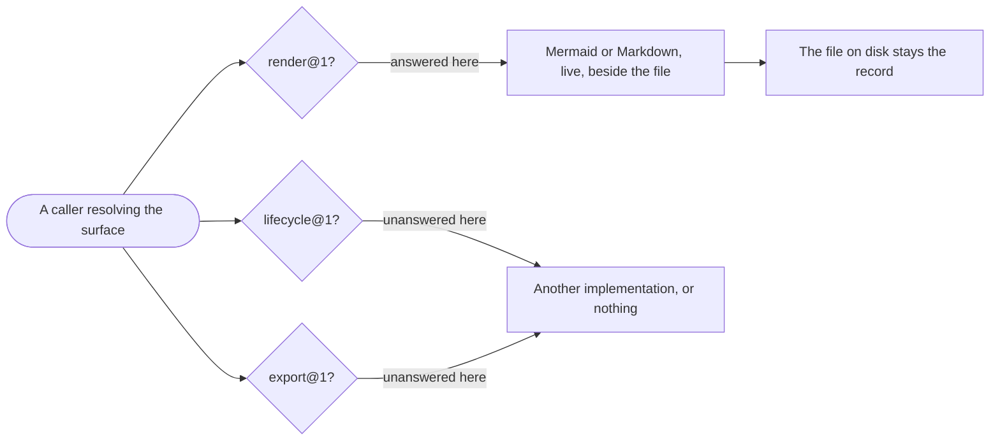

# delivery-surface-canvas

```meta
related: [".devbook/arc42/building-blocks/README.md", ".devbook/arc42/building-blocks/delivery.md#dependencies", ".devbook/arc42/adr/surfaces.md", ".devbook/arc42/12-glossary.md#canvas", ".devbook/arc42/12-glossary.md#preview"]
c4: ["marketplace.delivery-surface-canvas"]
code: ["plugins/delivery-surface-canvas"]
```

This block renders Mermaid and Markdown live beside the files they came from. It is responsible
for one thing: a diagram or a document written to a file can be looked at, live, beside the file.
Looking at it creates nothing anyone could mistake for a record.

**Owns:**

- the two viewers
- the navigation between views
- the transport that puts them on a canvas panel

Everything else is outside. It tracks no runs, exports nothing, persists nothing, and knows
nothing about what produced the content it is handed. It answers one capability group and is
the one plugin here that ships a single host's manifest and takes no marketplace entry.

[Chapter 8](../08-crosscutting-concepts.md) owns the kernel vocabulary: surface, capability group,
and plugin. The two terms this block owns, canvas and preview, are in the
[glossary](../12-glossary.md#canvas).

## Interfaces

```meta
related: [".devbook/arc42/adr/surfaces.md", ".devbook/arc42/08-crosscutting-concepts.md#surface"]
```

This block answers one capability group whole and nothing else. It ships no skills, only two
canvas operations, and the absences below are as much a feature as the renders are.

| Interface | Kind | Reached by |
| --- | --- | --- |
| `render_diagram`, `render_markdown` | Canvas actions, `delivery.surface.render@1` | A caller resolving the render group, on the one host with a canvas panel |
| Two canvases, one for diagrams and one for documents | Copilot extension, `extensions/delivery-surface-canvas/` | Copilot CLI, from the live tool list |
| The viewer pages | Loopback origin at an ephemeral port, per-instance token | The open canvas panel, with view changes pushed to it |

The two operations arrive as canvas actions rather than as namespaced tools, and the contract
is still satisfied: a surface is not required to be an MCP server.

### Render a Diagram

```meta
related: [".devbook/arc42/building-blocks/delivery-surface-canvas.md#view"]
```

- **Does:** shows Mermaid source live and pannable, with an optional explanation panel beside it.
- **Draws:** whatever the source says: C4, sequence, state, deployment, aggregate, context map,
  domain-event flow, subdomain landscape, wireframes, user flows.
- **Navigates:** `push` drills into a related diagram, Back walks the breadcrumbs, and
  `replace` updates in place. The history is the only thing this block remembers, and it dies
  with the panel.

### Render a Document

```meta
related: [".devbook/arc42/building-blocks/delivery-surface-canvas.md#view"]
```

- **Does:** shows Markdown as formatted HTML, with the same push-and-replace navigation.
- **Why:** same viewer shape, different content, so the two are one plugin rather than two.

### Stay a Preview

```meta
related: [".devbook/arc42/12-glossary.md#preview"]
```

- **Does:** persists nothing and renders the same source that was written to disk. The file stays
  the source of truth, and a rendered view nobody saved is not a record of anything.
- **Why:** this keeps the render group honest across all three implementations. A surface
  storing what it drew would become a second, staler copy of the artifact, and the run
  would then have two answers to what it produced.

### Declare Two Names

```meta
related: [".devbook/arc42/adr/surfaces.md"]
```

- **Does:** answers `render_diagram` and `render_markdown`, and nothing else. The extension's own
  origin serves viewer navigation and view inspection, rather than extra actions.
- **Why:** a surface that declares more than the contract stops being swappable for one that
  declares exactly it.

## Structure

```meta
related: [".devbook/arc42/building-blocks/delivery-surface-dashboard.md#structure", ".devbook/arc42/adr/surfaces.md"]
```

This repository's smallest model makes its size the statement: one aggregate, no store, and a
transport that knows the host.


### Model

```meta
```



- **`View ..> FileArtifact` is dashed and one-way, and it is the whole ethic of a surface.**
  Something this block cannot name wrote the file. The view is a preview of it and never a copy,
  so nothing here can become a second answer to what a run produced.
- **There is no run, no stage, and no store.** The other two implementations of this contract
  have all three. This one answers a different capability group, and a group is what a surface
  is substitutable by.
- **`Breadcrumb` is the only memory, and it is scoped to the panel.** It exists so a
  drill-down can be stepped back, and it dies when the panel closes. That is why `View` is an
  aggregate rather than a pure function, and why that is the extent of it.
- **`CanvasTransport` holds the token because it outlives the panel.** A canvas server that
  keeps running after the panel is gone is reachable by anything local. That is the one
  security question this model has and the dashboard's loopback pages do not.
- **`Canvas` is a host concept, and it is the only one in the diagram.** The two operations
  arrive as canvas actions rather than as namespaced tools, which is why the surface contract
  matches operation names and never a transport.

### View

```meta
```

Also called: render, panel content.

A view is what a canvas currently shows, and the history behind it. It is the only aggregate
here, and it is deliberately ephemeral. A view is a preview of a file that already exists, so
storing one would create a second, staler copy of something one call can re-render.

The history is the only state not derivable from the current call, which is why the aggregate
exists rather than the render being a pure function.

| Invariant | Enforced at | Evidence |
| --- | --- | --- |
| Nothing is persisted; a view is re-rendered rather than restored | render | untested |
| Rendered source is the same source written to disk — the file stays the record | render | untested |
| `push` leaves a breadcrumb the Back button walks; `replace` updates in place and is the default | `render_diagram()`, `render_markdown()` | untested |
| The declared tool surface is exactly two names | extension start | untested |
| Navigation and view inspection are served over the extension's own origin, never as extra actions | page load | untested |
| The canvas server checks a per-instance token, because it outlives the panel that opened it | request handling | untested |

The aggregate owns one enum and one entity:

- **Navigation Mode** (enum) is `push` or `replace`. `push` drills into a related view and
  leaves a breadcrumb, and `replace`, the default, updates what is on screen. There is no third
  value: a mode that cleared the history would make the Back button lie, and one that merged
  views would make the breadcrumb meaningless.
- **Breadcrumb** (entity) is one step in the history a `push` left behind, identified by its
  position. It exists so a drill-down can be stepped back, and it dies with the panel, which is
  the whole extent of this block's memory.

### Canvas Transport

```meta
related: [".devbook/arc42/12-glossary.md#canvas", ".devbook/tech/hosts.md#copilot-extension-sdk"]
```

It registers the two canvases, serves the viewer pages on a loopback origin at an ephemeral
port, and pushes view changes to the open page.

It is event-triggered and listens from extension load. It is a service rather than behaviour on
[View](#view) because it is the one part of this block that knows a host exists. Keeping that
knowledge in one place lets the viewers stay plain pages.

**This is the plugin's only transport, and it is why the contract matches operation names
rather than a transport.** The [two operations](#interfaces) arrive as canvas actions, and the
surface contract is still satisfied.

| Invariant | Enforced at | Evidence |
| --- | --- | --- |
| It registers exactly the two canvases, and pushes view changes to the open page | canvas registration | untested |
| Viewer pages are served on a loopback origin at an ephemeral port | server start | untested |
| The transport listens on 127.0.0.1 from the moment the extension loads | extension start | untested |

## Runtime

```meta
related: [".devbook/arc42/building-blocks/delivery-surface-canvas.md#view", ".devbook/arc42/building-blocks/delivery-surface-canvas.md#canvas-transport"]
```

### A View's Life

```meta
```



- **`replace` is the default because most renders are an update, not a descent.** A default of
  `push` would grow a history nobody asked for and make Back mean something different each
  time.
- **Nothing survives the panel.** That is not a limitation being worked around: it is what keeps
  a preview from becoming a record.
- **The transport outlives the panel and the view does not**, which is the whole reason the
  canvas server checks a per-instance token: it is reachable after the thing that opened it is
  gone.

### Where It Fits Among the Three

```meta
```



- **One group, whole, and no fallback of its own.** Answering render badly and lifecycle worse
  would make this substitutable for nothing, which is the failure the three-implementation split
  exists to avoid.
- **It answers on one host only, and that is a property of the group.** Its transport is a
  canvas panel and the other host has no equivalent, so there the
  [dashboard](delivery-surface-dashboard.md) answers the same group instead.
- **A caller finding no render group renders nowhere and says so once.** Absence is a normal
  outcome for every group, including this one.

## Dependencies

```meta
related: [".devbook/arc42/building-blocks/delivery.md#dependencies", ".devbook/arc42/08-crosscutting-concepts.md#surface"]
```

The first outbound row says why this plugin ships a single host's manifest and takes no
marketplace entry.

### Outbound

```meta
```

| Depends on | Pattern | Mechanism | Contract | Why |
| --- | --- | --- | --- | --- |
| Copilot Extension SDK | Conformist, and structurally | `extensions/delivery-surface-canvas/`, a `copilot-extension.json` and the module that registers two canvases | The host's extension shape | A canvas panel is the one thing this block needs, and only one host has one. |
| [delivery](delivery.md#dependencies) | Conformist to a Published Language | Implements the render group's two operation names, and nothing else | `resources/surface-contract.md`: `delivery.surface.render@1` | The contract matches operation names, which lets a canvas satisfy it without being an MCP server. |
| [The plugin kernel](../08-crosscutting-concepts.md) | Shared Kernel, with one documented exception | Plugin folder and one manifest; **no marketplace entry** | [Chapter 8](../08-crosscutting-concepts.md) | Only one host can load it, so the folder-shape rule is satisfied rather than broken. |
| The local loopback origin | Conformist | Viewer pages at an ephemeral port with a per-instance token, view changes pushed to the open page | Its own transport | The canvas server outlives the panel that opened it, so it alone needs a token. |

It carries no second manifest because nothing in it is there for the other host to install.

### Inbound

```meta
```

| Consumer | Pattern | Mechanism | Contract | What it relies on |
| --- | --- | --- | --- | --- |
| Whatever renders a diagram or a document | Customer-Supplier, this block supplying | Two operations, resolved as a capability group | `delivery.surface.render@1` | The group resolves separately, so a caller can get render here and lifecycle nowhere. |
| Nothing else | — | — | — | No plugin declares it, nothing lists it, and no host installs it from this marketplace. |

Being absent from the marketplace is the standing exception, and it is allowed on one test. A
plugin ships the manifest of every host that can load something in it. Here that is one host,
so this is the folder rule applied rather than waived, per
[the surfaces record](../adr/surfaces.md). A plugin holding one host-only asset still ships
both manifests.

It knows nothing about what produced its content, and nothing knows it exists. It is resolved
at run time like every surface, and none answering is a normal outcome.

It answers one group and is substitutable within it. On the other host, the
[dashboard](delivery-surface-dashboard.md#dependencies) answers the same group, which makes this
a second implementation rather than a host-specific fork.

It persists nothing, so it depends on no store and nobody depends on it for one. The file the
view previews is somebody else's record and stays the source of truth.
