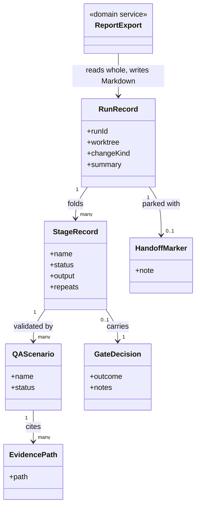
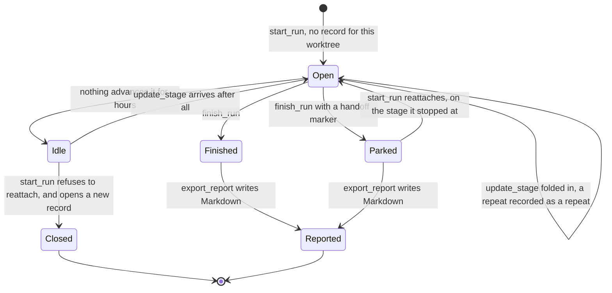
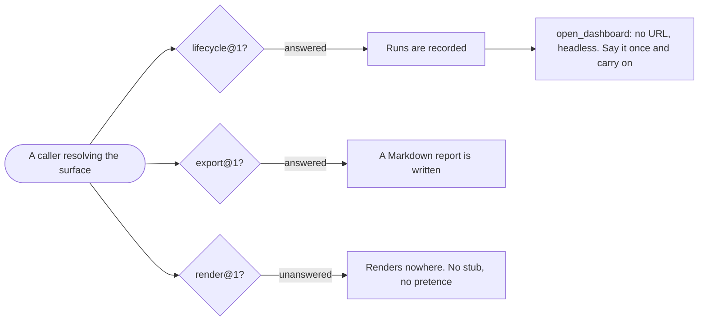

# delivery-surface-collector

```meta
related: [".devbook/arc42/building-blocks/README.md", ".devbook/arc42/building-blocks/delivery.md#dependencies", ".devbook/arc42/adr/surfaces.md", ".devbook/arc42/12-glossary.md#headless", ".devbook/arc42/12-glossary.md#unanswered-group"]
c4: ["marketplace.delivery-surface-collector"]
code: ["plugins/delivery-surface-collector"]
```

This block records a run to disk for unattended sessions. It is responsible for one thing: a run
nobody watched is still legible afterwards:

- which stages ran, and how many times
- what a person decided at each gate
- what the evidence was
- whether the run was handed off or abandoned

**Owns:**

- the run store
- the handoff round trip a resumed session depends on
- the Markdown report

It answers two of the three capability groups.

Rendering, deliberately, and everything about what produced the run lie outside it. It declares
no dependency and names no engine.

[Chapter 8](../08-crosscutting-concepts.md) owns the kernel vocabulary: surface, capability group,
MCP server. The two terms this block owns, headless and unanswered group, are in the
[glossary](../12-glossary.md#headless).

## Interfaces

```meta
related: [".devbook/arc42/adr/surfaces.md", ".devbook/arc42/08-crosscutting-concepts.md#surface"]
```

This block answers two capability groups and leaves one deliberately absent. It ships no skills:
it is one MCP server over stdio with no page and no port, and a person invokes nothing by name.

| Interface | Kind | Reached by |
| --- | --- | --- |
| `open_dashboard`, `start_run`, `record_prompt`, `set_run_context`, `update_stage`, `finish_run`, `list_runs`, `get_run` | MCP tools, `delivery.surface.lifecycle@1` | A caller matching the names by pattern from the live tool list |
| `export_report` | MCP tool, `delivery.surface.export@1` | The same, at the end of a run or long after it |
| `render_diagram`, `render_markdown` | Absent — `delivery.surface.render@1` is unanswered | Nobody: a caller resolving the group finds nothing and renders nowhere |

The nine declared names are exactly the two answered groups' names, and the render names are
absent rather than stubbed.

### Record a Run

```meta
related: [".devbook/arc42/building-blocks/delivery-surface-collector.md#run-record"]
```

- **Does:** answers the lifecycle group and keeps the result on disk, keyed by worktree, outside
  the repository.
- **Why:** runs survive a session restart and never show up in `git status`.
- **Keeps:** what outlives the session: stage status, output, and repeat count; the gate decision
  a person returned; QA scenarios and their evidence paths; the handoff marker and its note.
- **Why:** each answers a question a later reader actually has.
- **Reattaches or refuses:** resumes a handed-off run and declines an abandoned one. Both look idle
  by every derived signal, and only the [marker](#handoff-marker) separates them.

### Answer Nothing for Render

```meta
related: [".devbook/arc42/12-glossary.md#headless", ".devbook/arc42/12-glossary.md#unanswered-group"]
```

- **Does:** leaves the render tool names absent rather than stubbing them.
- **Why:** a caller resolves each capability group separately, so it finds this one unanswered and
  renders nowhere, instead of finding a stub that pretends to have shown someone something.
- **`open_dashboard`:** answers with no URL and says the run is being recorded rather than shown.
  Saying so once is the whole behaviour.

### Report Without Telemetry

```meta
related: [".devbook/arc42/building-blocks/delivery-surface-collector.md#report-export"]
```

- **Does:** writes the run's Markdown report: prompts, stages, output, QA evidence paths, monitoring
  findings, the handoff note, the summary. Asking for another format still writes Markdown and
  says so, never failing a run over a file extension.
- **Never:** token counts, per-stage cost, or a context gauge. A caller must never fill them in by
  hand.
- **Why:** nothing here observes a session, so those numbers would be a column of zeroes reading
  as a measurement rather than as an absence.

## Structure

```meta
related: [".devbook/arc42/building-blocks/delivery-surface-dashboard.md#structure", ".devbook/arc42/adr/surfaces.md"]
```

This is the [dashboard](delivery-surface-dashboard.md#structure)'s model without a viewer or
telemetry, and the removals are the content.


### Model

```meta
```



- **There is no `Viewer` and no `Telemetry`, and neither is an omission.** The render group's
  tool names are absent so a caller resolves it unanswered. The telemetry fields are absent
  because nothing here observes a session, and a column of zeroes reads as a measurement
  rather than as an absence.
- **`EvidencePath` is cited and never inlined.** Inlining evidence into a self-contained report
  is a rendering job. The screenshot therefore has to stay in the worktree that produced it,
  a real cost accepted rather than hidden.
- **`HandoffMarker` is the only stored derived-looking thing in the model, and it is stored
  for a reason.** Idleness is computed on read. The marker cannot be, because "was this handed
  off on purpose" is not visible in any timestamp.
- **`GateDecision` is recorded so a resumed session can re-run the gate**, not so it can skip
  it. The record makes the resumed session aware there was a decision at all, in a conversation
  it cannot read.
- **`RunRecord` is fed by a caller this model cannot name**, exactly as in the dashboard. Both
  implement one published contract, and their nearly identical models are the evidence that the
  contract is doing its job.

### Run Record

```meta
related: [".devbook/arc42/building-blocks/delivery-surface-dashboard.md#run-record", ".devbook/arc42/12-glossary.md#idleness"]
```

Also called: run, run store, run file.

A record keeps one run for later rather than showing it:

- stages with status, output and repeat count
- gate decisions
- QA scenarios with their evidence paths
- the handoff marker

Each run is one JSON file, outside the repository, keyed by worktree path.

The selection is the design. What earns its keep in an unwatched session is the half that
outlives it, so this block answers lifecycle and export and not render.

| Invariant | Enforced at | Evidence |
| --- | --- | --- |
| One record per run, keyed by worktree; a parked run is reattached to rather than duplicated | `start_run()` | `unit:node:plugins/delivery-surface-collector/mcp/delivery-surface-collector/dev/collector-test.mjs` |
| The record lists every session that drove it in `sessionIds`: a reattach appends the caller's `sessionId`, never replaces one, never records one twice, and drops a token the host left unsubstituted | `start_run()` | `unit:node:plugins/delivery-surface-collector/mcp/delivery-surface-collector/dev/collector-test.mjs` |
| A stage finishing twice is recorded twice | `update_stage()` | `unit:node:plugins/delivery-surface-collector/mcp/delivery-surface-collector/dev/collector-test.mjs` |
| The gate decision is recorded, so a resumed session re-runs the gate rather than trusting a conversation it cannot read | `update_stage()` | untested |
| A change kind is one `flow-code` derives, or a 1.13.0 kind a run file from before the per-phase flows still carries | `start_run()`, `set_run_context()` | untested |
| How a stage ran, `execution`, is stored on the stage verbatim and kept until a later call replaces it — its optional `round`, `blockers`, and `defectsFound` counts with it; one that is not an object is refused | `update_stage()` | `unit:node:plugins/delivery-surface-collector/mcp/delivery-surface-collector/dev/collector-test.mjs` |
| No token counts, no per-stage cost, no context gauge — nothing here observes a session | all mutations | `unit:node:plugins/delivery-surface-collector/mcp/delivery-surface-collector/dev/collector-test.mjs` |
| Idleness is derived on read and never stored | `get_run()`, `list_runs()` | untested |
| The declared tool surface is exactly the two answered groups' names, and the render names are absent | server start | `unit:node:plugins/delivery-surface-collector/mcp/delivery-surface-collector/dev/collector-test.mjs` |
| The record survives a session restart and never appears in `git status` | store | untested |
| The record and `active.json` are always whole JSON, however the servers of the sessions sharing a checkout overlap: each write lands in a temp file of its own and is renamed over the target, and every read-modify-write of a run, a reattach included, holds the run's cross-process lock | `writeRun()`, `writeActive()`, `withRunFileLock()` | `unit:node:plugins/delivery-surface-collector/mcp/delivery-surface-collector/dev/atomic-write-test.mjs` |
| A run that exists is always found: a read that meets the record mid-rename, as ENOENT or a sharing violation, retries a few times before answering, and `listRuns()` also names a run seen only as its temp or lock file, so a reattach never opens a duplicate. ENOENT is retried on Windows only; elsewhere the rename is atomic and a missing run is an immediate null | `readRun()`, `listRuns()` | `unit:node:plugins/delivery-surface-collector/mcp/delivery-surface-collector/dev/atomic-write-test.mjs` |

The record owns two entities besides the [Handoff Marker](#handoff-marker):

- **Stage Record** (entity) is one stage as recorded: name, status, output, links, and how many
  times it finished. The repeat count matters more here than anywhere else. A stage repeated
  after a revise decision is the one thing a report written days later cannot reconstruct
  from anything else.
- **QA Scenario** (entity) is one validation scenario with its status and evidence paths. The
  report cites the path, and the screenshot stays in the worktree that produced it. That is the
  trade this surface makes by writing Markdown and not HTML.

### Handoff Marker

```meta
related: [".devbook/arc42/building-blocks/delivery-surface-dashboard.md#handoff-marker", ".devbook/arc42/12-glossary.md#park", ".devbook/arc42/12-glossary.md#personal-validation"]
```

This is the note a deliberately handed-off run leaves behind, and the difference between a run
to reattach to and one to close. A parked run and an abandoned run are idle by identical
signals, and only one carries this.

`start_run` needs that distinction to resume one and refuse the other, and it is the reason a
marker is a stored value while idleness is derived.

| Invariant | Enforced at | Evidence |
| --- | --- | --- |
| A parked run carries a marker; an abandoned one does not, though both are idle by identical signals | `update_stage()` | untested |
| `start_run` resumes a run that carries one and refuses one that does not | `start_run()` | `unit:node:plugins/delivery-surface-collector/mcp/delivery-surface-collector/dev/collector-test.mjs` |

### Report Export

```meta
related: [".devbook/arc42/12-glossary.md#headless"]
```

It writes the run's report from what was recorded:

- prompt history
- the stage table
- each stage's output and links
- QA scenarios with their evidence paths
- monitoring findings
- the handoff note
- the summary

It runs on command, at the end of a run or long after. **It writes only Markdown.** A
self-contained HTML report with evidence inlined is a rendering job, and rendering is the half
this surface does not answer. Asking for another format still writes Markdown and says so in the
result, never failing the run over a file extension.

| Invariant | Enforced at | Evidence |
| --- | --- | --- |
| Markdown, and only Markdown | `export_report()` | `unit:node:plugins/delivery-surface-collector/mcp/delivery-surface-collector/dev/collector-test.mjs` |
| A request for another format still writes Markdown and says so in the result, never failing the run | `export_report()` | `unit:node:plugins/delivery-surface-collector/mcp/delivery-surface-collector/dev/collector-test.mjs` |
| The report carries the prompt history, stage output and links, QA scenarios with evidence cited by path, monitoring findings, the gate decision, and the summary | `export_report()` | `unit:node:plugins/delivery-surface-collector/mcp/delivery-surface-collector/dev/collector-test.mjs` |
| A Report Back stage is left out when the run recorded no origin and the stage never ran; a 1.13.0 Work Item Update stage reads the same way | `export_report()` | untested |

## Runtime

```meta
related: [".devbook/arc42/building-blocks/delivery-surface-collector.md#run-record", ".devbook/arc42/building-blocks/delivery-surface-collector.md#handoff-marker"]
```

### A Record's Life

```meta
```



A record has three ends, and a single stored value separates two of them.

- **`Idle` and `Parked` look identical to every derived signal.** Only the marker separates
  them, which is why it is stored where idleness is computed, and why `start_run` can reattach
  to one and refuse the other.
- **A reattached run resumes on its stage.** Opening a second record beside a parked run is
  the duplicate this whole round trip exists to prevent. The collector's own test drives that
  over stdio the way a host does.
- **Every end reports.** A run that finished and exported nothing is a run nobody can read
  afterwards, a total loss for a surface whose entire purpose is *afterwards*.

### What a Caller Finds

```meta
```



- **Each group is resolved separately**, which is the mechanic that lets one surface answer
  two groups honestly rather than three groups badly.
- **A stub would be worse than an absence.** A render call that returns success without
  showing anyone anything makes the caller believe a person saw something.
- **`open_dashboard` returning no URL is a normal outcome**, not a degraded one. For a
  scheduled or unattended run it is the correct one.

## Dependencies

```meta
related: [".devbook/arc42/building-blocks/delivery.md#dependencies", ".devbook/arc42/08-crosscutting-concepts.md#surface"]
```

Like every surface here, it declares nothing and nothing declares it.

### Outbound

```meta
```

| Depends on | Pattern | Mechanism | Contract | Why |
| --- | --- | --- | --- | --- |
| [delivery](delivery.md#dependencies) | Conformist to a Published Language | Implements the lifecycle and export tool names, and deliberately not the render ones | `resources/surface-contract.md`: `delivery.surface.lifecycle@1`, `.export@1` | Declaring exactly its groups' names keeps it substitutable for another implementation of them. |
| [The plugin kernel](../08-crosscutting-concepts.md) | Shared Kernel | Plugin folder, two manifests, marketplace entry, `mcp/<server>/` | [Chapter 8](../08-crosscutting-concepts.md) | It is packaged like everything else here. |
| Model Context Protocol | Conformist | One MCP server over stdio, plain Node, no listening socket | The protocol's own schemas | The transport is how a caller reaches it. There is no page and no port. |
| The local filesystem, outside the repository | Conformist | One JSON file per run, keyed by worktree path, root overridable | Its own store layout | A run must survive a session restart and must never appear in `git status`. |

### Inbound

```meta
```

| Consumer | Pattern | Mechanism | Contract | What it relies on |
| --- | --- | --- | --- | --- |
| Whatever drives a run | Customer-Supplier, this block supplying | Tool names matched by pattern from the live tool list | The two groups it answers | Groups resolve separately, so the missing render group reads as unanswered, not as a broken surface. |
| [delivery-schedule](delivery-schedule.md#dependencies) | Customer-Supplier, this block supplying | Lifecycle calls from an unattended cloud session | The same contract | A run recorded with nobody watching is readable afterwards, the case this implementation exists for. |
| [devbook-config](devbook-config.md#dependencies) | Conformist, read-only | Reports whether this plugin is installed, enabled, and at what version | The marketplace entry and the manifest | Nothing but the name and version. |

The absent render group is a declaration, not a gap. A caller finds it unanswered and renders
nowhere, rather than finding a stub that pretends to have shown someone something. That is why
[the surfaces record](../adr/surfaces.md) forbids declaring a name you do not implement.

This block has no telemetry dependency, and therefore no telemetry. Nothing here observes a
session, so it has no hook, host-specific half, or numbers. It therefore works identically on
both hosts, where the [dashboard](delivery-surface-dashboard.md#telemetry)'s capture does not.

This block has no page, no port, and no authentication question. The whole HTTP surface the
dashboard has to reason about does not exist here. That is most of why this implementation is
the right one for a run nobody is watching.

A surface is never a dependency in either direction, and none answering is a normal outcome.
