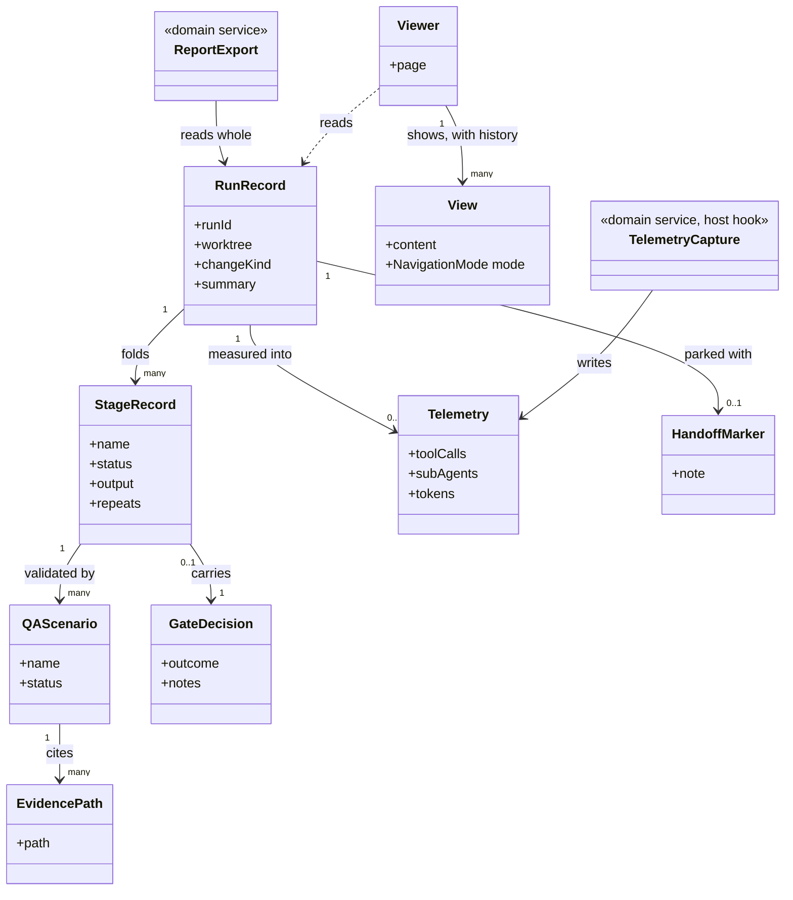
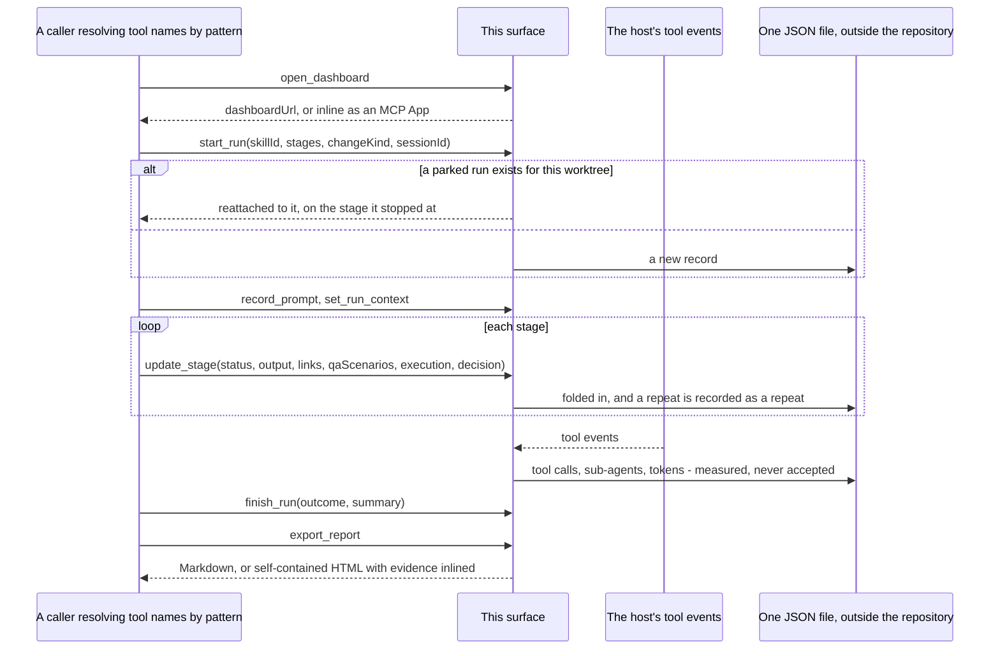
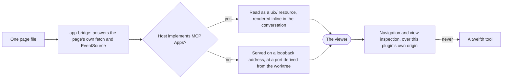

# delivery-surface-dashboard

```meta
related: [".devbook/arc42/building-blocks/README.md", ".devbook/arc42/building-blocks/delivery.md#dependencies", ".devbook/arc42/adr/surfaces.md", ".devbook/arc42/12-glossary.md#idleness"]
c4: ["marketplace.delivery-surface-dashboard"]
code: ["plugins/delivery-surface-dashboard"]
```

This block shows a run live, measured by hooks rather than told. It is responsible for three
things: a run is visible while it happens, what it shows was measured rather than claimed, and
uninstalling it costs a view and never a capability.

**Owns:**

- the run store
- the three pages
- the telemetry the hooks capture
- the report exported at the end

It answers all three capability groups of the surface contract.

What produced the run lies outside it. This block knows nothing about flows, gates, or extension
points. It receives lifecycle calls, and whoever made them resolved its tool names by pattern
from the live tool list. It declares no dependency and names no engine.

[Chapter 8](../08-crosscutting-concepts.md) owns the kernel vocabulary: surface, capability group,
and MCP server. The one term this block owns, idleness, is in the
[glossary](../12-glossary.md#idleness).

## Interfaces

```meta
related: [".devbook/arc42/adr/surfaces.md", ".devbook/arc42/08-crosscutting-concepts.md#surface"]
```

This block answers three capability groups whole and also measures, which no other surface here
does. It ships no skills: its whole surface is an MCP server's tools and three pages, and a
person invokes nothing by name.

| Interface | Kind | Reached by |
| --- | --- | --- |
| `open_dashboard`, `start_run`, `record_prompt`, `set_run_context`, `update_stage`, `finish_run`, `list_runs`, `get_run` | MCP tools, `delivery.surface.lifecycle@1` | A caller matching the names by pattern from the live tool list |
| `render_diagram`, `render_markdown` | MCP tools, `delivery.surface.render@1` | The same caller, resolving the group on its own |
| `export_report` | MCP tool, `delivery.surface.export@1` | The same, at the end of a run or long after it |
| The run timeline, the diagram viewer, the document viewer | Three pages, one file each | Inline as a `ui://` resource under MCP Apps, otherwise on a loopback origin |
| `telemetry-hook.mjs` | Command hook, `hooks/hooks.json` | A host with command hooks, on tool events, outside any run's control flow |

The eleven tool names are the declared surface, exactly and nothing more. They carry a
plugin-namespaced prefix when installed as a plugin and a bare one from a repository's own MCP
configuration. A consumer matches by pattern and never by one spelling.

### Track a Run

```meta
related: [".devbook/arc42/building-blocks/delivery-surface-dashboard.md#run-record", ".devbook/arc42/building-blocks/delivery.md#run-started"]
```

- **Does:** answers the lifecycle group (open, start, record the prompt, set the context, update
  a stage, finish, list, get) and keeps the result on disk, keyed by worktree, outside the repository.
- **Why:** a run survives a session restart and never shows up in `git status`.
- **Reattaches:** picks a handed-off run up where it stopped rather than opening a second beside
  it. A parked run and an abandoned one both look idle, and only the
  [handoff marker](#handoff-marker) tells them apart.
- **Derives:** whether a run has stalled and what to call it, from where its output has landed,
  rather than storing either as status.
- **Why:** a list of parallel sessions is then readable at a glance without anyone naming them.

### Watch a Run Live

```meta
related: [".devbook/arc42/building-blocks/delivery-surface-dashboard.md#viewer"]
```

- **Does:** shows the run list, each run's stages with status and output, QA scenarios with their
  evidence inline, and the tool-activity and context panels.
- **Served:** inline where the host implements MCP Apps, and on a loopback origin where it does
  not, from one page file either way.
- **Renders:** the render group, Mermaid live and pannable and Markdown as formatted HTML, both
  with push-and-replace navigation so a drill-down can be stepped back.
- **Never:** replaces a file. A rendered view is a preview of one that exists.

### Measure the Session

```meta
related: [".devbook/arc42/building-blocks/delivery-surface-dashboard.md#telemetry-capture", ".devbook/arc42/building-blocks/delivery-surface-dashboard.md#telemetry"]
```

- **Does:** folds tool calls, sub-agent use, and token usage into the run from hook-captured tool
  events, and warns when the context gauge crosses its threshold.
- **Why:** nothing asks the agent to count anything, which separates these numbers from an estimate.
- **Limit:** this is the one capability outside the contract. It degrades to nothing rather than
  to something wrong: on a host without command hooks the run is tracked in full and the panels
  are empty.

### Export the Report

```meta
related: [".devbook/arc42/building-blocks/delivery-surface-dashboard.md#report-export"]
```

- **Does:** answers the export group with [the run's report](#report-export), as Markdown or as
  self-contained HTML with the evidence inlined.
- **Why:** inlined evidence lets the report survive the worktree that produced it.

## Structure

```meta
related: [".devbook/arc42/05-building-block-view.md#surface-plugins", ".devbook/arc42/adr/surfaces.md"]
```

This block has two aggregates, two domain services, and one host-specific part.


### Model

```meta
```



- **Nothing in this model points at the engine, and that is the design.** A caller it cannot
  name feeds `RunRecord` through lifecycle calls, having resolved these tool names by pattern
  from the live tool list. Installing this plugin makes runs visible and uninstalling it costs
  a view.
- **`Telemetry` is the only association written from outside the tool surface.** The hook runs
  on the host's tool events, not inside a run. That is why it is `0..1` and why its absence is
  a legitimate state rather than a failure.
- **Idleness and the session title are absent from this diagram on purpose.** Both are derived
  on read, from the last update and from where the output landed. Storing either would make a
  stale value indistinguishable from a current one.
- **`EvidencePath` is a value, and its whole content is a constraint.** It resolves against the
  worktree root and refuses anything outside it. The HTML export inlines what it points at, so
  the report outlives the file.
- **`Viewer` reads `RunRecord` and is not part of it.** The pages are a projection served over
  the plugin's own origin, which is why navigation is not an extra tool. A surface declaring
  more than the contract stops being swappable for one that declares exactly it.
- **`GateDecision` is recorded and never made here.** A resumed session re-runs the gate rather
  than trusting this record, which is why the surface holding it is not a party to it.

### Run Record

```meta
related: [".devbook/arc42/building-blocks/delivery.md#run", ".devbook/arc42/adr/configuration.md", ".devbook/arc42/12-glossary.md#idleness"]
```

Also called: run, run store, run file.

One record holds one run:

- stages with status and output
- the prompt history
- QA scenarios with their evidence
- gate decisions
- telemetry
- a handoff marker

The store keeps one JSON file per run, outside the repository and keyed by worktree path. A run
therefore survives a session restart and never shows up in `git status`.

It is a record and not the run. Nothing here advances a run or decides anything about it. It
folds what it is told, adds what its own hooks measured, and answers questions about the result.

| Invariant | Enforced at | Evidence |
| --- | --- | --- |
| One record per run, keyed by worktree; a `start_run` for the same skill as a parked run reattaches rather than opening a second | `start_run()` | `unit:node:plugins/delivery-surface-dashboard/mcp/delivery-surface-dashboard/dev/handoff-test.mjs` |
| The record lists every session that drove it in `sessionIds`: a reattach appends the caller's `sessionId`, never replaces one, never records one twice, and drops a token the host left unsubstituted | `start_run()` | `unit:node:plugins/delivery-surface-dashboard/mcp/delivery-surface-dashboard/dev/handoff-test.mjs` |
| A stage finishing twice is recorded twice | `update_stage()` | untested |
| A change kind is one `flow-code` derives, or a 1.13.0 kind a run file from before the per-phase flows still carries | `start_run()`, `set_run_context()` | untested |
| How a stage ran, `execution`, is stored on the stage verbatim and kept until a later call replaces it — its optional `round`, `blockers`, and `defectsFound` counts with it; one that is not an object is refused | `update_stage()` | `unit:node:plugins/delivery-surface-dashboard/mcp/delivery-surface-dashboard/dev/handoff-test.mjs` |
| Evidence paths resolve inside the git worktree root; anything outside is refused | `update_stage()` | untested |
| Telemetry is captured from tool events and never accepted from a caller | telemetry hook | `unit:node:plugins/delivery-surface-dashboard/mcp/delivery-surface-dashboard/dev/subagent-telemetry-test.mjs` |
| Idleness and the session title are derived on read, never stored as status | `get_run()`, `list_runs()` | `unit:node:plugins/delivery-surface-dashboard/mcp/delivery-surface-dashboard/dev/session-title-test.mjs` |
| The record holds destination kinds, never the words shown for them; the words are read from the repository's own stack-config entry on every title | `start_run()`, `update_stage()` | `unit:node:plugins/delivery-surface-dashboard/mcp/delivery-surface-dashboard/dev/session-title-integration-test.mjs` |
| The declared tool surface is exactly the contract's eleven names and nothing more | server start | untested |
| The record survives a session restart | store | `unit:node:plugins/delivery-surface-dashboard/mcp/delivery-surface-dashboard/dev/handoff-test.mjs` |
| The record is always whole JSON, however its writers overlap: each write lands in a temp file of its own and is renamed over the record, and every read-modify-write, the server's and the telemetry hook's alike, holds the record's cross-process lock | `writeRun()`, `withRunFileLock()` | `unit:node:plugins/delivery-surface-dashboard/mcp/delivery-surface-dashboard/dev/atomic-write-test.mjs` |
| A run that exists is always found: a read that meets the record mid-rename, as ENOENT or a sharing violation, retries a few times before answering, and `listRuns()` also names a run seen only as its temp or lock file, so a reattach never opens a duplicate. ENOENT is retried on Windows only; elsewhere the rename is atomic and a missing run is an immediate null | `readRun()`, `listRuns()` | `unit:node:plugins/delivery-surface-dashboard/mcp/delivery-surface-dashboard/dev/atomic-write-test.mjs` |

The record owns two entities and two values besides [Telemetry](#telemetry) and the
[Handoff Marker](#handoff-marker):

- **Stage Record** (entity) is one stage as recorded: name, status, output, links, and how many
  times it finished. Its identity inside the record is the stage name. The repeat count keeps a
  revise decision legible, because a stage that ran twice must not read as one long stage.
- **QA Scenario** (entity) is one validation scenario with its status and the evidence it
  produced. It has identity because it is reported individually and because the exported report
  cites its evidence by path.
- **Evidence Path** (value) is a path to a screenshot or a recording, resolved against the git
  worktree root. This block refuses anything resolving outside it, because a surface that will
  cite an arbitrary path is a surface that will read one. The HTML export inlines these as data
  URIs, so an exported report stays readable after the worktree is gone. The Markdown one cites
  them, which is why the file has to stay where it was produced.
- **Session Title** (value; also called session name, prefix) is
  `<prefix>[:<context>] — <run title>`, computed from where the run's writes landed: a
  published Artifact, one of the five devbook folders, or code. It appends the bounded context
  when the winning files sit in exactly one.

  The record tallies kinds, and the word each kind shows as comes from
  `components.delivery-surface-dashboard.sessionNaming.labels` in the repository's stack config.
  There, `devbook` stands for all five folders, and `null` means no prefix and no rename, since
  an unprefixed copy of the run title is worse than the host's own name. Kinds sharing a word
  are tallied as one before the dominant kind is picked. The title is `null` before anything has
  been written, for the same reason. The config key is
  [the configuration record](../adr/configuration.md)'s.

[Idleness](../12-glossary.md#idleness) is derived on read and never stored, because a stored
idleness is indistinguishable from a stale one.

### Telemetry

```meta
```

Also called: tool activity, token usage, insight panel.

Hooks running on tool events fold tool calls, sub-agent use, and token usage into the record.
Nothing asks the agent to count anything, because a self-reported number is an estimate posing
as a measurement.

A command hook captures it by reading an event payload and writing a file, which a prompt hook
cannot do. On a host without command hooks the run is still tracked in full and the panels
have nothing to show. That is why this costs a column and not a capability group.

| Invariant | Enforced at | Evidence |
| --- | --- | --- |
| Every number is measured from a tool event; nothing asks the agent to count | the hook | `unit:node:plugins/delivery-surface-dashboard/mcp/delivery-surface-dashboard/dev/subagent-telemetry-test.mjs` |
| On a host without command hooks the run is still tracked in full, and only the panels are empty | hook registration | untested |

### Handoff Marker

```meta
related: [".devbook/arc42/building-blocks/delivery-surface-collector.md#handoff-marker", ".devbook/arc42/12-glossary.md#idleness"]
```

This is the note a deliberately handed-off run leaves behind. It distinguishes a parked run from
an abandoned one: both look idle by every other signal, and only one should be reattached to. A
later `start_run` needs that distinction to reattach to one and refuse the other.

| Invariant | Enforced at | Evidence |
| --- | --- | --- |
| A parked run carries a marker; an abandoned one does not, though both look idle by every other signal | `update_stage()` | `unit:node:plugins/delivery-surface-dashboard/mcp/delivery-surface-dashboard/dev/handoff-test.mjs` |
| `start_run` reattaches to a run that carries one and refuses one that does not | `start_run()` | `unit:node:plugins/delivery-surface-dashboard/mcp/delivery-surface-dashboard/dev/handoff-test.mjs` |

### Viewer

```meta
```

Also called: page, panel, dashboard.

The viewer is three pages: the run timeline, the Mermaid diagram viewer, and the Markdown
document viewer. One file serves each page two ways: inline where the host implements MCP Apps,
and on a loopback origin where it does not. A bridge answers the page's own network calls as
tool calls, so neither page learns which way it was loaded.

| Invariant | Enforced at | Evidence |
| --- | --- | --- |
| Navigation and view inspection are served over the plugin's own origin, never added as extra tools | page load | untested |
| One page file serves both transports | page load | untested |
| The HTTP side has no authentication, and reaching it already requires local access | server start | untested |
| A rendered view is a preview of a file that exists, never a replacement for it | render | untested |

A viewer shows one **View** (entity): one thing currently shown, with a history behind it.
`push` drills into a related view and leaves a breadcrumb the Back button walks; `replace`, the
default, updates in place. The history is what makes a drill-down steppable, so a view has
identity within its viewer.

### Report Export

```meta
related: [".devbook/arc42/building-blocks/delivery-surface-dashboard.md#run-record"]
```

It writes the run's report from what was recorded, as Markdown or as self-contained HTML with
the evidence inlined:

- prompt history
- the stage table
- each stage's output and links
- QA scenarios with their evidence
- monitoring findings
- the handoff note
- the summary

It runs on command, at the end of a run or long after. It is a service, not behaviour on
[Run Record](#run-record), because it produces an artifact outside the record and reads across
all of it at once.

| Invariant | Enforced at | Evidence |
| --- | --- | --- |
| The report is written from what was recorded, read across every part of the record at once | `export_report()` | untested |
| Markdown, or self-contained HTML with the evidence inlined | `export_report()` | untested |
| Command-invoked, at the end of a run or long after it | `export_report()` | untested |
| A Report Back stage is left out when the run recorded no origin and the stage never ran; a 1.13.0 Work Item Update stage reads the same way | `export_report()`, the run timeline | untested |

### Telemetry Capture

```meta
related: [".devbook/arc42/building-blocks/delivery-surface-dashboard.md#telemetry"]
```

This hook runs on tool events. It folds tool calls, sub-agent use, token usage, and where each
write landed into the record, and warns when the session's context gauge crosses a threshold.

The host triggers it, outside any run's control flow. It is the one thing in this
marketplace that measures a session rather than being told about it. That is also why it is the
one place this block is host-specific, structurally rather than by omission.

| Invariant | Enforced at | Evidence |
| --- | --- | --- |
| Event-triggered by the host, outside any run's control flow | hook registration | untested |
| It folds tool calls, sub-agent use, and token usage into the record | the hook | `unit:node:plugins/delivery-surface-dashboard/mcp/delivery-surface-dashboard/dev/subagent-telemetry-test.mjs` |
| It warns when the session's context gauge crosses a threshold | the hook | untested |
| It writes back only what it owns — insights, token usage, the context gauge, the write destinations — onto a fresh read of the record, so a stage the server wrote meanwhile is never reverted and nothing it measured is dropped | the hook | `unit:node:plugins/delivery-surface-dashboard/mcp/delivery-surface-dashboard/dev/session-title-integration-test.mjs` |

## Runtime

```meta
related: [".devbook/arc42/building-blocks/delivery-surface-dashboard.md#run-record", ".devbook/arc42/building-blocks/delivery.md#run-started"]
```

### A Record, Filled

```meta
```



- **Reattach or open, never both.** A second record beside a parked run is the failure the
  handoff marker exists to prevent. It is the one behaviour here with a test driving the real
  server over stdio.
- **Telemetry arrives on a different path from everything else.** Every other arrow into the
  record is a lifecycle call from a caller this block cannot name. Telemetry comes from the host,
  outside any run's control flow, which is what makes the numbers a measurement.
- **A repeat is a repeat.** A stage recorded once after two attempts has erased the revise
  decision that caused the second one.

### A Page, Reached Two Ways

```meta
```



- **Navigation is not a tool.** A surface that declares more than the contract stops being
  swappable for one that declares exactly it. The plugin's own origin therefore serves anything
  the pages need beyond the eleven names.
- **The loopback address is stable per worktree.** A tab or a host's browser pane left open
  outlives a server restart, and `?run=<id>` lands on one run. A taken port falls back to an
  ephemeral one rather than failing to serve.
- **There is no authentication on the HTTP side**, and reaching it already requires local
  access to the machine. The [canvas](delivery-surface-canvas.md) implementation of the same
  contract does check a token, because it outlives the panel that opened it.
- **A rendered view is a preview of a file that exists.** Render the same source that was
  written to disk. A rendered view nobody saved is not a record of anything.

## Dependencies

```meta
related: [".devbook/arc42/building-blocks/delivery.md#dependencies", ".devbook/arc42/08-crosscutting-concepts.md#surface"]
```

A surface is not a layer, and nothing may declare one: this block declares no dependency in
either direction.

### Outbound

```meta
```

| Depends on | Pattern | Mechanism | Contract | Why |
| --- | --- | --- | --- | --- |
| [delivery](delivery.md#dependencies) | Conformist to a Published Language | Implements the tool names of all three capability groups, and nothing else | `resources/surface-contract.md`: `delivery.surface.lifecycle@1`, `.render@1`, `.export@1` | Declaring exactly these names keeps implementations substitutable; declaring more would end that. |
| [The plugin kernel](../08-crosscutting-concepts.md) | Shared Kernel | Plugin folder, two manifests, marketplace entry, `mcp/<server>/`, `hooks/hooks.json` | [Chapter 8](../08-crosscutting-concepts.md) | It is packaged like everything else here. |
| Model Context Protocol | Conformist | One MCP server, started on the first tool call, plain Node with no npm dependencies | The protocol's own schemas | The transport is how a caller reaches it at all. |
| MCP Apps | Conformist, optional | Pages read as `ui://` resources and rendered inline where the host implements it | The MCP Apps resource shape | Where it is absent, a loopback origin serves the same file, which is what the bridge exists for. |
| The host's command hooks | Conformist, host-specific | `hooks/hooks.json`, a hook reading a tool-event payload and writing the run store | The host's own hook schema | Measuring requires reading an event and writing a file, which a prompt hook cannot do. |
| The local filesystem, outside the repository | Conformist | One JSON file per run, keyed by worktree path, root overridable | Its own store layout | A run must survive a session restart and must never appear in `git status`. |

No root `hooks.json` sits beside `hooks/hooks.json`, structurally rather than by omission.

### Inbound

```meta
```

| Consumer | Pattern | Mechanism | Contract | What it relies on |
| --- | --- | --- | --- | --- |
| Whatever drives a run | Customer-Supplier, this block supplying | Tool names matched by pattern from the live tool list, never by one spelling | The three capability groups | Each group resolves separately, and this block answers all three. Neither names the other. |
| [delivery-schedule](delivery-schedule.md#dependencies) | Customer-Supplier, this block supplying | The same lifecycle calls, from unattended sessions | The same contract | The same. It follows the engine's reporting contract and treats no surface bound as normal. |
| [devbook-config](devbook-config.md#dependencies) | Conformist, read-only | Reports whether this plugin is installed, enabled, and at what version | The marketplace entry and the manifest | Nothing but the name and version. |

The thing being rendered knows no surface exists, and this block knows nothing about what
produced its input. Whichever tool opens it resolves it at run time, and none answering is a
normal outcome: it costs a view, never a capability.

Substitutability is per capability group, not per host. The three groups are resolved
separately, so a caller finds the ones this block answers and looks elsewhere, or nowhere, for
the rest.

The telemetry dependency is the one asymmetry, and it is a column rather than a group. A
Copilot run bound to this plugin gets the same lifecycle tools and the same panels with the
numbers absent rather than wrong. Nothing in the contract names telemetry, which is what keeps
the asymmetry from costing a capability group.

Namespacing is a matching problem, not a naming one, as [Interfaces](#interfaces) says.
