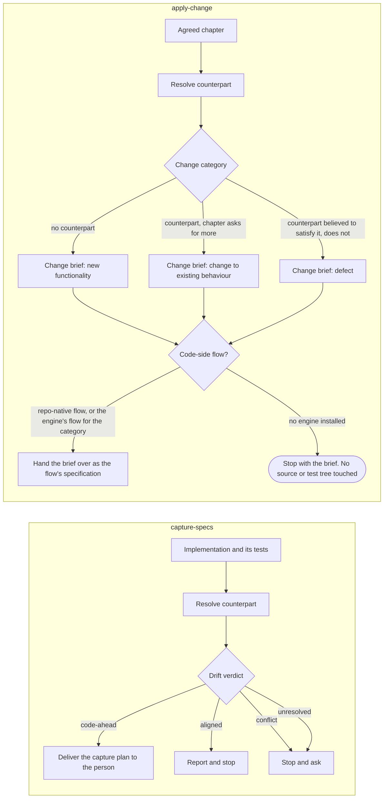

# devbook-code-sync

```meta
related: [".devbook/arc42/building-blocks/devbook.md", ".devbook/arc42/building-blocks/README.md", ".devbook/arc42/12-glossary.md#drift-verdict", ".devbook/arc42/12-glossary.md#sync-unit", ".devbook/arc42/12-glossary.md#sync-group"]
c4: ["marketplace.devbook.unit-lister", "marketplace.devbook.spec-converter"]
code: ["plugins/devbook/skills/capture-specs", "plugins/devbook/skills/apply-change", "plugins/devbook/skills/verify-change", "plugins/devbook/assets/spec-kinds"]
```

This block is the code-sync part of [devbook](devbook.md). It brings a chapter and the code
implementing it back into agreement, in whichever direction is behind, without guessing either side.

**Owns**

- The three converter skills over seven chapter kinds.
- The unit lister that decides what one run covers.
- The two directions they run in.

| Concern | Owner |
| --- | --- |
| The chapter shape and the check | [devbook](devbook.md#structure) |
| The flow that builds a change brief | [delivery](delivery.md)'s `flow-code` |
| The drift report, an unattended run that passes a sync unit or group | [delivery-schedule-entry-points](delivery-schedule-entry-points.md#schedule-devbook-verify) |
| The sweeps that level by direction, also passing a unit or group | Backlog |

## Interfaces

```meta
related: [".devbook/arc42/building-blocks/devbook.md#interfaces"]
```

It exposes three skills and one CLI. Each skill covers the seven kinds: aggregate, domain
service, feature, setting, actor, building block, and design component. Each also reads a page's
click demo as the `demo` kind inside its page's unit.

A journey is not a kind. It is
evidence for the requirements whose cases point at its parts. Its derived spec and its last run
prove them the way an `e2e` test does. It gets no verdict row of its own.

| Interface | Kind | Reached by |
| --- | --- | --- |
| `capture-specs`, `apply-change`, `verify-change` | skills | A person, one skill per run over a chapter, sync unit, or sync group |
| `units.mjs` | unit lister, CLI and in-process | A person checking what one verify pass or one pull request covers |

The session-start hook routes a person to a skill when a task crosses between a chapter and its
code. The weekly `devbook-verify` schedule also reaches `verify-change`, through
`delivery-schedule`'s wrapper, and a `phase-spec-check` binding reaches `capture-specs` in write
mode. `schedule-devbook-verify` lists the units from `--json`, and Backlog's sync sweeps select their groups
from `--groups --json`.

### capture-specs

```meta
related: [".devbook/arc42/building-blocks/devbook-code-sync.md#spec-converter", ".devbook/arc42/building-blocks/devbook-code-sync.md#catching-up-with-the-code", ".devbook/arc42/adr/flow-engine.md"]
```

- **Does:** reads an implementation and its tests and plans the chapter that is missing, thin, or
  stale, for any of the seven kinds.
- **Delivers:** a capture plan for the person: the drafts to the folder's template, arranged as a
  delta against the target file (`ADDED`, `MODIFIED`, or `REMOVED` by heading), each claim carrying
  its evidence, and the report table.
- **Writes:** nothing by default.
- **Why:** code is evidence, not agreement, so the pass that found the code does not also decide
  what the chapter says. A person carries the plan into the folder, or does not.

Write mode is the one exception, and it exists for `flow-code`'s Spec Check. The skill's
frontmatter declares `updates: true`, which is how a `phase-spec-check` binding knows it may
update. Bound there, it carries the plan's `code-ahead` entries into the chapters the change
is scoped to, each with its `meta` block. It runs the devbook check after them. It never
writes `approved` or any other decision rung, and it never carries a `REMOVED` entry.

Every edit is listed for Personal Validation beside the code, so the person still decides what the
chapter says, only later in the run. Called by a person, it stays plan-only.

The kind is the chapter's `type`, or the file where the folder defines none. What a kind needs
is read from its own file rather than carried in the skill. A skill is a direction, because ten
skills carried one procedure ten times and the kind-specific part was a mapping table each pair
restated from its two ends.

Two of the three converters carry OpenSpec's verb, so a reader who has met OpenSpec first
needs no translation. `apply-change` implements an agreed spec there and here, and
`verify-change` is report-only in both. This one does not, and cannot.

OpenSpec's `sync-specs`
merges the spec deltas a proposal already wrote and never opens source. Reading an
implementation to write the chapter is a move OpenSpec has no skill for at all, because there
specs lead and code follows. A name that says "the specs catch up" in both places while
meaning a different feeder in each buys back the translation it was meant to save. So this one
takes the protocol's own word, **capture**, and the borrowing stops at two.

The aggregate is the unit and not its parts: a consistency boundary decided twice is a
boundary decided differently. A domain service is the deliberate exception. Defined by
coordinating across boundaries rather than living in one, it is its own kind and owns the
events it raises.

`features.md` is the one chapter written from the user's point of view, so the feature kind is
the one capture that **runs the application**. Reading a controller tells you a route exists;
using the feature tells you what the product lets someone do, in what order, with what
wording. Screenshots are report evidence and are never committed into a devbook folder.

The plan puts behaviour into `requirements.md` and the invariants subpages rather than into the
prose it belongs beside, one rule per chapter. A requirement comes with the scenarios that prove it, an
invariant with the unit test that does. Neither is a kind of its own. A feature's promises are that
feature's pass and an aggregate's rules are that aggregate's. A rule captured apart from
the thing it constrains is a rule decided twice. A shared value object's or enum's rules are its
grouping's, in `domain.invariants.md`, because the type belongs to no one aggregate and pinning
them under one decides them for all.

The split follows who is held to it: a promise made outside the model is a requirement, and what a
type guarantees is an invariant. That also fixes the level each is proved at. A design component's
rules are requirements under its own chapter in `design/`, proved `e2e` or by a visual test,
because a component keeps or breaks them in what the user sees.

### apply-change

```meta
related: [".devbook/arc42/building-blocks/devbook-code-sync.md#spec-converter", ".devbook/arc42/12-glossary.md#drift-verdict"]
```

- **Does:** turns an agreed but unbuilt chapter of any of the seven kinds into a change brief
  (outcomes, invariants, ubiquitous language, out of scope, acceptance checks) plus a change category.
- **Delivers:** the brief, to the flow that implements a change of that category, resolved the way
  the spec-side write is: a repo-native flow first, then the engine's. With no engine installed it
  stops with the brief.
- **Never:** edits a source or test tree itself.
- **Reads:** code, without changing it.
- **Why:** establishing what already exists lets the brief ask only for the delta, and decides the
  change category: new functionality, a change to existing behaviour, or a defect.

### verify-change

```meta
related: [".devbook/arc42/12-glossary.md#drift-verdict", ".devbook/arc42/12-glossary.md#sync-direction", ".devbook/arc42/building-blocks/devbook-code-sync.md#unit-lister"]
```

- **Does:** reports the drift verdict per chapter. The report's action column names which of the
  other two a verdict calls for.
- **Never:** writes a chapter, a brief, or a status.

It is the step both of the others take before they write, offered on its own for the question "is
this chapter still true".

Its evidence is the source and, per chapter, the tests its `tests` field names at the level
its type calls for: `unit` for an invariant, `e2e` or `integration` for a requirement. It
reads them as files and runs none of them, nor the application. A requirement proven only
end to end would otherwise go unchecked, and running the product belongs to `capture-specs`.

A requirement whose case points at a part of a journey takes the journey's spec and last run
as its end-to-end evidence. A run whose signature no longer matches the journey's is no
evidence and is listed as `stale` after the report. A part a case points at with no spec makes
the requirement `spec-ahead`. Delivery's `phase-spec-check` reports both the same way, for the
journeys a run's scope listed.

Its scope is the wide one: a chapter, a file, a bounded context, or a whole devbook folder,
still one kind per run outside a sync group, and still one table for all of it. Reading is cheap
when nothing is written. The question a person asks before a review, whether this folder has
drifted, is not answerable one chapter at a time. A table per chapter would hide the shape of the
whole, which is the only thing a folder-wide run adds.

Each row also names the unit the chapter belongs to, read from `units.mjs` and never
inferred. Which way a sweep levels that unit is not the chapter's to say. Since contract 38
no chapter carries a direction, and Backlog keeps the direction map per repository and folder.

## Structure

```meta
related: [".devbook/arc42/building-blocks/devbook.md#structure", ".devbook/arc42/adr/chapter-schema.md"]
```


It holds two of devbook's domain services. The unit lister decides the scope, and the spec
converter is the three skills read as one service. Its `code` leaves out the unit lister's
folder, `plugins/devbook/tools/devbook-meta`, because it is the checker's and
[devbook](devbook.md) already names it.

### Unit Lister

```meta
related: [".devbook/arc42/12-glossary.md#sync-unit", ".devbook/arc42/12-glossary.md#sync-group", ".devbook/arc42/adr/chapter-schema.md", ".devbook/arc42/building-blocks/devbook-code-sync.md#spec-converter"]
```

Also called: `units.mjs`.

`units.mjs` reads the reference graph and lists every sync unit with its chapters and
files. The graph build marks each unit's root chapter through `isUnitRoot` in `metadata.mjs`.
Each chapter belongs to one unit, decided from headings, `type`, file names, and `related` alone:

- An owned type, by the aggregate it sits under.
- An event, by the raiser its `related` names.
- An invariant, by the grouping it sits under.
- A requirement, by the feature it names and only otherwise by the aggregate.
- A term, by the one unit its name or alias resolves into.

Shared value objects and enums form one shared-types unit per context. A `user` or `technical`
actor is a unit of its one chapter, in `actors.md` or `context.md`. An `organisation` is modelled
and never authenticated, so it roots none and stays context. A building block's files are its own
file and the building-block view. Where `arc42/` has a workspace they also include `workspace.dsl`
and the `c4/` files it includes, since the workspace is part of the building-block kind.

With `--groups` it joins units into the groups a sweep claims. A requirement that names two
aggregates and no feature is the only thing that joins them. A `depends-on`, a by-id reference, or
a shared type never does, so a feature touching five aggregates does not pull all five into one
pull request. A group of more than 40 chapters is set aside for a person rather than split.

Orphans are listed beside: an event naming no raiser, a term with two homes, or a requirement naming
nothing. `--json` prints the result, at version 2, for a sweep to read. The `--direction` filter
went with contract 38, because a direction is the sweep's own configuration now.

| Invariant | Enforced at | Evidence |
| --- | --- | --- |
| Every chapter belongs to at most one unit, decided from structure and never from prose | `units.mjs` | `unit:node:plugins/devbook/tools/devbook-meta/units.test.mjs` |
| A requirement naming a feature belongs to the feature, whatever else it names | `units.mjs` | `unit:node:plugins/devbook/tools/devbook-meta/units.test.mjs` |
| A `user` or `technical` actor roots a unit; an `organisation` roots none | `units.mjs`, `isUnitRoot` in `metadata.mjs` | `unit:node:plugins/devbook/tools/devbook-meta/units.test.mjs` |
| Units join only through a requirement naming two aggregates and no feature; links never join | `units.mjs` | `unit:node:plugins/devbook/tools/devbook-meta/units.test.mjs` |
| A group past `maxGroupChapters` is set aside and never split | `units.mjs` | `unit:node:plugins/devbook/tools/devbook-meta/units.test.mjs` |
| A building block lists `workspace.dsl`, and each included file that declares an element or a view, among its files whenever the workspace declares one | `units.mjs` | `unit:node:plugins/devbook/tools/devbook-meta/units.test.mjs` |
| The same corpus prints the same output | `units.mjs` | `unit:node:plugins/devbook/tools/devbook-meta/units.test.mjs` |

### Spec Converter

```meta
related: [".devbook/arc42/12-glossary.md#drift-verdict", ".devbook/arc42/building-blocks/devbook-code-sync.md#capture-specs", ".devbook/arc42/tdr/6-sync-specs-borrows-a-name-openspec-uses-for-something-else.md", ".devbook/arc42/12-glossary.md#sync-unit", ".devbook/arc42/12-glossary.md#sync-group"]
```

The spec converter is the two directions between a chapter and the code that implements it, plus
the check that says which one a chapter needs. It is three skills over seven kinds and the demo a page carries:

- `capture-specs` reads an implementation and plans the chapter.
- `apply-change` reads an agreed chapter and turns it into a change brief for the flow that
  implements it, touching no source or test tree itself.
- `verify-change` reports the drift verdict and writes nothing.

Two of the names are OpenSpec's verbs for the same moves, and the third is the protocol's own word.
[Debt record 6](../tdr/6-sync-specs-borrows-a-name-openspec-uses-for-something-else.md) holds
why the borrowed spelling was dropped.

A command invokes it, one skill and one kind per run. The two skills that produce something take
one target or one sync unit or group, and the one that does not also takes a folder or a bounded
context. Everything a kind needs lives once in its own file rather than in a skill per kind and
direction.

A sync unit or a sync group is a scope as well, and the one a sweep passes. Its chapters are
the ones `units.mjs` lists, never a set the skill works out by reading. So the scope a person
checks and the scope a sweep acts on are the same. A group is one run across the kinds its
units carry, each chapter read through its own kind's file. The requirement that joins them is one
rule, and a rule changed in two pull requests lands half-decided. Any `conflict` stops the whole
group, and a group drifting both ways is captured before it is applied: the two directions never
share a pass.

An unattended run carries its own result in, and lands it as a draft pull request: the draft is
the person the attended path would have asked. A captured chapter it adds arrives at
`status: draft`, and nothing it carries rises above `draft` or touches a decision rung. On the
apply side it skips a chapter nobody has agreed, because the stop-and-confirm has nobody to ask.

Counterpart resolution uses **no metadata field** linking a chapter to a code path. A path in
a block rots on the first refactor and gives no signal when it does. It resolves through
the chapter's `aliases`, then the building-block view, then the observed naming convention, and
reports `unresolved` rather than guessing.

A building block is the one exception: its `code` folders are read before the view. The checker warns on a folder that is gone, so the rot the rule guards against is reported rather than
silent.

An actor climbs its own rungs first: the `role` at its declaration, the policies that admit it,
and the client registration a `technical` actor authenticates with. Its counterparts sit in the
authorization layer rather than under a type name. A guard admitting more than the chapter grants
is a `conflict`, never a chapter to capture. Writing it down would record a privilege on the
strength of the code that leaked it.

The same search catches the reverse rot. `verify-change` reports an alias that names no identifier
in the source tree as its own finding. It proposes to remove or correct it and never rewrites it. A `requirement` or `invariant` is excepted, because its `aliases` are codes and name none by
design. No checker pass duplicates this: an identifier search that knows no language would be noisy
and slow.

| Invariant | Enforced at | Evidence |
| --- | --- | --- |
| One skill per run, and one kind unless the scope is a sync group | the three skills | untested |
| A unit's or group's chapters are the ones `units.mjs` lists; any `conflict` stops the group | the code-sync protocol | untested |
| An unattended run lands a draft pull request, adds chapters at `draft`, and writes nothing above `draft` | the code-sync protocol | untested |
| The kind is the chapter's `type`, or the file where the folder defines none | the three skills | untested |
| `apply-change` touches no source or test tree, and `verify-change` writes nothing | the three skills | untested |
| `capture-specs` writes a chapter only in write mode, carries only `code-ahead` entries in scope, and never writes a decision rung | the code-sync protocol | untested |
| The aggregate is the unit rather than its parts; a domain service is the exception and is its own kind | the kind files | untested |
| A grant in code wider than an actor's chapter is a `conflict`, never captured | the actor kind file | untested |
| No metadata field links a chapter to a code path, except a building block's `code`, which is read before the building-block view | counterpart resolution | untested |
| A building-block run reads `workspace.dsl` with its chapters: a `code` folder that does not exist, a code project no element covers, and a dependency the workspace does not draw are drift, and a capture plan drafts DSL keyed by identifier or view key | the building-block kind file | untested |
| Resolution walks the chapter's `aliases`, then the building-block view, then the observed naming convention, and reports `unresolved` rather than guessing | counterpart resolution | untested |
| `verify-change` reports every alias outside a `requirement` or `invariant` that names no identifier in the source tree as its own finding and never edits `aliases`; the checker takes no alias pass | counterpart resolution | untested |

## Runtime

```meta
related: [".devbook/arc42/building-blocks/devbook.md#runtime"]
```

### Catching Up With the Code

```meta
related: [".devbook/arc42/building-blocks/devbook-code-sync.md#spec-converter", ".devbook/arc42/12-glossary.md#drift-verdict"]
```



Which side already exists decides the direction. Neither one guesses: an unresolved counterpart is
reported as unresolved, and a conflict stops and asks. Both open with the same resolve-and-verdict
step, and `verify-change` is that step on its own: the report table, no write in either direction.

- **Neither direction writes the thing it is about.** A capture pass delivers a plan and a
  person carries it in; an apply pass delivers a brief and a flow builds it. Both name a
  delta against something that already exists, which keeps either from re-specifying work that is done.
- **`apply-change` reads code without changing it.** That read is why the update case can name
  where the current behaviour lives.
- **The brief goes where the chapter goes.** The code-side write resolves like the spec-side
  one: a repo-native `flow-*` skill first, then the engine's flow for the code, `flow-code`,
  which derives its kind from the category. With no engine installed the run stops with the brief,
  and which flow picks it up is the user's decision. No flow knows these skills exist; a brief
  reaches one as ordinary input, so the dependency still runs one way.
- **A term chapter has no pair of its own.** Each capture pass that resolves a counterpart by
  inference proposes the discovered code name as an alias in its plan. That turns a one-off
  inference into a pairing the next pass can use once someone accepts it.
- **The target's status decides what each direction may do.** A spec that is ahead of the
  code stays ahead until a person says otherwise. Capture never plans over a `draft` and
  reports what the code has beside what the draft says instead. Verify flags such a verdict
  `unagreed`, a flag and not a sixth verdict, and apply stops to confirm. Against a
  `deprecated` chapter capture does not run, verify reports, and apply refuses.
- **An open invariant row does not stop a chapter being `active`**, and it does stop that one rule being built. The brief names it as needing a decision rather than briefing a rule
  nobody agreed.
- **Each converter carries the review-note prohibition itself.** `capture-specs` never writes a
  review note, `apply-change` never carries an open one into a brief, and both say so in their
  own `Do not` section. The session-start prompt states the reading rule; a writing rule has to be at the
  point of use to survive the session that reaches it.

## Dependencies

```meta
related: [".devbook/arc42/building-blocks/devbook.md#dependencies"]
```

It is part of devbook's L0 foundation, so it declares nothing either. Its one reach past its
parent is a brief to whatever flow a repository has.

### Outbound

```meta
```

| Depends on | Pattern | Mechanism | Contract | Why |
| --- | --- | --- | --- | --- |
| [devbook](devbook.md#structure) | Shared Kernel, its parent | `units.mjs` reads the reference graph `build.mjs` derives; the skills read each kind's file under `assets/spec-kinds/` and follow `assets/code-sync-protocol.md` | The `meta` schema, the chapter address, `isUnitRoot`, and the protocol | A scope, a verdict, and a capture plan are all expressed in chapters, so this block is the convention's own and ships in its plugin. |
| [delivery](delivery.md#flow-code) | Separate Ways | `apply-change` hands its brief to a repo-native `flow-*` first, then to `flow-code`, and stops with it when no engine is installed | A brief as ordinary input | No flow knows these skills exist, so the dependency runs one way and a repository without the engine still gets the brief. |

### Inbound

```meta
```

| Consumer | Pattern | Mechanism | Contract | What it relies on |
| --- | --- | --- | --- | --- |
| [delivery-phases](delivery-phases.md#phase-spec-check) | Separate Ways | A repository binds `capture-specs` to `phase-spec-check`, and its `updates: true` frontmatter lets the phase write | The skill name and the `updates` key | That write mode carries only `code-ahead` entries in scope and never a decision rung. |
| [delivery-schedule-entry-points](delivery-schedule-entry-points.md#schedule-devbook-verify) | Separate Ways | `schedule-devbook-verify` lists the units from `units.mjs --json` and invokes `verify-change` per unit | The skill name and the `--json` output's `version` | That the scope a person checks and the scope the drift report covers are the same list. |
| A person, either host | Conformist | Invokes one skill per run, routed by the session-start hook | The report table and the drift verdicts | That a verdict names which of the other two skills it calls for. |
