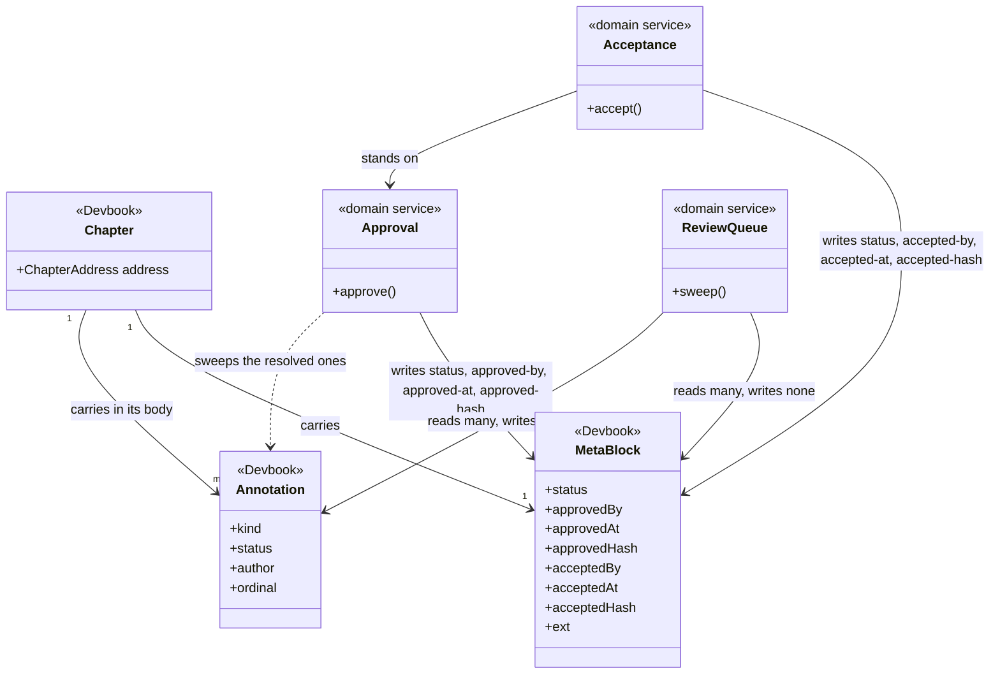
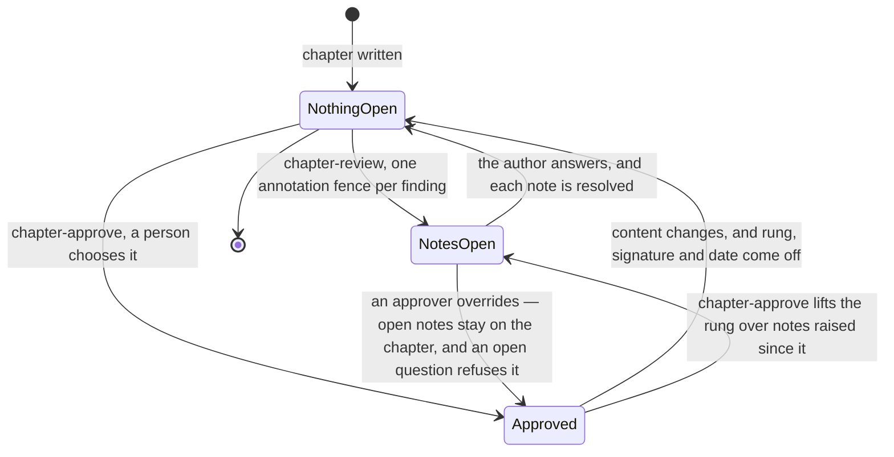
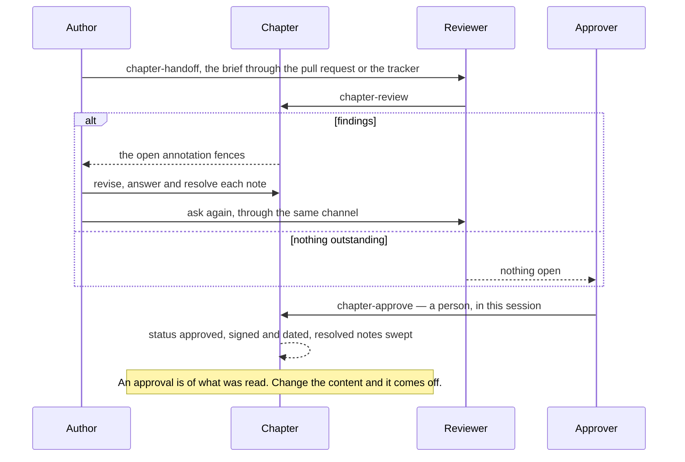

# devbook-collaboration

```meta
related: [".devbook/arc42/building-blocks/README.md", ".devbook/arc42/building-blocks/devbook.md#dependencies", ".devbook/arc42/building-blocks/devbook.md#change", ".devbook/arc42/adr/annotations.md", ".devbook/arc42/adr/chapter-schema.md", ".devbook/arc42/12-glossary.md#review-pass", ".devbook/arc42/12-glossary.md#stale-approval"]
c4: ["marketplace.devbook-collaboration"]
code: ["plugins/devbook-collaboration"]
```

How a chapter is reviewed and decided. Responsible for two things: that every objection to a
chapter is written into it, beside the passage it is about, and that an approval on it was
chosen by a person in the session that wrote it.

Inside the block: the brief that asks for a review, the reading of a verdict off the open
notes, the two decisions, and the sweep that reports what is still open. The same five skills
take a [change](devbook.md#change) as one unit: its proposal and every delta reviewed
together, one decision per gate, written once on `proposal.md` and never on the chapters the
deltas target. Deciding a chapter outside a change is unchanged.

Outside it: what a chapter says, what its folder's rules are, the schema, and the
[annotation](devbook.md#annotation) a finding is written as — all [devbook](devbook.md)'s —
and who owes the next move, which is the pull request's or the tracker's. This block owns no
schema and no state of its own: the only fields it writes are devbook's two decision rungs and
their records, held to their meaning by devbook's check, and a finding lives in devbook's own
device ([the annotations record](../adr/annotations.md)).

## Interfaces

```meta
related: [".devbook/arc42/building-blocks/devbook.md#interfaces"]
```

Five skills, the gate the two decisions share, `resources/decision-gate.md`, and the one
script the queue runs on. They move one chapter through a review to the
two decisions past it, and one of the five writes nothing at all. There is no install: the state they write is devbook's
schema, so enabling the plugin is the whole adoption. Deleting the answered notes is
`devbook:annotation-sweep`, in the plugin that owns the fence.

| Interface | Kind | Reached by |
| --- | --- | --- |
| `chapter-handoff` | skill | A person, on one chapter |
| `chapter-review` | skill | The named reviewer, on one chapter |
| `chapter-approve` | skill | A person who chose it in that session — never a schedule, never a cleared review |
| `chapter-accept` | skill | A person who chose it in that session, over evidence — never a green suite, never a merged pull request |
| `chapter-review-queue` | skill | A person, or a schedule: it writes nothing |
| `scripts/review-queue.mjs` | read-only CLI | `chapter-review-queue`, or a person who wants the queue as JSON |

### chapter-handoff

```meta
related: [".devbook/arc42/building-blocks/devbook-collaboration.md#review-position", ".devbook/arc42/building-blocks/devbook-collaboration.md#the-review-pass"]
```

Name the reviewer and produce the brief to send them. It writes nothing into the chapter: who
owes the next move is workflow state, and it survives the conversation in the pull request or
the tracker the brief is sent through, where a reassignment is not a content diff.

### chapter-review

```meta
related: [".devbook/arc42/building-blocks/devbook-collaboration.md#finding", ".devbook/arc42/building-blocks/devbook.md#annotation"]
```

Read a chapter against its folder's rules and its own evidence, and write one annotation fence
per objection. The open fences are the verdict: any left open is changes requested, none is
cleared. There is no verdict field beside them, so the verdict and its evidence cannot drift.

Cleared is not approval: it says nothing is outstanding. It obliges nobody and grants
nothing, which is what lets a chapter wait for an approver rather than for a reviewer.

### chapter-approve

```meta
related: [".devbook/arc42/building-blocks/devbook-collaboration.md#approval", ".devbook/arc42/building-blocks/devbook-collaboration.md#chapter-approved"]
```

Record that a person read this chapter and approved it, in devbook's own rung with a
signature and a date, and sweep the chapter's resolved notes in the same change.

An open `kind: question` note blocks it outright: devbook's check reports an approval standing
over one as an error, so this is the one condition the skill refuses on rather than states.
Every other open note is shown and weighed, flags first; on a chapter already approved, a note
dated after `approved-at` is named as raised since the approval, and revise means lifting the
rung.

It runs only where a person chose it in that session — never from a schedule, never as a
consequence of a cleared review, and never on the strength of a conversation a later session
cannot read.

### chapter-accept

```meta
related: [".devbook/arc42/building-blocks/devbook-collaboration.md#acceptance", ".devbook/arc42/building-blocks/devbook-collaboration.md#chapter-accepted"]
```

Record that a person saw the implemented work against this chapter and accepted it, in the
rung above `approved`, with a signature, a date, and the content fingerprint the acceptance
was of. The approval record stays: the two statements are different, and both are wanted.

What it shows is the built work, never a summary of it — the application started through the
repository's `run` skill where it has one, and the chapter's linked `tests` run. It refuses
on an open `kind: question`, on a chapter that was never approved, and on an approval whose
fingerprint no longer matches the chapter: an acceptance stands on a current approval, and
there is nothing to accept against without one.

Like the approval under it, it runs only where a person chose it in that session — never from
a green suite, a merged pull request, or a schedule.

### chapter-review-queue

```meta
related: [".devbook/arc42/building-blocks/devbook-collaboration.md#review-queue"]
```

Sweep the adopted folders and every open change and report the chapters and changes with
open notes, the work awaiting a decision, and which approvals have gone stale. It writes nothing, which makes it the one skill
here that is safe to schedule.

The sort itself is `scripts/review-queue.mjs`, not the skill. A table read by a model can sort
the same chapters differently on two runs, and a script cannot. The skill runs it, groups its
rows by who owes the next move, and offers that move.

## Structure

```meta
related: [".devbook/arc42/building-blocks/devbook.md#structure", ".devbook/arc42/adr/annotations.md", ".devbook/arc42/adr/chapter-schema.md"]
```

No aggregate and no storage of its own: a review position read off the chapter, three domain
services, and two domain events stated in devbook's language.


### Model

```meta
```

Where this block's state physically lives, and where the line runs between it and the chapter
it is written inside.



- **No review state is stored.** Where a review stands is the chapter's `status` and its open
  annotation fences, both devbook's, and who owes the next move lives in the pull request or
  the tracker. This block contributes the procedure and none of the vocabulary
  ([the annotations record](../adr/annotations.md)).
- **The decision rungs are `domain/`'s and a change's, the fence is every folder's.** So
  the pass runs wherever a chapter lives, and the two gates run on model chapters and on a
  change's `proposal.md` — a repository with neither gets the review and no decision.
- **The line is who writes, not who defines.** Every field is devbook's; this block writes
  `status`, `approved-by`, and `approved-at` only through [Approval](#approval), and the
  acceptance three only through `Acceptance`, which stands on the record Approval left.
- **Both decisions are services.** Their result is a field another block owns, which is
  coordination rather than a transition of anything this block holds.
- **A [Finding](#finding) is an `Annotation`, and the association is a dependency rather than
  a composition.** The fence hangs off the chapter, not off the review: it outlives the pass
  that raised it, a person can write one with no review running, and this block neither owns
  its shape nor sweeps it. What the review contributes is the reading — an open
  `kind: question` is the one that blocks the approval decision.
- **The seam that used to be open is closed.** Findings were flat `ext` keys until 2026-09-09;
  see [the annotations record](../adr/annotations.md) for why, and for why the sweep stayed
  with devbook.

### Review Position

```meta
related: [".devbook/arc42/12-glossary.md#review-pass", ".devbook/arc42/building-blocks/devbook.md#meta-block"]
```

One chapter's position in a review, read and never stored: its `status` rung and the open
annotation fences in its body. Open fences say changes are requested and what they are; none
open says nothing is outstanding. Who owes the next move is not part of it — that is the pull
request's or the tracker's, where a reassignment is not a content diff on a chapter whose text
did not change.

Until contract 21 the position was stored as devbook's `review`, `reviewer`, and `review-at`,
and the check held them against the fences. A stored copy of what the fences already say is a
second record that can disagree with the first, and a review field beside `status` stated the
chapter's stage twice ([the annotations record](../adr/annotations.md)).

| Invariant | Enforced at | Evidence |
| --- | --- | --- |
| This block writes no `meta` field except devbook's two decision rungs and their six record fields | all mutations | untested |
| On a change, the decision is written once on `proposal.md`, with the change's hash, and on no chapter a delta targets | `chapter-approve()`, `chapter-accept()` | untested |
| A change is accepted only with every `tasks.md` step done and every delta `verify-change` covers verified `aligned`; a delta against a chapter outside its kinds owes no verdict | `chapter-accept()` | untested |
| A change merges only once accepted over its current hash | devbook's `delta.mjs --apply` | `unit:node:plugins/devbook/tools/devbook-meta/change-folder.test.mjs` |
| A leftover `review`, `reviewer`, or `review-at` is reported by name, in every folder | devbook's check | `unit:node:plugins/devbook/tools/devbook-meta/review-state.test.mjs` |
| A finding is written through devbook's `annotations.mjs` and never as a field | `chapter-review()`, `chapter-approve()` | untested |
| Approval sweeps the chapter's resolved notes in the same change that writes the rung | `chapter-approve()` | untested |
| No chapter is approved over an open `kind: question` note | `chapter-approve()` | `unit:node:plugins/devbook/tools/devbook-meta/field-scope.test.mjs` |
| The gate shows every open note on the chapter, from the chapter itself, before the decision is asked | `chapter-approve()` | untested |
| No skill here writes `approved` without a person choosing it in that session | `chapter-approve()` | untested |
| An annotation is never read as chapter content | convention | open — devbook's rules state it beside the annotation rule; nothing checks a reader obeyed it |

It owns no value object and no enum. The reviewer is named in the brief, and changes
requested and cleared are readings of the fences, not values anyone writes.

### Finding

```meta
related: [".devbook/arc42/building-blocks/devbook.md#annotation", ".devbook/arc42/adr/annotations.md"]
```

Also called: note, comment, objection.

One unresolved objection, as one [annotation](devbook.md#annotation) fence in the chapter
body — devbook's device, not this block's. It has identity within the review because it is
answered individually, and it is addressed the way devbook addresses a note: the chapter, plus
its ordinal under that heading.

This block reads a finding and writes one; it owns neither the shape nor the lifecycle. What
it adds is the reading: an open `kind: question` is a hole in the chapter and blocks the
approval decision, while a `comment`, `suggestion`, or `flag` is a remark about a chapter that
stands. Among the remarks a `flag` is read first, and a note dated after the chapter's
`approved-at` is read as raised since the approval — an objection the approval never saw, and
a reason to lift it. Neither reading blocks; see [the decision](../adr/annotations.md).

It was one flat `ext` key until 2026-09-09, which recorded no author, could not be replied to
in place, and never said which passage it was about. See
[the decision](../adr/annotations.md).

| Invariant | Enforced at | Evidence |
| --- | --- | --- |
| Among the remarks a `flag` is read first | the reading | untested |
| A note dated after the chapter's `approved-at` is read as raised since the approval | the reading | untested |
| Neither reading blocks a decision; only an open `kind: question` does | `chapter-approve()` | untested |
| This block reads and writes a finding and owns neither its shape nor its lifecycle | `annotations.mjs` | untested |

### Approval

```meta
related: [".devbook/arc42/adr/chapter-schema.md", ".devbook/arc42/adr/annotations.md"]
```

Also called: sign-off, agreed.

The decision that writes devbook's own `approved` rung, with `approved-by` and `approved-at`,
and sweeps the chapter's resolved notes in the same change.

Invocation semantics: command-invoked, and never anything else. It is the one operation here
that writes a field this block does not own, so it runs only where a person chose it in that
session — not from a schedule, not as a consequence of a cleared review, and not on the
strength of a conversation a later session cannot read.

The behaviour is a service rather than a transition because there is nothing here to
transition: the [Review Position](#review-position) is read, not stored, and the output is a
field another block owns.

It lives in this block and not in the flow engine because it writes the rung it decides, and
the engine reads that rung and never writes it. It reads the chapter, not the derived index:
every fact the decision needs is in the one file it is already showing, and the index is
refreshed on a schedule, so the note written on this branch an hour ago is the one it lacks.
See [the decision](../adr/annotations.md).

| Invariant | Enforced at | Evidence |
| --- | --- | --- |
| Command-invoked and never anything else — not from a schedule, and not as a consequence of a cleared review | `chapter-approve()` | untested |
| It reads the chapter, never the derived index | `chapter-approve()` | untested |
| The rung it writes is devbook's field, which the flow engine reads and never writes | `chapter-approve()` | untested |

### Review Queue

```meta
related: [".devbook/arc42/12-glossary.md#review-pass", ".devbook/arc42/12-glossary.md#stale-approval"]
```

Sweeps the adopted folders and reports the chapters with open notes, the work awaiting a
decision, and which approvals have gone stale — an approval that no longer stands because the
content moved under it.

Invocation semantics: query-oriented, and it writes nothing at all. It is a read across every
chapter in the repository rather than an operation on one, which is why it is a service and
not a method: no single [Review Position](#review-position) can answer *what is open right
now*.

| Invariant | Enforced at | Evidence |
| --- | --- | --- |
| It writes nothing at all | `review-queue.mjs` | untested |
| It reports what is open, and which approvals have gone stale under content that moved | `review-queue.mjs` | `unit:node:plugins/devbook-collaboration/scripts/review-queue.test.mjs`, `unit:node:plugins/devbook/tools/devbook-meta/content-hash.test.mjs` |
| Each chapter and each open change lands in the first row that matches, and a change is one row over its proposal and every delta | `review-queue.mjs` | `unit:node:plugins/devbook-collaboration/scripts/review-queue.test.mjs` |
| It reads the `meta` and `annotation` fences of the adopted folders and the open changes, and never `_meta/` or `archive/` | `review-queue.mjs` | `unit:node:plugins/devbook-collaboration/scripts/review-queue.test.mjs` |
| A lapse is decided by the recorded fingerprint where the rung carries one, and otherwise by git, with the method named | `review-queue.mjs` | `unit:node:plugins/devbook-collaboration/scripts/review-queue.test.mjs` |

### Acceptance

```meta
related: [".devbook/arc42/adr/chapter-schema.md", ".devbook/arc42/building-blocks/devbook-collaboration.md#approval"]
```

Also called: validated, signed off on the build.

The decision that writes devbook's `accepted` rung, with `accepted-by`, `accepted-at`, and
`accepted-hash`, on top of the approval record it stands on and never in place of it.

A service for the same reason [Approval](#approval) is: its result is not a state of the
aggregate but a field belonging to another block, and it reads evidence — a running
application, a test run — that lives outside this one entirely.

| Invariant | Enforced at | Evidence |
| --- | --- | --- |
| The acceptance stands on an approval record and never replaces one | devbook's check | `unit:node:plugins/devbook/tools/devbook-meta/accepted-rung.test.mjs` |
| `accepted-at` falls on or after `approved-at` | devbook's check | `unit:node:plugins/devbook/tools/devbook-meta/accepted-rung.test.mjs` |
| An unsigned, undated, or orphaned acceptance record is reported | devbook's check | `unit:node:plugins/devbook/tools/devbook-meta/accepted-rung.test.mjs` |
| Both records come off together when the content moves under them | devbook's check | `unit:node:plugins/devbook/tools/devbook-meta/accepted-rung.test.mjs` |
| The rung is on `domain/`'s ladder and a change's proposal, and no other folder's | devbook's check | `unit:node:plugins/devbook/tools/devbook-meta/accepted-rung.test.mjs`, `unit:node:plugins/devbook/tools/devbook-meta/change-folder.test.mjs` |
| It reads evidence that lives outside this block — a running application, a test run | `chapter-accept()` | untested |

### Chapter Approved

```meta
related: [".devbook/arc42/building-blocks/devbook.md#chapter", ".devbook/arc42/building-blocks/devbook-collaboration.md#approval"]
```

Published when a person approves a chapter. It is the one fact this block states in somebody
else's language: it is written into devbook's `status`, `approved-by`, and `approved-at`
fields, lands in git like any other change, and travels with the content rather than sitting
in flow configuration or in somebody's memory.

Payload:

- `status` — the `approved` rung, on top of `domain/`'s ladder or a change's `proposal.md`, and no other folder's
- `approved-by` — one person, handle, or team; never a list
- `approved-at` — the day they approved it, `YYYY-MM-DD`
- `approved-hash` — optional; the fingerprint of the content approved, which is what makes a
  later lapse a check result rather than something a reader has to establish from git

Consumers:

- **[devbook](devbook.md)** — the rung is its field, and its check reports an approval that is
  unsigned or undated, or a record left behind on a chapter no longer claiming the rung.
- **[delivery](delivery.md)** — a flow's approval gate reads whether a chapter it is about to
  build from was agreed, and never writes the rung itself.
- **Any reader of the chapter** — which is the point of recording it in the chapter rather
  than anywhere else.

Published language rules:

- **The rung is never a resting value and is never omitted to mean itself.** A chapter states
  it while the approval stands and drops back to its ordinary rung the moment the content
  changes.
- **`approved-by` and `approved-at` are written and deleted in the same change as the rung.**
  Either the approval is current and the status says so, or it has lapsed and the record
  comes out with it.
- **An approval is of what was read, not of the heading.** Nothing may re-assert it from a
  previous approval, a cleared review, or a version comparison.

### Chapter Accepted

```meta
related: [".devbook/arc42/building-blocks/devbook.md#chapter", ".devbook/arc42/building-blocks/devbook-collaboration.md#acceptance"]
```

Published when a person accepts the built work against a chapter. The rung above
[Chapter Approved](#chapter-approved), and the one statement the loop between a specification
and its implementation otherwise loses: `approved` says the chapter is right, `accepted` says
the product satisfies it.

Payload:

- `status` — the `accepted` rung, on `domain/`'s ladder or a change's `proposal.md`, and no other folder's
- `accepted-by` — one person, handle, or team; never a list
- `accepted-at` — the day they accepted it, `YYYY-MM-DD`, on or after `approved-at`
- `accepted-hash` — optional; the fingerprint of the content accepted

Consumers:

- **[devbook](devbook.md)** — the rung is its field, and its check reports an acceptance that
  is unsigned, undated, dated before its approval, or standing over no approval at all.
- **[delivery](delivery.md)** — a flow may record the decision at its personal-validation
  gate, and never writes the rung itself.
- **Any reader of the chapter** — including a team accepting in a different tool, for whom
  the chapter is the only place both sides read.

Published language rules:

- **It stands on an approval and never replaces one.** An accepted chapter carries both
  records, because the two statements are different and are usually made by different people
  on different days.
- **Both records come off together.** A content change drops the acceptance with the
  approval: a build was accepted against the text that was approved.
- **What is accepted is the chapter's content, never a commit.** Which pull request delivered
  it belongs to the tracker, not to a field here.

## Runtime

```meta
related: [".devbook/arc42/building-blocks/devbook-collaboration.md#review-position", ".devbook/arc42/building-blocks/devbook-collaboration.md#approval", ".devbook/arc42/building-blocks/devbook.md#a-chapters-standing"]
```

How a chapter moves through a review, and how it leaves.

### The Review Pass

```meta
related: [".devbook/arc42/12-glossary.md#review-pass"]
```

Five skills, and two positions a chapter can hold on its way to a decision, both read off its
fences. The resting shape is no open note and no review field — there is none to write.



- **The hand-off is not a position.** `chapter-handoff` sends a brief and writes nothing: a
  review asked for but not yet started lives in the pull request or the tracker, and the
  chapter's own rung already says it is not settled.
- **Nothing open is not approval.** It says nothing is outstanding, obliges nobody, and grants
  nothing. Collapsing the two would make a reviewer's sign-off into an approval decision they
  never made.
- **Approval is one change.** The rung, `approved-by`, and `approved-at` go in, and the
  chapter's resolved notes are swept with them.
- **An open question is the one thing that blocks the decision.** Devbook's check reports an
  approval standing over one as an error, so `chapter-approve` refuses rather than warns.
  Every other kind of note is weighed, not enforced — a `flag` first, and a note dated after
  `approved-at` named as raised since the approval. Choosing revise over one is the
  `Approved --> NotesOpen` edge: the rung comes off by a person's decision rather than by a
  content change, and the notes already on the chapter are the findings.
- **The exit is content change, not time.** An approval lapses because the chapter moved
  under it, which is why [Review Queue](#review-queue) reports staleness rather than the
  chapter claiming to be current.

### Who Owes the Next Move

```meta
```

The same pass read as a hand-off. The chapter holds the findings; who owes the next move
travels with the brief, in the pull request or the tracker.



- **Nothing here is inferred from a conversation.** A later session cannot read this one, so
  every finding is written into the chapter, every ask travels where a later session can read
  it, and the approval is taken in the session that writes it.
- **The queue sweep runs beside this diagram, never inside it.** It reads every chapter and
  changes none, which is what makes it the one operation here safe to schedule.

## Dependencies

```meta
related: [".devbook/arc42/building-blocks/devbook.md#dependencies", ".devbook/arc42/08-crosscutting-concepts.md#layer", ".devbook/arc42/adr/annotations.md"]
```

An L1 extension: exactly one declared dependency, on the foundation whose schema it writes
into.

### Outbound

```meta
```

| Depends on | Pattern | Mechanism | Contract | Why |
| --- | --- | --- | --- | --- |
| [devbook](devbook.md#dependencies) | Customer-Supplier, declared `devbook >=1.0.0 <2.0.0` | Reads a chapter's `status` and its open annotation fences; writes no review field | `devbook-chapter-metadata.md`: a review in progress is the chapter's rung plus its open fences, never a field | It has no store and no vocabulary of its own, and remembers nothing about a review in the chapter — [the annotations record](../adr/annotations.md). |
| [devbook](devbook.md#interfaces) | Conformist, for the parser | The review queue imports `metadata.mjs`, `delta.mjs`, and `demo.mjs` from the repository's `.devbook/_tools/devbook-meta/` | The fence parsers, and the fingerprint `chapter-hash.mjs` prints | A second parser would be a second reading of the schema, and a fingerprint computed twice can disagree with the check. The repository's own copy keeps the queue on the schema that repository is at. |
| [devbook](devbook.md#annotation) | Conformist, for the whole device | Writes findings through `.devbook/_tools/devbook-meta/annotations.mjs` | The [annotation](devbook.md#annotation) fence: its schema, its placement rule, and its open/resolved/gone lifecycle | A finding is devbook's device, not this block's. It reads the fences as the evidence a verdict stands on, and sweeping them is devbook's too — see [the annotations record](../adr/annotations.md). |
| [devbook](devbook.md#chapter) | Conformist, for one field | Writes `status: approved` or `accepted` and the six record fields directly, on `domain/` chapters and a change's `proposal.md` only | The two decision rungs, on `domain/`'s ladder and a change's proposal, and their six record fields | Both rungs are devbook's fields and keep devbook's meaning. This block runs the decisions; it does not own the vocabulary, and a repository with no `domain/` folder and no change gets the review pass and neither decision. |
| [The plugin kernel](../08-crosscutting-concepts.md) | Shared Kernel | Plugin folder and two manifests | [Chapter 8](../08-crosscutting-concepts.md) | It is packaged like every other plugin here, and — alone among them — materializes nothing and stamps nothing. |
| Claude Code and Copilot Plugin APIs | Conformist | Manifests and skills | Each host's own schemas | Enabling the plugin is the whole adoption; the rules its skills follow are devbook's, and reach a host through devbook's install. |

### Inbound

```meta
```

| Consumer | Pattern | Mechanism | Contract | What it relies on |
| --- | --- | --- | --- | --- |
| [devbook](devbook.md#dependencies), as a reader | Conformist, reversed | Its check reads `status: approved` and the approval record, and reports an unsigned, undated, or orphaned approval, and a leftover review field by name | The approval and acceptance records | That this block writes each record whole, and never writes a review field. |
| [delivery](delivery.md#dependencies) | Separate Ways | A flow's approval gate reads whether a chapter was agreed before building from it | The `approved` rung, read from the chapter | Nothing from this plugin. It reads devbook's field, which is why the two never name each other. |
| [devbook-config](devbook-config.md#dependencies) | Conformist, read-only | Reports whether the plugin is installed and enabled | The marketplace entry and manifests | Nothing: there is no stamp to read and no install to invoke. |

**The fence and the rungs are the entire dependency, and both are devbook's.** Disable this
plugin and they stay defined, validated, and meaningful — a person can review with fences and
decide with the rungs by hand, and be held to the same rules. What goes is the procedure, not
the vocabulary.

**This block reads no `ext` key.** The namespace it once stored its state in is reserved and
unused; the first extension's state became schema instead.

**Nothing declares this block.** It is above devbook in the layer order and below nothing, so
no manifest anywhere names it — a repository that has not enabled it simply has no skill that
runs the pass, and every chapter still reads correctly.

**Promotion to a work item is not here, and the Separate Ways row above is why.** A note that
has become tracked work should be promoted through `bindings["delivery.tracker"]`, but the
operations, their resolution order, and the key naming them are declared in `delivery`'s own
engine contract — a file this block may not point at. Restating it here is what the Separate
Ways relationship exists to prevent, so promotion belongs in `delivery` or in a bridge allowed
to name both. See [the annotations record](../adr/annotations.md).
