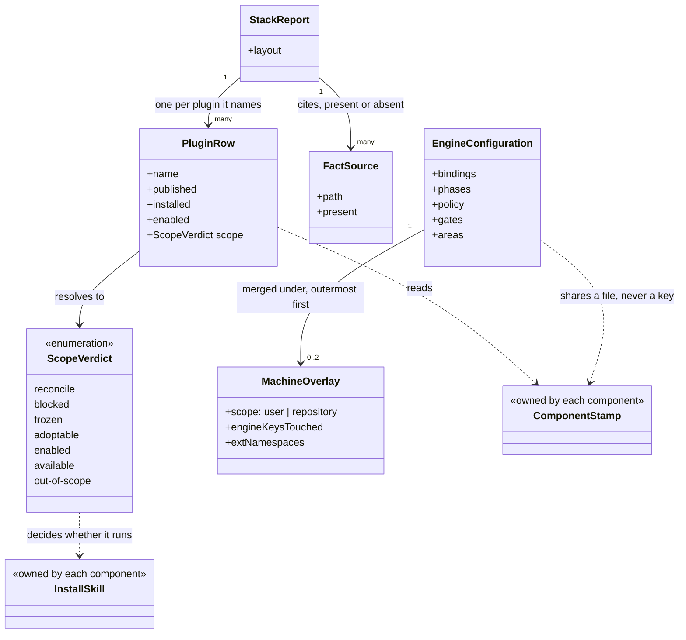
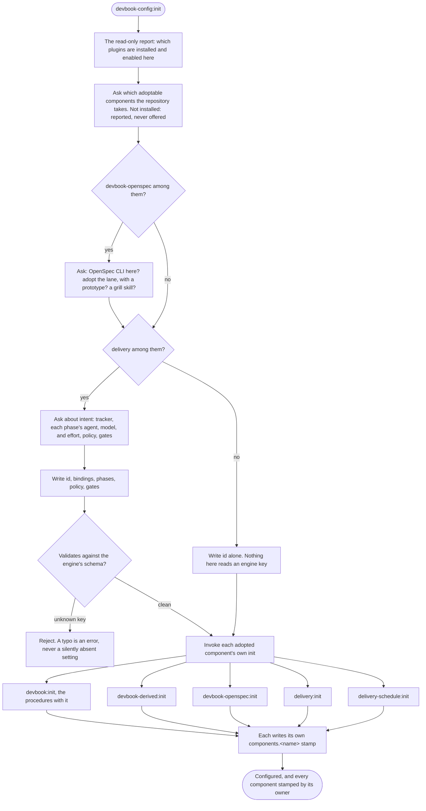
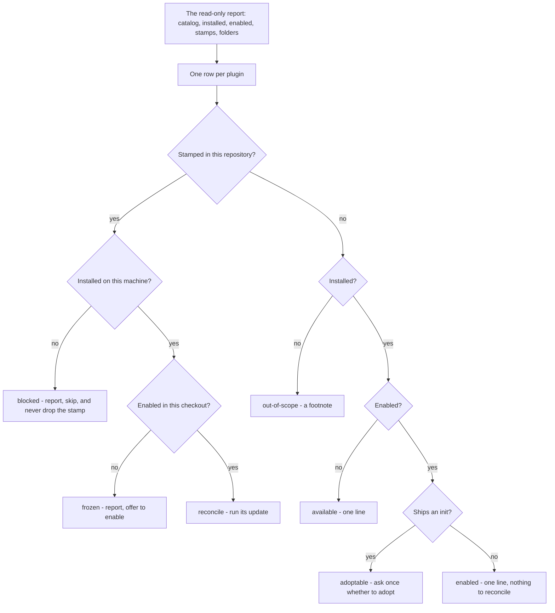

# devbook-config

```meta
related: [".devbook/arc42/building-blocks/README.md", ".devbook/arc42/building-blocks/delivery.md#dependencies", ".devbook/arc42/adr/plugin-boundaries.md", ".devbook/arc42/adr/configuration.md", ".devbook/arc42/05-building-block-view.md#config-plugin"]
c4: ["marketplace.devbook-config"]
code: ["plugins/devbook-config"]
```

What this stack is, what this machine has, and how this repository is wired.

**Responsible for:**

- a repository's stack configuration existing before anything initializes itself
- moving it forward in one run
- diagnosing its installation without a write
- naming the file behind every answer about the stack

**Owns:**

- the engine-owned keys of the stack config
- the read-only report behind every fact
- the scope verdict that decides what an update touches
- the drift report against the adoption record

| Concern | Owner |
| --- | --- |
| Every `components.<name>` stamp | That component's own `init` and `update` |
| The schema of the engine keys | [delivery](delivery.md) |
| Writing a chapter | A flow |

This block names every plugin in the marketplace and declares none.

## Interfaces

```meta
```

Seven skills and the one script all seven read through. Four skills write nothing, and one
writes nothing into the repository. None writes a key another component owns.

| Interface | Kind | Reached by |
| --- | --- | --- |
| `init` | skill | A person adopting the stack in a repository, before any component initializes itself |
| `update` | skill | A person moving the configured stack forward |
| `doctor` | skill | A person; `init` and `update` at their close; the daily `devbook-validate` schedule where this plugin is installed |
| `report` | skill | `init` and `update` at their close, or a person asking how the repository is set up |
| `ask` | skill | A person with a question about this marketplace |
| `adoption` | skill | A person checking the `ai/` adoption record against what is installed |
| `local` | skill | A person, after `init` or `update` offers it or the report says no user overlay exists |
| `scripts/report.mjs` | script, the read-only report | The seven skills, run in place from the plugin root |
| `scripts/model-selection.mjs` | script, the category converter | `local`, which merges what it prints into the user overlay; it writes nothing |
| `resources/setup-report.md` | template, the setup report | `report`, which `init` and `update` close on, one shape for all three |
| `resources/provider-resolution.md` | contract, provider resolution | `doctor`, at its provider step |
| The engine keys of `.devbook/config.json` | what it writes | `init` and `update`, and nothing else in that file |
| The user's devbook config directory | what it writes | `local` alone: a stack-config overlay at the user or repository layer, and `AGENTS.local.md` |

### init

```meta
```

- **Does:** Write a repository's engine-owned keys for the first time: which tracker, which
  agent runs each phase of each flow and on which model and effort, which policy switches, which
  gates. Then invoke every component's own `init`, reimplementing none.
- **Refuses:** a repository where `.devbook/config.json` already exists: "already initialized,
  run update".
- **Closes on:** [`report`](#report), as `update` does: what is adopted, the procedures and
  routines, every plugin's version, and what the run changed.
- **Never:** writes past the engine keys. Every `components.<name>` stamp stays with the
  component that knows what it materialized, the boundary
  [Engine Configuration](#engine-configuration) holds.
- **Why:** it is a conversation about intent, so it is not the skill that moves the stack forward.
- **See:** [Init Service](#init-service) and the run under
  [Init, Then Every Component](#init-then-every-component).

The change lane is one more component with three questions: is the OpenSpec CLI here, adopt the
lane, and grill an idea before proposing it.

Init checks the CLI and prints the install command rather than running it, the way the issue
sweep checks `gh`. It writes the `spec` and tracker bindings to
[devbook-openspec](devbook-openspec.md) and the optional gates, and adds the change folder to
what `devbook:init` adopts. It leaves `openspec init`, the schema, and the `components.openspec`
stamp to `devbook-openspec:init`.

The grill skill comes from another marketplace, so it is a binding,
`bindings["openspec.grill"]`. Init writes that one key whether or not the engine is adopted: the
lane reads it, not the engine.

### update

```meta
```

- **Does:** Move the whole configured stack forward in one run: version drift, outstanding
  migrations, a fan-out to every adopted component's `update`, and a re-validated config.
- **Closes on:** [`report`](#report), a run that changed nothing included, with each component's
  stamp before and after.
- **Never:** changes anything about intent, or drops a stamp. A component this machine has not
  installed is reported, skipped, and **left stamped**.
- **Why:** unchanged intent makes it safe to run when nothing has changed. A stamp is committed
  and shared while installed-ness is personal, so dropping the entry would un-adopt the component
  for everyone on the next commit.
- **See:** [Update Service](#update-service) and the verdicts under
  [Update, By Scope](#update-by-scope).

### doctor

```meta
related: [".devbook/arc42/building-blocks/devbook.md#validate", ".devbook/arc42/building-blocks/devbook-config.md#stack-report"]
```

- **Does:** Say whether the installation is current: every component's stamp against disk,
  devbook's migrations run with `--check`, each component's `AGENTS.md` section against its
  stamped hash and its template, and each installed plugin against the newest published. Every
  finding names the component's `update` that fixes it.
- **Never:** writes.
- **Fails on:** hard drift; staleness and customization are only reported.
- **Why:** it is the half of what `devbook:check` used to ask that reads every stamp. It moved
  here because this is the one context allowed to read them all, and a devbook skill never names
  another plugin.

It also resolves every phase's `agent` and `skill` in the effective configuration, read through
delivery's `check.mjs --print`, never merged by hand. An agent resolves against the installed
agents and the repository's own agent folder. A skill resolves against the installed plugins'
skills and, for `repo:`, the repository's own skill folder.

The engine's checker validates a field's shape and never whether it exists. A skill that
migration 015 retired would otherwise do nothing at every run and say so only in that run's
summary.

- A retired id is hard drift, named with its successor and `devbook:update` as the fix.
- Any other unresolved id is a warning, because the flow degrades past it.
- Also warnings: an agent id in a `skill` field, and an `agent` naming a plugin with more
  than one agent or none.
- A phase with no `agent` or `skill` is not a finding.

It flags a `phases` map left under a retired flow, `flow-update-packages` or `flow-project`,
and a leftover `model-selection.md` in the user's devbook config directory. Both name the skill
that moves them: `delivery:update` for the map and `local` for the file.

Where the change lane is stamped, it checks the OpenSpec CLI against `components.openspec.cli`.
It lists every open change whose folder nobody has committed to in seven days. Both are
warnings. The CLI is a fact about this machine, like a plugin it lacks. A stale proposal waits on
a person, who settles it either way in the host that keeps the proposal's state.

### report

```meta
related: [".devbook/arc42/building-blocks/devbook-config.md#doctor", ".devbook/arc42/building-blocks/devbook-config.md#stack-report"]
```

- **Does:** Print the setup report for the repository as it stands: every plugin's installed and
  newest version with its scope, what is adopted and what the engine binds after every overlay,
  the procedures, the routines, and what `doctor` still finds open.
- **Never:** writes.
- **Closes:** `init` and `update`, which hand it the rows of their own run. Run by hand, that
  section reads as a standing report.
- **Why:** neither `doctor` nor `ask` prints the whole state: `doctor` lists only what is wrong
  and `ask` answers one question. A setup is compared, after an upgrade or by the next person,
  only against a report of the same shape.

### ask

```meta
```

- **Does:** Answer one question about this marketplace from what is on disk, as
  [Ask Service](#ask-service) lists.
- **Never:** writes.
- **Only asset allowed to:** name every plugin.
- **Why:** it is the only one whose subject is the marketplace rather than a unit of work.

### adoption

```meta
related: [".devbook/arc42/building-blocks/delivery.md#flow-spec"]
```

- **Does:** Report where the adoption record no longer matches what is installed, enabled, and
  wired, and hand every edit to the folder's own flow.
- **Never:** writes, deliberately.
- **Why:** the report can only see what is on disk, and whether people actually work a certain
  way is not on disk.
- **See:** [Adoption Drift](#adoption-drift).

### local

```meta
date: 2026-10-05
related: [".devbook/arc42/building-blocks/devbook-config.md#engine-configuration", ".devbook/arc42/adr/configuration.md", ".devbook/arc42/08-crosscutting-concepts.md#phase"]
```

- **Does:** Ask what is true of this machine and write it where the stack reads it: a
  [machine overlay](#engine-configuration) at the user layer by default, the repository layer when
  an answer is about one repository, and `AGENTS.local.md`. All of it sits under the user's
  devbook config directory, none in the clone.
- **Phases:** it asks which agent, model, and effort this person wants for each. It writes the
  answers into the overlay's `phases` map, where they win field by field over the team's defaults.
- **Retires:** an existing `model-selection.md`. `scripts/model-selection.mjs` maps each 1.13.0
  category onto the phases its stages became, and `local` deletes the file on the person's yes
  once the overlay validates.
- **Questions:** every one is optional and the default is nothing. A grill skill of the person's
  own is one of them: `bindings["openspec.grill"]` in an overlay wins over the repository's, and
  `null` there skips grilling on this machine.
- **Why:** `init` may not write an overlay, which is true of the person running it, not of the
  repository they set up. Without `local`, the first run on every machine took the team's defaults
  without saying so.
- **Offered by:** `init` and `update` at their close, and the report says when no user layer exists.

## Structure

```meta
related: [".devbook/arc42/05-building-block-view.md#config-plugin", ".devbook/arc42/adr/configuration.md", ".devbook/arc42/adr/plugin-boundaries.md"]
```


Two aggregates and four services: what the report reads, what the engine keys are, and where the
line runs between what this block writes and what it only looks at.

### Model

```meta
related: [".devbook/arc42/building-blocks/delivery.md"]
```



- **The two dashed edges into `ComponentStamp` are the whole boundary.** This block reads every
  stamp and writes none. `EngineConfiguration` and `ComponentStamp` share one file and never a
  key, which is [one config file, two kinds of key](../adr/configuration.md) in a diagram.
- **`ScopeVerdict` decides whether a component's `init` or `update` runs and never runs one itself.**
  The fan-out is a delegation, so a component's own skills remain the only thing that knows what
  it materialized.
- **`FactSource` is associated with the report rather than with a row, and it carries `present`.**
  A file that was absent still produces a source, so an empty table says "this was not there"
  rather than "there is nothing".
- **`PluginRow` names every plugin and depends on none.** A plugin it cannot find becomes a row
  reading `not installed`, degrading rather than failing as the engine does for an unresolved agent.
- **`EngineConfiguration` conforms to a schema this block does not own.** The field names and
  their meanings are [delivery](delivery.md)'s; this block is their only writer.
- **Nothing in this model reads a devbook chapter.** It reads which folders exist and in which
  layout, and stops. Writing a chapter is a flow's, so the adoption service reports and hands over.

### Stack Report

```meta
related: [".devbook/arc42/12-glossary.md#report"]
```

What is on disk, read and nothing else:

- the catalog in the working tree and in the host's clone
- the host's installed-plugin state
- three settings layers merged nearest-last
- the stack config and every machine overlay layer
- the devbook folders under `.devbook/`
- the `skills/` folders of the engine and the schedule plugin

It shows each flow's phase map as a table. It names every key 1.14.0 retired that a config file
still carries, and a leftover `model-selection.md`, each with the skill that moves it. It is the
[report](../12-glossary.md#report) behind every answer this block gives.

It is the aggregate because a fact here is only usable with its source attached. "Already latest"
is usually wrong because a clone is older than the catalog it is compared to, so the report prints
both, and the commit behind each.

| Invariant | Enforced at | Evidence |
| --- | --- | --- |
| Every fact names the file it came from, and every file that was absent is named too | report | untested |
| It reads and takes no network | report | untested |
| A plugin it names but cannot find is reported as not installed, never as an error | report | untested |
| The installed version is the one install that applies to this repository, as the host picks it — local, then project scope naming the root or a worktree's main checkout, then user; an install made for another project never counts, whatever its version | report | `unit:node:plugins/devbook-config/scripts/report.test.mjs` |
| An empty table is legible as "this file was absent", never as "there is nothing" | report | untested |
| The three scope inputs stay orthogonal — installed is per machine, enabled is per checkout, stamped is per repository | scope resolution | untested |
| Every agent, skill, and chore a phase entry names is checked against the plugins this checkout enables | report | `unit:node:plugins/devbook-config/scripts/report.test.mjs` |

The parts it owns:

- **Plugin Row** — an entity. One plugin as the report sees it: the newest published version,
  the version on disk, whether this checkout enables it, its stamp if the repository has one, and
  the scope that follows. Identity is the plugin name, which is also why a name is never reused
  after release.
- **Fact Source** — a value object. The path a fact was read from, carried with the fact. It makes
  an answer checkable rather than authoritative, and it is why an absent file produces an empty
  row with a named source instead of silence.
- **Scope Verdict** — an enum. What an update does with one component: `reconcile`, `blocked`,
  `frozen`, `adoptable`, `enabled`, `available`, `out-of-scope`. It derives from three orthogonal
  inputs (installed, enabled, stamped) and from whether the plugin has a stamp to write at all,
  never from a version comparison.

  `enabled` is the verdict for a plugin that stamps nothing by design: a surface, the review
  plugin, this one. Enabling it was the adoption, and there is no `init` to offer.

  `blocked` is the one worth stating twice. A stamp is committed and shared while installed-ness
  is personal and per-machine, so a component this machine lacks is skipped and **left stamped**.
  Dropping the entry would un-adopt it for everyone on the next commit.

### Engine Configuration

```meta
related: [".devbook/arc42/building-blocks/delivery.md#stack-config", ".devbook/arc42/adr/configuration.md", ".devbook/arc42/12-glossary.md#engine-key"]
```

The keys this block writes into `.devbook/config.json`: `bindings`, `phases`, `policy`, `gates`,
and the optional `areas`, each an [engine key](../12-glossary.md#engine-key), and nothing else in
that file. `phases` holds one complete map per flow, and a phase's model and effort are legal in
it as the team's defaults. The schema is [delivery](delivery.md#stack-config)'s and this block
conforms to it; this block owns the writing.

The boundary is by key and it is absolute. A `components.<name>` stamp is written by that
component's own `init` and `update`, the only things that know what it materialized. That is
also why `devbook:init` and `devbook:update` did not move here.

| Invariant | Enforced at | Evidence |
| --- | --- | --- |
| Only the engine keys are written here | `init()`, `update()` | untested |
| No component's stamp is ever written or dropped by this block | `init()`, `update()`, `doctor()` | untested |
| The result validates against the engine's schema, which rejects an unknown key | validation | `unit:node:plugins/delivery/tools/stack-config/check.test.mjs` |
| Init runs before any component initializes itself, and hands each component its own `init` | `init()` | untested |
| A model or an effort `init` or `update` writes is a team default in the committed file; a person's own choice goes into an overlay, which only `local` writes | `init()`, `update()`, `local()` | untested |
| A `model-selection.md` converts category by category into the overlay phases its stages became, and a category naming no phase is reported | `scripts/model-selection.mjs` | `unit:node:plugins/devbook-config/scripts/model-selection.test.mjs` |
| `extensions`, `bindings["delivery.roles"]`, and `bindings["delivery.mcp"]` are rejected by name, with a message naming `delivery:update` | validation | untested |

The value it holds:

- **Machine Overlay** — a value object. An overlay merged over the committed file, holding what
  is true of this machine only. Two layers, outermost first: the user's for every repository,
  and the user's for the repository whose committed `id` names it. Both live under the user's
  devbook config directory and never in a clone, so a fresh worktree runs with the same
  settings as the last.

  Each may add a gate and may never remove one, the asymmetry the engine holds for configuration,
  applied one layer down, at every layer. None may carry the `id` that found it. Its `phases`
  entries name only what they change and win field by field, so a model or an effort set here
  overrides the team's default. Every layer is absent by default, and none is private: nothing
  secret goes in either.

  An overlay may carry `ext.<plugin>.<key>`, a plugin's own machine-scope state, which the engine
  merges and never reads; the committed file may not. `local` writes an overlay for the person
  running it. A plugin writes its own `ext` namespace there and nothing else. The reasoning is
  [the configuration record](../adr/configuration.md).

### Init Service

```meta
related: [".devbook/arc42/12-glossary.md#engine-key"]
```

- **Entry:** the [`init`](#init) skill, which refuses a repository whose config already exists.
- **Invocation:** command-invoked, as a conversation about intent: which tracker, which agent
  runs each phase and how, which gates.
- **Why apart from [Update Service](#update-service):** the two answer *what should this
  repository use?* and *is what it uses current?*. Merging them would put an interview in front
  of an operation people run to change nothing.

| Invariant | Enforced at | Evidence |
| --- | --- | --- |
| It writes the engine keys and invokes each component's own `init`, reimplementing none | `init` | untested |
| Command-invoked, and a conversation about intent — which is why it stays apart from `update` | `init` | untested |

### Update Service

```meta
```

- **Entry:** the [`update`](#update) skill.
- **Invocation:** command-invoked. It fans out over the [scope verdict](#stack-report), running
  what it can.

| Invariant | Enforced at | Evidence |
| --- | --- | --- |
| It changes nothing about intent | `update` | untested |
| It fans out over the scope verdict, reporting what this machine has not installed or this checkout has not enabled | `update` | untested |
| A stamp is never dropped because a component is uninstalled or disabled | `update` | untested |

### Ask Service

```meta
related: [".devbook/arc42/12-glossary.md#report"]
```

- **Entry:** the [`ask`](#ask) skill.
- **Covers:** what devbook, the engine, the extensions, the surfaces, and the unattended lane are
  and how they fit; which version of each plugin is installed against the newest published; which
  are enabled.
- **Invocation:** query-oriented. Its state half comes from the [report](#stack-report) and its
  concept half from walking the canon: the plugin READMEs, the domain chapters, the arc42
  chapters, and the engine's two contracts.

| Invariant | Enforced at | Evidence |
| --- | --- | --- |
| Query-oriented: it writes nothing | `ask` | untested |
| It is the only asset that names every plugin | convention | untested |

### Adoption Drift

```meta
```

Also called: ai/ drift.

- **Entry:** the [`adoption`](#adoption) skill.
- **Invocation:** query-oriented.
- **Why:** the derivable half of `ai/` goes stale on every upgrade and is exactly what the report
  already prints. The other half rates whether people actually work that way, which no file on
  disk records.

Reporting drift is inside this block's subject. Writing the chapter is not.

| Invariant | Enforced at | Evidence |
| --- | --- | --- |
| Query-oriented: it writes nothing at all | `adoption` | untested |
| A status, an adoption line, or a piece of evidence is never derived from an install | `adoption` | untested |
| Every edit it implies is handed to the folder's own flow | `adoption` | untested |

## Runtime

```meta
```

Two flows: a repository being set up once, and the whole stack being moved forward afterwards.

### Init, Then Every Component

```meta
```



- **Nothing is set up that this machine has not installed.** Installing a plugin is the user's
  act; a stamp written for one the machine lacks is `blocked` on the very next update.
- **The engine keys exist only for the engine.** They are `delivery.*` settings, so a repository
  adopting devbook without `delivery` is asked nothing about phases, policy, or gates.
  `bindings["openspec.grill"]` is the one exception: the change lane reads it, not the engine.
- **The fan-out is a delegation, always.** Everything that materializes anything is invoked, never
  reimplemented. A component's own `init` and `update` are the only things that know what that
  component materialized, which is why nothing here writes a stamp.
- **An unknown key is rejected rather than ignored.** That single property is most of what the
  schema is for.

### Update, By Scope

```meta
```



Three orthogonal inputs, six verdicts, and one of them exists purely to stop a well-meant cleanup.

- **`blocked` never drops the stamp**, for the reason under [Stack Report](#stack-report).
- **The three inputs stay orthogonal on purpose.** Collapsing them into one "is it set up" flag
  produces the wrong answer for a colleague who has not installed what you have.
- **Version comparison decides nothing here.** Scope decides what runs, and the ledger decides
  what a migration does.

## Dependencies

```meta
related: [".devbook/arc42/building-blocks/delivery.md#dependencies", ".devbook/arc42/building-blocks/devbook.md#dependencies", ".devbook/arc42/08-crosscutting-concepts.md#layer"]
```

It names every plugin in the marketplace and declares no `dependencies`, devbook included.

### Outbound

```meta
```

| Depends on | Pattern | Mechanism | Contract | Why |
| --- | --- | --- | --- | --- |
| [delivery](delivery.md#dependencies) | Conformist, and the only writer | Writes the engine keys; validates with the engine's own checker; `doctor` reads the effective configuration through its `--print` | `resources/config.schema.json` | The engine keys are the engine's schema. This block conforms to a shape it does not own. |
| [devbook](devbook.md#dependencies) | Conformist, read-only | Reads which folders are adopted under `.devbook/`, invokes `devbook:init` and `devbook:update` during a fan-out, runs its migrations with `--check` from `doctor` | The folder layout, the two skill names, and `migrate.mjs --check` | Named for the folder it writes into, not for a plugin it needs. One it cannot find is reported as not installed. |
| [devbook-derived](devbook-derived.md#dependencies), [delivery-schedule](delivery-schedule.md#dependencies) | Conformist, read-only | Reads their stamps and invokes their `init` or `update` during a fan-out | The stamp shape and each component's two skill names | Every stamp stays with its component. This block decides *whether* one runs, never what it does. |
| [devbook-openspec](devbook-openspec.md#dependencies) | Conformist, read-only | Reads its stamp, invokes its `init` or `update` during a fan-out, writes its provider ids into the engine keys | Its stamp, its two skill names, and the ids `devbook-openspec:spec` and `devbook-openspec:tracker` | The lane's questions answer engine keys, so init asks them. Everything OpenSpec materializes is the bridge's. |
| The four surfaces | Conformist, read-only | Reports whether each is installed, enabled, and at what version | The marketplace entries and manifests | Naming a plugin is not depending on one. Every row degrades to `not installed`. |
| The host's own plugin state | Conformist, **and a known divergence** | Reads the host's config directory, its installed-plugin file, its marketplace clones, and three settings layers | The host's own file layout | Install and enable state are facts about a host alone, so an asset names those files or answers nothing. |
| [The plugin kernel](../08-crosscutting-concepts.md) | Shared Kernel | Plugin folder, two manifests, marketplace entry, `scripts/` run in place from the plugin root | [Chapter 8](../08-crosscutting-concepts.md) | It is packaged like everything else here. |

### Inbound

```meta
```

| Consumer | Pattern | Mechanism | Contract | What it relies on |
| --- | --- | --- | --- | --- |
| A repository being set up | Customer-Supplier, this block supplying | `.devbook/config.json`, written before any component initializes itself | The engine's schema | That init runs first and hands each component its own `init`. |
| [devbook](devbook.md#dependencies) and every other component, during a fan-out | Customer-Supplier, reversed — this block calling | Their own `init` and `update`, invoked with a scope verdict already resolved | Each skill's name, its idempotence, and its refusal of the other's case | That an update run twice is harmless, which is what makes a whole-stack update safe. |
| [delivery-schedule](delivery-schedule-entry-points.md#schedule-devbook-update) | Conformist, by name | `schedule-devbook-update` runs `update` unattended; `schedule-devbook-validate` runs `doctor` | Each skill's name, and every question `update` asks having a safe answer | That `update` stops rather than guesses where a person must act, so an unattended run can answer or skip. |
| Nothing declares it | — | — | — | No manifest anywhere names this plugin, in either direction. |

**Naming every plugin and depending on none is the position, and it is deliberate.** A plugin it
cannot find is reported as `not installed`, degrading as the engine does for an unresolved agent
rather than failing. That keeps this block outside the layer order rather than under it.

**The host-path row is the one divergence, and it is recorded rather than hidden.** This is the
only asset in the marketplace that still names a host's own files, after the two profile plugins
were deleted for doing exactly that. A slot would be the clean fix, and the engine's closed set
has no member for *where this host keeps its plugins*.

**The other host's plugin state has never been written down here**, so its rows come back empty
while the catalog half still answers. The report says which files it read and which were absent,
which keeps an empty table legible rather than misleading.
