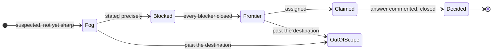

# devbook-skills

```meta
related: [".devbook/arc42/building-blocks/README.md", ".devbook/arc42/adr/plugin-boundaries.md", ".devbook/arc42/building-blocks/devbook.md#dependencies", ".devbook/arc42/building-blocks/delivery.md#dependencies", ".devbook/arc42/building-blocks/delivery-schedule.md#dependencies"]
c4: ["marketplace.devbook-skills"]
code: ["plugins/devbook-skills"]
```

This block makes sure output reads well, and that a large effort is planned before it is
built. It holds reusable guidance that any plugin can name and none has to depend on, and one
planning procedure a person runs by hand.

**Owns** five skills:

- `show-me` puts a picture before the prose whenever the content has a shape. It holds the catalog of picture kinds, the content each one fits, and the rule that prose afterwards says only what the picture cannot.
- `research-brief` answers a question about something outside the repository from primary sources, every claim cited. It holds the shape of a brief and what counts as a primary source.
- `pr-body` writes a pull request description that says whether the merge can be walked back. It holds the three sections and what makes a door one-way.
- `retro` reads one session or run back and ranks what would make the next one get further. It holds the lenses it reads through.
- `wayfinder` charts an effort too big for one session as a map of decision tickets on the repository's issue tracker and resolves them one per session. It holds the shapes of a map and its tickets.

Where the output goes lies outside the block:

| Concern | Owner |
| --- | --- |
| A chapter's sections | Its folder rule |
| A pull request's structure | The repository's template |
| A flow's report | The engine's reporting contract |
| Where a brief lands | Its caller |

The block owns no state in the repository, installs nothing into one, and stamps nothing. The
only thing it writes anywhere is a wayfinder map and its tickets, which live on the tracker.

## Interfaces

```meta
```

A caller reaches a skill by naming it, as [Inbound](#inbound) lists, and no caller names `wayfinder`.

| Interface | Kind | Reached by |
| --- | --- | --- |
| `show-me` | skill | A person who asks to be shown |
| `emit-session-context.mjs` | SessionStart hook, declared for both hosts | The host at session start, where `.devbook/config.json` exists or `enabledPlugins` names the plugin |
| `research-brief` | skill | A person who asks for research |
| `pr-body` | skill | A person writing a pull request |
| `retro` | skill | A person after a session or run |
| `wayfinder` | skill | A person alone, by `/wayfinder`; the host never invokes it on its own |

### show-me

```meta
related: [".devbook/arc42/adr/plugin-boundaries.md"]
```

- **Does:** Picks the picture from what the content describes, puts it first, and keeps the prose after it to the reasons, the exceptions, and the limits.
- **Writes:** Markdown that renders on both hosts and on GitHub, so its pictures are Mermaid, fenced code, and tables.
- **Never:** An HTML mockup.
- **Why:** Neither a chapter nor a pull request can carry one.
- **Holds:** The orientation card, five aligned lines that open a handback, a decision, or a finished change.
- **Why:** A person switching between sessions sees the change, its stage, and what it needs from them.
- **Loaded by:** The hook, which puts the skill's rule into every session.
- **Why:** An ordinary reply has no caller to name it.

A live reply to a person is extremely concise, and fragments are fine, because the person can
ask a follow-up. Whatever is read later or decides something keeps full sentences: a
confirmation, a question the person must answer, a chapter, a pull request description, and a
tracker comment.

### research-brief

```meta
related: [".devbook/arc42/adr/plugin-boundaries.md"]
```

- **Does:** Answers one question from the sources that own each fact (official documentation, source code, a specification, a first-party API), never from a write-up of them.
- **Returns:** A question, a short answer, one cited claim per row with a confidence of `confirmed`, `inferred`, or `unverified`, and what the sources leave open.
- **Writes:** Nothing.
- **Why:** The caller decides where the brief lands.
- **Adapted from:** The `research` skill in `mattpocock/skills`, which writes its findings to a file itself.

### pr-body

```meta
related: [".devbook/arc42/adr/plugin-boundaries.md", ".devbook/arc42/building-blocks/delivery-schedule-entry-points.md#schedule-merge-review"]
```

- **Does:** Writes three sections.
  - **Summary** is one view of the change, picked per `show-me`.
  - **Evidence** is a before and an after from the same check, tiered: a screenshot is S, a test run or console output A, a green build or check B. It states the depth validation reached, and startup-only says nothing was exercised.
  - **Merge Danger** declares the door and the blast radius.
- **One-way door:** In a repository with devbook, a change that ships a migration, renames a `.devbook/config.json` key or a stamp field, deletes data, or touches an `accepted` chapter. It links the decision record it rests on.
- **Keeps:** The structure of a repository's pull request template and a caller's ordered body. The skill fills the sections that match.
- **Adapted from:** The `pr` skill in `mattpocock/skills`, which copies `show-me`'s catalog in where this one names the skill.

### retro

```meta
related: [".devbook/arc42/adr/plugin-boundaries.md", ".devbook/arc42/building-blocks/delivery-schedule-entry-points.md#schedule-weekly-retro", ".devbook/arc42/building-blocks/delivery-phases.md#phase-summary"]
```

- **Does:** Reads one session (the current one unless another is named) or one delivery run the surface recorded, with the person present, and ranks the changes to the agent's environment that would have saved the most turns or tokens.
- **Ten lenses:** Navigation, rediscovery, automated checks, coding standards, baseline size, unused context, no-ops, tool economy, information access, and model and effort.
- **Answers:** A mechanical violation with a check in the repository's own linter, hook, or CI, never a written rule. A written rule is kept for a judgement call and goes to review rather than implementation.
- **Writes:** Nothing. It presents the candidates, so each accepted one is a change through the flow that owns the file.
- **Only holder of:** The lenses. `schedule-weekly-retro` reads a week of sessions through the same set and lands its edits as a draft pull request.
- **Adapted from:** The `retro` skill in `mattpocock/skills`, merged with the three lenses the weekly retro carried before.

### wayfinder

```meta
related: [".devbook/arc42/adr/plugin-boundaries.md", ".devbook/arc42/building-blocks/delivery-schedule-entry-points.md#schedule-issue-sweep"]
```



- **Does:** Plans an effort that no single session can hold, in two modes.
  - **Charting** names the destination, grills breadth-first for the open decisions, and creates one `wayfinder:map` issue. The issue has a child per decision ticket that can already be stated precisely, wired by the tracker's native blocking.
  - **Working** takes one frontier ticket (open, unblocked, unclaimed), claims it by assignment, resolves it, closes it with the answer as a comment, and folds what the answer revealed back into the map.
- **Limit:** A session resolves one ticket. Research tickets are the exception, run in the background.
- **Never:** A slice of the build. A ticket resolves a decision, and the map is done when nothing is left to decide. The pull to just do the work marks its edge, unless the map's Notes carry execution into it.
- **Ticket types:** Four, each naming how it resolves.
  - `research`: through `research-brief`, whose brief is the resolution comment.
  - `prototype`: through the repository's `prototype` skill when it has one.
  - `grilling`: through a `grilling` skill, or one question at a time inline when there is none.
  - `task`: by doing the work that unblocks a decision.
- **Tracker:** The repository's own, reached through the host's issue CLI.
- **Shapes:** The map's and a ticket's live in `map.md` beside the skill.
- **Adapted from:** The `wayfinder` skill in `mattpocock/skills`, which reads its tracker operations from a setup skill of its own and resolves grilling through two named skills with no fallback.

## Structure

```meta
```

Five parts, two of which lean on another:


`show-me`'s catalog pairs each kind of content with the picture that shows it.

| The content describes | Picture |
| --- | --- |
| Steps in order, or a request passing between parts | Mermaid `sequenceDiagram` or `flowchart` |
| Something that moves through states | Mermaid `stateDiagram-v2` |
| Parts and how they connect | Mermaid `flowchart` or `classDiagram` |
| Files or folders and what each is for | A shallow tree with one label per entry |
| The shape of a type, an interface, or a function | Its signature, as fenced code |
| What changed in an existing structure | A fenced `diff` |
| How control passes through functions | An indented call stack |
| An algorithm | Short pseudocode |
| Options or items compared on the same points | A table |

The other four parts:

- `research-brief`'s brief: question, answer, one cited claim per row with its confidence, and what stays unanswered.
- `pr-body`'s description: Summary, Evidence, Merge Danger.
- `retro`'s ten lenses, each pairing what to look for with the change it calls for.
- `wayfinder`'s map (Destination, Notes, Decisions so far, Not yet specified, Out of scope) and its ticket, a question under one of four type labels.

| Invariant | Enforced at | Evidence |
| --- | --- | --- |
| The picture comes before the prose, and the prose never narrates it part by part | `show-me` | untested |
| A diagram stays at about nine nodes, and a larger one is split | `show-me` | untested |
| Every picture renders as plain Markdown on both hosts and on GitHub | `show-me` | untested |
| A live reply may use fragments; a confirmation, a question to the person, a chapter, a pull request description, and a tracker comment keep full sentences | `show-me` | untested |
| Every claim in a brief cites a primary source, and a claim without one is not written | `research-brief` | untested |
| A brief writes nothing to the repository | `research-brief` | untested |
| A one-way door links the decision record it rests on, or says there is none | `pr-body` | untested |
| Evidence never claims a validation depth that was not reached | `pr-body` | untested |
| A mechanical violation is answered with a check, never a written rule | `retro` | untested |
| A retro writes nothing; every candidate names its evidence, and a lens with none gets no candidate | `retro` | untested |
| A session resolves at most one wayfinder ticket, research tickets excepted, and claims it before any work | `wayfinder` | untested |
| A decision lives in its ticket alone; the map gists it and links | `wayfinder` | untested |
| On a ticket with the person, the agent never answers the person's side | `wayfinder` | untested |

## Dependencies

```meta
related: [".devbook/arc42/08-crosscutting-concepts.md#layer", ".devbook/arc42/adr/plugin-boundaries.md"]
```


This L0 foundation declares nothing and nothing declares it. Callers name the skill alone, and
each keeps its own short rule for when the skill is absent.

The view also draws the couplings between the three callers, and the pull requests delivery and
delivery-schedule open on GitHub. Those belong to [delivery](delivery.md#dependencies) and
[delivery-schedule](delivery-schedule.md#dependencies). Only the arrow from devbook-skills to
GitHub is this block's: `wayfinder` writing its map. Which phase or contract names which skill
is in the Inbound tables below.

### Outbound

```meta
```

| Depends on | Pattern | Mechanism | Contract | Why |
| --- | --- | --- | --- | --- |
| [The plugin kernel](../08-crosscutting-concepts.md) | Shared Kernel | Plugin folder and two manifests | [Chapter 8](../08-crosscutting-concepts.md) | It is packaged like every other plugin here. |
| Claude Code and Copilot Plugin APIs | Conformist | Manifests, skills, and one session-start hook | Each host's own schemas | Enabling the plugin is the whole adoption. |
| The repository's issue tracker | Conformist | The host's issue CLI (`gh` on GitHub), with native sub-issues and blocking | The tracker's own API | `wayfinder` keeps its map there. A tracker without native blocking takes a body line instead. |

### Inbound

```meta
```

| Consumer | Pattern | Mechanism | Contract | What it relies on |
| --- | --- | --- | --- | --- |
| [devbook](devbook.md#dependencies) | Separate Ways | `devbook-writing.md` names `show-me` for every chapter except `domain.md` and its splits | The skill name | Nothing else. Without the skill, the rule's own table of diagram kinds applies. |
| [delivery](delivery.md#dependencies) | Separate Ways | Names the skills below | The skill name | Nothing else |
| [delivery-schedule](delivery-schedule.md#dependencies) | Separate Ways | Names the skills below | The skill name | Nothing else |
| [devbook-config](devbook-config.md#dependencies) | Conformist, read-only | Reports whether the plugin is installed and enabled | The marketplace entry and manifests | Nothing: there is no stamp to read and no install to invoke. |

| Caller | Skill | Named at | Without it |
| --- | --- | --- | --- |
| delivery | `pr-body` | The Create Pull Request phase | The description follows `show-me` or plain prose. |
| delivery | `show-me` | Beneath `pr-body`; the report-back to the person; its orientation card opens Personal Validation, a gate, and the Summary | The engine reports in prose as before. |
| delivery | `research-brief` | The Scope phase, and the Drafting phase for `arc42/` and `tech/` | It cites each external fact's primary source itself or leaves the fact open. |
| delivery | `retro` | The Summary, after two or more revise rounds at Personal Validation | It offers nothing. |
| delivery-schedule | `pr-body` | `draft-pr-contract.md`, for a sweep's draft pull request body; `schedule-merge-review` reads the door it declares | The contract's body still states the door, and the review judges a one-way diff from the diff itself. |
| delivery-schedule | `retro` | `schedule-weekly-retro`, for its lenses | It reads through its own three lenses. |

The issue sweep leaves every `wayfinder:*` issue to its map by label, naming no skill.
