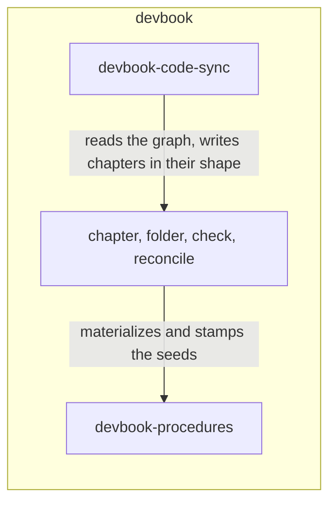
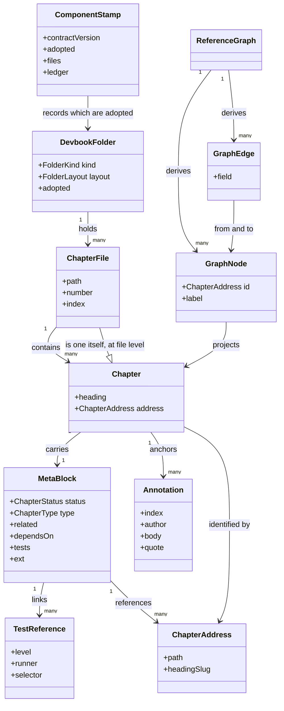
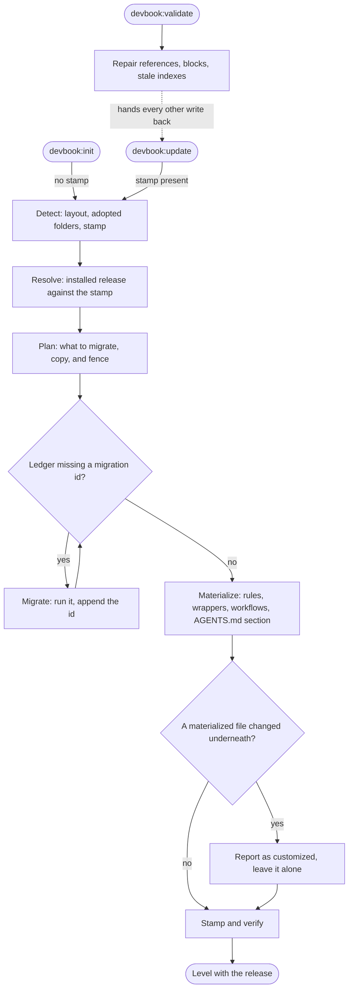
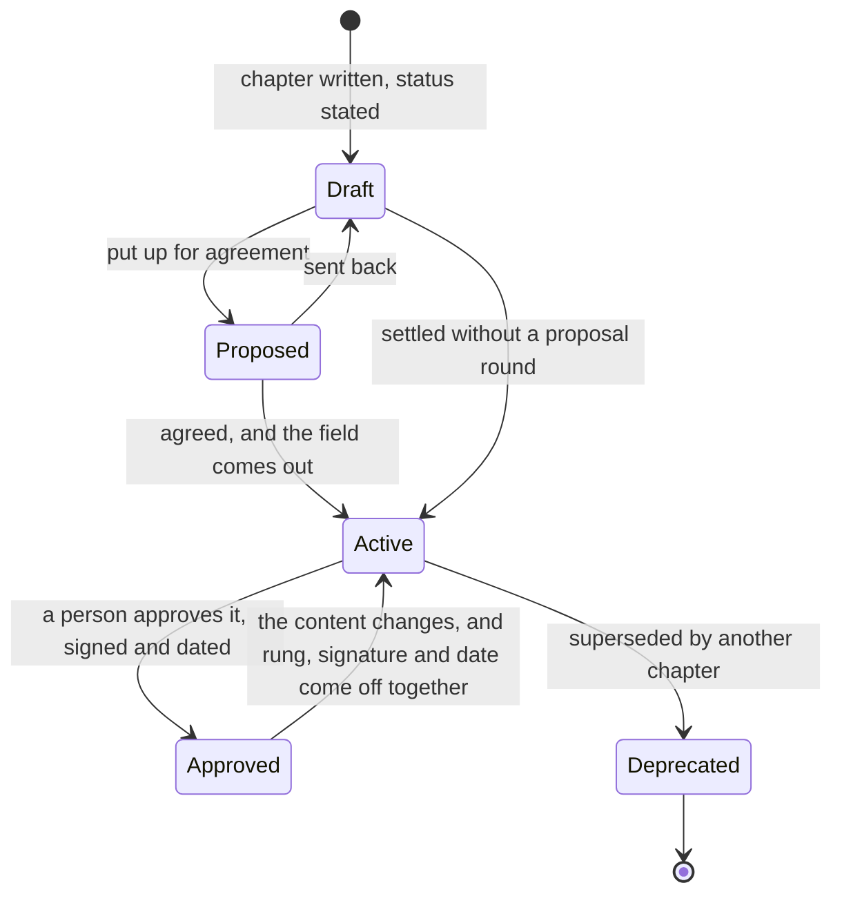

# devbook

```meta
related: [".devbook/arc42/building-blocks/README.md", ".devbook/arc42/building-blocks/devbook-code-sync.md", ".devbook/arc42/building-blocks/devbook-procedures.md", ".devbook/arc42/adr/plugin-boundaries.md", ".devbook/arc42/adr/chapter-schema.md", ".devbook/arc42/tdr/4-delivery-depends-on-devbook.md", ".devbook/arc42/12-glossary.md#adoption", ".devbook/arc42/12-glossary.md#reconcile", ".devbook/arc42/12-glossary.md#drift-verdict"]
```

The convention itself. Responsible for three things: that a chapter can be addressed, that
the reference pointing at it still resolves, and that a repository can adopt the convention,
upgrade it, and be told when the two have drifted apart.

Inside the block: the `meta` block and its field set, the address a chapter is reached by, the
annotation fence, the reconcile that materializes the convention into a repository, the
change folder and the merge of its deltas, the two directions between a chapter and the
code that implements it, and the five procedures every repository has and no plugin can
write — `run`, `capture`, `diagnose`, `estimate`, `prototype` — each with a goal this block
fixes and a body the repository owns. Two of those are blocks of their own one level in,
each with its own file: the two directions between a chapter and its code are
[devbook-code-sync](devbook-code-sync.md), and the five procedures are
[devbook-procedures](devbook-procedures.md). This file is the convention's white box around
them: the chapter, the folder, the check, and the reconcile.



Outside it: what a chapter should *say*. The folder rules describe a shape, not content, and
the procedure for changing a chapter belongs to [delivery](delivery.md). Who reviews a chapter
and who approved it belongs to [devbook-collaboration](devbook-collaboration.md). The
committed `_meta/` index is [devbook-derived](devbook-derived.md)'s: this block's checker
takes a `--write` flag and nothing in this block passes it.

## Interfaces

```meta
related: [".devbook/arc42/building-blocks/devbook-derived.md#interfaces", ".devbook/arc42/08-crosscutting-concepts.md#plugin-rule"]
```

Twelve skills — six that own the convention in a repository, three that cross the boundary
between a chapter and the code implementing it, each over seven chapter kinds and the demo a page carries, and three that
carry a scenario page from its text to its run — plus the rules
`init` delivers, the tools it materializes, one workflow, one hook, one contract that other
plugins follow, and the one file a repository may author to change what the check accepts. None of the
skills is a flow: this block ships the shape and the check, and the procedure for carrying a
change belongs to the engine.

| Interface | Kind | Reached by |
| --- | --- | --- |
| `init` | skill | A person, or `devbook-config:init` during a fan-out |
| `update` | skill | A person, or `devbook-config:update` during a fan-out |
| `validate` | skill | A person, or the daily `devbook-validate` schedule through `delivery-schedule`'s own wrapper |
| `tech-update` | skill | A person, or the weekly `tech-update` schedule through `delivery-schedule`'s own wrapper |
| `prose-check` | skill | A person, or a `delivery-schedule` catalog entry naming it as a target |
| `annotation-sweep` | skill | A person, on one chapter |
| `scenario-write`, `scenario-derive`, `scenario-run` | skills | A person, where `domain/` is adopted: `scenario-write` from a chapter that needs a journey, `scenario-derive` when the coverage check names it, `scenario-run` to prove a page; and delivery's [phases](delivery-phases.md#phase-implement), `scenario-derive` from `implement` and `scenario-run` from `verify`, for the pages a run's scope lists; described under [Scenario Tools](#scenario-tools) |
| `capture-specs`, `apply-change`, `verify-change` | skills | A person, one skill per run over a chapter, a sync unit, or a sync group, routed there by the session-start hook when a task crosses between a chapter and its code; `verify-change` also by the weekly `devbook-verify` schedule through `delivery-schedule`'s own wrapper |
| `devbook-chapter-metadata.md`, `devbook-annotations.md`, `devbook-naming.md`, `devbook-writing.md`, and one rule per folder | rules | Either host, on opening a matching chapter, through the wrapper `init` writes; a folder's own rule lands only where the folder is adopted |
| `build.mjs` | checker CLI | `validate`, CI on every pull request through `devbook-meta.yml`, and `devbook-derived` with the `--write` flag |
| `delta.mjs` | delta merge, CLI and in-process | A person with `--check` or `--apply`, a bridge's archive, and the graph build through `checkDelta` for every indexed delta |
| `demo.mjs` | demo rules, in-process | The graph build through `demoProblems`, and `delta.mjs` through `demoFileIssues` for every demo a change carries |
| `scenario.mjs` | scenario page rules, in-process | The graph build through `scenarioProblems`: the stem register, the setup fields resolved against chapters and `.devbook/scenarios/profiles.json`, `scenario:` images, `Proved by:` pointers and the `e2e` entries they derive, and the parts no requirement claims |
| `units.mjs` | unit lister, CLI and in-process | A person checking what a direction covers before setting one; the sync sweeps, which select their groups from `--groups --json` |
| `annotations.mjs` | fence writer, CLI and in-process | `annotation-sweep` and every `devbook-collaboration` skill |
| `dotnet-packages.mjs`, `frontend-packages.mjs` | inventory scripts | `tech-update`, where `tech/` is adopted |
| `scenarios/check.mjs` | coverage check CLI | A person or CI, where `domain/` is adopted: every scenario page against the spec that implements it |
| `scenarios/signature.mjs` | signature CLI and in-process | `scenario-derive`, for the `// signature:` line a spec opens with; the coverage check and the reporter in-process |
| `scenarios/setup.ts`, `scenarios/report.mjs` | scenario runner and Playwright reporter | A repository's derived specs import the runner and its `shot` helper; its Playwright config names the reporter, which writes `run.json` and the screenshots |
| `scenarios/playwright.mjs`, `scenarios/package.json` | Playwright loader and module scope | The runner and `shot` helper, which take `@playwright/test` from the suite that runs them and load as ES modules, so a suite that is its own npm package needs no mapping |
| `scenarios/scenario-page.vector.json` | shared test vector | spec-manager and Backlog, which recompute a page's signature and must agree with it |
| `emit-session-context.mjs` | SessionStart hook, declared for both hosts | The host, at session start |
| `resources/demo-address.md` | contract, `devbook.demo.address@1` | The demo template's script, spec-manager, and Backlog, which address a demo and talk to it through it and never extend it |
| `run`, `capture`, `diagnose`, `estimate`, `prototype` | seeds under `assets/procedures/skills/`, each with a `goal` | Materialized by `init` and `update` into `.agents/skills/<name>.md` with a wrapper per host — `run` as a `.claude/skills/run-<name>/SKILL.md` recipe with a Copilot twin; then any session, either host, by name |
| `assets/procedures/demo-template.html` | the starting demo template | `prototype`, through the repository's copy at `.devbook/design/demo-template.html`; the sample beside it, by spec-manager and Backlog as a test fixture |
| `.devbook/statuses.json` | repository file, optional | The check and the canvas lint, reading the repository's own `status` ladder; a viewer's status picker reads the same file |

The three converter skills and `units.mjs` are described in
[devbook-code-sync](devbook-code-sync.md#interfaces), and the seeds and the demo template in
[devbook-procedures](devbook-procedures.md#interfaces). The rest are below.

### init

```meta
related: [".devbook/arc42/building-blocks/devbook.md#reconciler", ".devbook/arc42/building-blocks/devbook.md#reconciling-a-repository"]
```

Bring devbook into a repository that has none: ask which folders and which procedures to
adopt, scaffold each folder, copy the payload, seed each procedure, and write the stamp. It refuses where `components.devbook` already exists —
"already initialized, run update" — because the stamp is what the next run reads, and a second
init would ask again what it already answers.

### update

```meta
related: [".devbook/arc42/building-blocks/devbook.md#reconciler", ".devbook/arc42/building-blocks/devbook.md#reconciling-a-repository"]
```

Bring a stamped repository level with the installed release in one idempotent operation:
detect, resolve, plan, migrate, materialize, stamp and verify. An upgrade, a change in which
folders are adopted, and an outstanding migration are the same run, and the stamp says which.
It refuses where no stamp exists, since with no provenance every file on disk would read as
customized.

It is the only writer of everything it materializes — the rules and their per-host wrappers,
the CI workflow, the tooling, the procedures and their wrappers, and one marker-fenced section
of the repository's agent instructions. A procedure dropped from `procedures.adopted` orphans
its three files, reported and never deleted; a path once written and no longer is moves
through a migration, since hash-matching cannot move a customized body. A materialized file that changed underneath is reported and left, never
overwritten; an edit inside a marker-fenced section makes the next reconcile skip the section,
which is what the markers exist for.

### validate

```meta
related: [".devbook/arc42/building-blocks/devbook.md#reconciler", ".devbook/arc42/building-blocks/devbook.md#index-generator"]
```

Validates the corpus: does every chapter satisfy the schema, does every reference resolve. It
repairs what it can prove in the chapters and hands every other write back. Whether the
installation is current — the stamp, the ledger, the `AGENTS.md` section — is
[devbook-config's `doctor`](devbook-config.md#doctor), the one context that reads every
component's stamp. The daily `devbook-validate` schedule reaches it through
`delivery-schedule`'s own wrapper.

Two writers for one file is how a reconcile stops being idempotent, which is why this skill is
deliberately narrow.

### tech-update

```meta
related: [".devbook/arc42/building-blocks/devbook.md#tech-inventory", ".devbook/arc42/building-blocks/delivery.md#flow-spec"]
```

Refresh a repository's technology graph from the deterministic package inventories, then
analyse the repository for what appears in no package manifest — runtimes, services,
platforms, protocols, tooling — and hand the authoring to the folder's own write path. It runs
the check and never the writer; the weekly `tech-update` schedule reaches it through
`delivery-schedule`'s own wrapper.

### prose-check

```meta
related: [".devbook/arc42/building-blocks/devbook.md#validate", ".devbook/arc42/building-blocks/devbook.md#chapter"]
```

The prose half beside `validate`'s structural half: read every adopted folder and report
the sentence that says nothing a reader needs or names something the tree no longer has — a
stale name after a fold, a term defined twice, a hedge on a fact. It writes nothing. A chapter
is content, so the standard is narrower than an instruction tightening and a record stays as
it was taken: an edit is a person's, through the folder's flow.

### annotation-sweep

```meta
related: [".devbook/arc42/building-blocks/devbook.md#fence-writer", ".devbook/arc42/building-blocks/devbook.md#annotation", ".devbook/arc42/adr/annotations.md"]
```

Delete every resolved annotation fence in one chapter and nothing else — the last step of the
lifecycle, where `resolved` lives only the rest of the branch and gone is the resting state.
Chapter-scoped, so a person sees what is about to go before it does.

## Structure

```meta
related: [".devbook/arc42/building-blocks/devbook-derived.md#structure", ".devbook/arc42/adr/chapter-schema.md", ".devbook/arc42/adr/checks-and-indexes.md"]
```

Three aggregates — the chapter, the folder, and the graph derived from a corpus of them —
seven domain services, and the two value objects the aggregates share. Two of the services, the
Unit Lister and the Spec Converter, are [devbook-code-sync](devbook-code-sync.md#structure)'s,
and the Procedure, its Goal, and the Demo Template are
[devbook-procedures](devbook-procedures.md#structure)'s; the five services left are below. The chapter is the
consistency boundary everything else is expressed in terms of.

### Model

```meta
```

What a devbook folder holds, what a chapter is made of, and what the generator derives from a
corpus of them.



- **A file is a chapter as well as a container.** Its top-level heading carries a block
  describing the document as a whole, which is why `ChapterFile` both holds chapters and is
  one. `number` and `index` exist only at that level, because they place the document in its
  directory and a chapter's position is already its position in the document.
- **A chapter has no stored id.** `ChapterAddress` is derived from the path and the heading,
  so the association from a `MetaBlock` to another chapter is by value. Renaming a heading
  breaks every inbound edge on purpose: the alternative is an id nobody can see in the
  rendered Markdown.
- **The graph is a projection, never a peer.** `GraphNode` and `GraphEdge` are rebuilt from
  the corpus on every run and are equal by value; nothing writes to them, and nothing reads
  them as the source of a fact a chapter already carries.
- **`ext` is a field on the block, not an association.** It produces no edge and is carried
  through unvalidated, which is exactly what makes it usable by a plugin devbook has never
  heard of. Two extensions never collide because each namespaces by its own name — a
  convention this block states and deliberately does not enforce.
- **An annotation belongs to one chapter and has no life outside it.** It is an entity rather
  than a value object because replies accumulate against it, and it disappears rather than
  transitioning when it is resolved.
- **The stamp lives in the consuming repository.** It relates to a folder by adoption and to
  a migration by id presence in the ledger, never by comparing versions. It is
  [the plugin kernel](../08-crosscutting-concepts.md#stamp)'s concept, held here only for the
  keys this block owns.

### Chapter

```meta
```

Also called: section, heading, node.

The consistency boundary of this block, and the unit everything else is expressed in terms
of. A chapter is one heading that carries a `meta` block, together with the block and every
annotation anchored inside it. Its identity is its address — the file path plus the slug of
its heading — which is derived and never stored, so a heading rename is a re-identification
and every reference to the old address stops resolving in the same pass.

A chapter is not a file. One file holds many, and the file itself is a chapter too: the
top-level heading carries a block of its own describing the document as a whole.

| Invariant | Enforced at | Evidence |
| --- | --- | --- |
| A heading is an addressable chapter if and only if it carries a `meta` fence | parse | `unit:node:plugins/devbook/tools/devbook-meta/status-optional.test.mjs`, `unit:node:plugins/devbook/tools/devbook-meta/schema-gate.test.mjs` |
| A `#` line inside a fenced block is content, never a heading, to the parser and to every annotation write alike | parse, write | `unit:node:plugins/devbook/tools/devbook-meta/annotations-write.test.mjs` |
| The fence stays even when the block is empty | parse | untested |
| Every file carries a file-level block under its top-level heading | parse | untested |
| `type` is present wherever the folder defines a value set for the level | parse | `unit:node:plugins/devbook/tools/devbook-meta/schema-gate.test.mjs` |
| A resting `status` is written by omitting the field, never as `active` | parse | `unit:node:plugins/devbook/tools/devbook-meta/status-optional.test.mjs` |
| A block's `status` is held to the first `.devbook/statuses.json` rule matching its file and level, else to the built-in ladder; no rule makes `active` a rung, drops a decision rung, or widens a rating ladder | parse, graph build | `unit:node:plugins/devbook/tools/devbook-meta/statuses.test.mjs` |
| `status: approved` carries both `approved-by` and `approved-at`, and neither outlives it | parse | `unit:node:plugins/devbook/tools/devbook-meta/accepted-rung.test.mjs` |
| An `approved-hash` or `accepted-hash` that does not match the chapter's content is a lapsed decision | parse | `unit:node:plugins/devbook/tools/devbook-meta/content-hash.test.mjs`, `unit:node:plugins/devbook/tools/devbook-meta/accepted-rung.test.mjs` |
| `status: accepted` stands on a signed approval, and `accepted-at` is on or after `approved-at` | parse | `unit:node:plugins/devbook/tools/devbook-meta/accepted-rung.test.mjs` |
| Neither decision rung, nor any of its six fields, appears outside `domain/` | parse | `unit:node:plugins/devbook/tools/devbook-meta/accepted-rung.test.mjs` |
| A `domain/` file may carry a page the convention does not name, typed by its own filename | parse | `unit:node:plugins/devbook/tools/devbook-meta/additional-page.test.mjs` |
| A scenario page is a `domain/` file typed `scenario`, inside a bounded context at any depth; the type in another folder or on a chapter is an error, and its `##` parts owe no block and stay addressable | parse | `unit:node:plugins/devbook/tools/devbook-meta/scenario-page.test.mjs`, `unit:node:plugins/devbook/tools/devbook-meta/structural-sections.test.mjs` |
| A scenario page's `status` is absent, `draft`, or `proposed`; it carries no `tests`; its steps open with a bold Given, When, Then, or And; its stem is unique across the corpus | parse, graph build | `unit:node:plugins/devbook/tools/devbook-meta/scenario-page.test.mjs`, `unit:node:plugins/devbook/tools/devbook-meta/status-optional.test.mjs` |
| `start`, `actor`, `data`, `profile`, `flags`, and `settings` sit on a scenario page's file-level block alone; `actor`, `flags`, and `settings` resolve to an actor, a `feature-flag`, and a `setting` chapter, and `profile` and every portal named resolve in `.devbook/scenarios/profiles.json` when it exists | parse, graph build | `unit:node:plugins/devbook/tools/devbook-meta/scenario-page.test.mjs`, `unit:node:plugins/devbook/tools/devbook-meta/field-scope.test.mjs` |
| A `#### Scenario:` holding `Proved by: <page>.md#<part>` holds nothing else and names a part of a scenario page, whose spec derives the requirement's `e2e` entry; a part no case names is reported as an unclaimed journey | parse, graph build | `unit:node:plugins/devbook/tools/devbook-meta/scenario-page.test.mjs` |
| A `scenario:<stem>#<label>` image names an existing scenario page, and neither it nor a `shot:` image counts as a diagram | parse, graph build | `unit:node:plugins/devbook/tools/devbook-meta/scenario-page.test.mjs` |
| A chapter's kind lives in `type` and never in the heading text | parse | untested |
| Every `related` and `depends-on` entry resolves to an existing chapter or file | graph build | untested |
| Every `tests` entry parses as `<level>:<runner>:<selector>` | parse | `unit:node:plugins/devbook/tools/devbook-meta/tests-field.test.mjs` |
| An `ext.*` key is carried through untouched, unvalidated, and produces no edge | graph build | untested |
| An annotation's ordinal counts within its own heading and never reaches a subchapter's notes | parse, write | `unit:node:plugins/devbook/tools/devbook-meta/annotations-write.test.mjs` |
| A folder-specific field describes a chapter, so the file-level block carries none of them | parse | `unit:node:plugins/devbook/tools/devbook-meta/field-scope.test.mjs` |
| `domain/`'s `depends-on`, `feature-flag`, and `setting` sit on a `feature` or `sub-feature`; `key`, `default`, and `scope` sit on the switch chapters they describe; `deployment` sits on a `bounded-context` chapter or a `context.md` file-level block and is `service` or `module`; `aliases` sits on any chapter, and on a `requirement` or `invariant` holds the codes the rule is cited by | parse | `unit:node:plugins/devbook/tools/devbook-meta/field-scope.test.mjs` |
| A context's `deployment` is stated alike on its `bounded-context` chapter and on the `context.md` that chapter's `related` names, or on neither | build | `unit:node:plugins/devbook/tools/devbook-meta/deployment-pairing.test.mjs` |
| An `approved` chapter never carries an open `kind: question` fence — the open question outranks the rung | parse | `unit:node:plugins/devbook/tools/devbook-meta/field-scope.test.mjs` |
| `ai/`'s `stage` is a chapter's own, from the DevOps loop's eight words; a file-level `stage` is an error and a usage without one is reported | parse | `unit:node:plugins/devbook/tools/devbook-meta/ai-loop.test.mjs`, `unit:node:plugins/devbook/tools/devbook-meta/field-scope.test.mjs` |
| An `ai/` usage names the technology it rests on in `depends-on`; a `related` entry into `tech/` is reported | parse | `unit:node:plugins/devbook/tools/devbook-meta/ai-loop.test.mjs` |

Two enums are the chapter's own. **Chapter Status** is where the content stands: each folder
defines its own ladder — `domain/` uses `draft`, `proposed`, `active`, `deprecated` — and on
`domain/`'s alone sit two decision rungs: `approved`, the chapter is right, and `accepted`
above it, the built work satisfies it. The second stands on the first and keeps its record.
The other four folders have neither: what those rungs decide is asked of the model. Each ladder is a default a repository may replace
with its own transitional rungs, never touching the resting value, the decision rungs, or a
rating. Three folders have a resting value written
by omitting the field; two make the field mandatory because there the value is a rating, and
unrated is not the same as the lowest rung. **Chapter Type** is what kind of thing the chapter
is: the classification that is never written into the heading. Three folders define a value
set that classifies every chapter, at chapter level and at file level separately; `arc42/`
deliberately defines none, because its only kind distinction is already carried by heading
level. `design/` defines one value, `requirement`, and types nothing else: a rule a component
keeps or breaks is a `### Requirement:` under the component's chapter, so a tool that reads
OpenSpec reads it, and everything else there is a guideline heading level already describes.

### Meta Block

```meta
```

Also called: meta fence, metadata block.

The fenced `meta` (YAML) block under a heading: flat keys, no nesting, and equal by value. It
is what turns a heading into a node, so deleting it as noise silently drops the chapter out of
the graph and out of every reference pointing at it.

The field set is closed except for one seam. `status`, `type`, `related`, `issue`, `effort`,
`roadmap`, `date`, `tests`, `number`, and `index` are devbook's, with the six decision fields
— `approved-by`, `approved-at`, `approved-hash`, `accepted-by`, `accepted-at`,
`accepted-hash` — scoped to `domain/` beside the rungs that write them, and `sync`, the
sync direction, on `domain/`, `arc42/`, and `design/` blocks at the four levels the chapter
schema decision names; each with a documented meaning per folder; `ext.<plugin>.<key>` belongs to whoever namespaced
it. Empty collections and nulls are omitted rather than written out, so absence has exactly
one spelling. No field records a review in progress: that is `status` plus the chapter's open
annotation fences, and the `review`, `reviewer`, and `review-at` fields contract 21 removed
are reported by name.

| Invariant | Enforced at | Evidence |
| --- | --- | --- |
| A heading without a `meta` block is not a node, so deleting one drops the chapter out of the graph and out of every reference to it | `build.mjs` | `unit:node:plugins/devbook/tools/devbook-meta/schema-gate.test.mjs` |
| Flat keys, no nesting, and equal by value | schema validator | `unit:node:plugins/devbook/tools/devbook-meta/schema-gate.test.mjs` |
| The field set is closed except for `ext.<plugin>.<key>` | schema validator | `unit:node:plugins/devbook/tools/devbook-meta/field-scope.test.mjs` |
| The six decision fields are scoped to `domain/` | schema validator | `unit:node:plugins/devbook/tools/devbook-meta/field-scope.test.mjs` |
| Empty collections and nulls are omitted, so absence has exactly one spelling | schema validator | `unit:node:plugins/devbook/tools/devbook-meta/schema-gate.test.mjs` |
| `sync` is one of five directions, set only on a sync level and never on a chapter a unit owns; a value no unit inherits is warned | schema validator, `build.mjs` | `unit:node:plugins/devbook/tools/devbook-meta/sync-field.test.mjs` |

### Annotation

```meta
related: [".devbook/arc42/adr/annotations.md"]
```

Also called: note, comment, thread.

A review note living in the chapter, in a second fenced block, beside the passage it is about.
It has identity within its chapter — an index, an author, a body, and replies — and it
inherits position as its anchor, git as its sync, the pull request as its review, and
`git blame` as its authorship record.

Its address is scoped to its own heading, not to the chapter's line range: the index counts
only the notes under that heading, so a note under a subheading belongs to the subchapter and
a parent's index never reaches it. Every operation that reads or writes a note counts the same
way, because an index that means one thing to a reader and another to a writer resolves to
the wrong note.

An annotation is an open loop rather than a record: resolving one means deleting it. It is
never chapter content, so a reader loading a chapter as task context skips every fence, and a
chapter carrying an open question is not agreed whatever its `status` says.

| Invariant | Enforced at | Evidence |
| --- | --- | --- |
| A note's index is scoped to its own heading, so a parent's index never reaches a subchapter's note | `annotations.mjs` | `unit:node:plugins/devbook/tools/devbook-meta/annotations.test.mjs` |
| Every operation that reads or writes a note counts the same way | `annotations.mjs` | `unit:node:plugins/devbook/tools/devbook-meta/annotations.test.mjs` |
| Resolving a note deletes it: an annotation is an open loop, never a record | `annotations.mjs` | `unit:node:plugins/devbook/tools/devbook-meta/annotations-write.test.mjs` |
| A fence is never chapter content, so a reader loading a chapter as task context skips every one | convention | untested |
| A chapter carrying an open question is not agreed whatever its `status` says | devbook's check | `unit:node:plugins/devbook/tools/devbook-meta/field-scope.test.mjs` |

### Devbook Folder

```meta
related: [".devbook/arc42/08-crosscutting-concepts.md#devbook-folder", ".devbook/arc42/adr/chapter-schema.md", ".devbook/arc42/12-glossary.md#adoption"]
```

One of the five folders the convention governs, and the unit of adoption: a repository takes
a subset, and the tooling emits scopes for the folders that actually exist. The folder lives
at `.devbook/<kind>/`, owns its own derived `_meta/`, written beside its chapters, and the
reading order of the files inside it comes from each folder's convention rather than from a
stored field.

| Invariant | Enforced at | Evidence |
| --- | --- | --- |
| Every folder lives under `.devbook/` and drops its leading dot there — `.devbook/.domain` resolves to nothing | layout detection | `unit:node:plugins/devbook/tools/devbook-meta/layout.test.mjs` |
| An address is the chapter's real repository path | graph build | `unit:node:plugins/devbook/tools/devbook-meta/layout.test.mjs` |
| A root-level dot-folder is reported as an error naming the move, and never indexed | layout detection | `unit:node:plugins/devbook/tools/devbook-meta/layout.test.mjs` |
| A folder's convention orders its files — root first, pinned first and last around the rest | outline build | `unit:node:plugins/devbook/tools/devbook-meta/layout.test.mjs` |
| A split file — `domain.order.md`, one chapter out of `domain.md` — reads directly after the file it is named after, or in its slot when that file is gone | outline build | `unit:node:plugins/devbook/tools/devbook-meta/layout.test.mjs` |
| Dropping a folder from `adopted` orphans its materialized files rather than deleting them | reconcile | untested |

**Folder Layout** is one `.devbook/` parent, five subfolders without their dots, the
repository rollup in `.devbook/_meta/`, the tooling in `.devbook/_tools/`, and the stack
config beside them. The layout is a constant rather than a detected value since
[the chapter schema record](../adr/chapter-schema.md); what is detected is which of the five
exist. **Folder Kind** is `arc42`, `domain`, `tech`, `design`, `ai`, and `changes`. The kind
decides which rule file governs the folder, which `status` ladder applies, and which `type`
value set is legal — which is why it is a closed set and adding the sixth, `changes`, was
contract 23 rather than a folder.

### Change

```meta
related: [".devbook/arc42/12-glossary.md#change", ".devbook/arc42/12-glossary.md#delta", ".devbook/arc42/12-glossary.md#proposal", ".devbook/arc42/building-blocks/devbook-openspec.md#constraints"]
```

A proposed change to the devbook, in `openspec/changes/<name>/`: the one folder kind outside
`.devbook/`, because OpenSpec's CLI resolves `changes/` only under `openspec/`. Its
`proposal.md` and every delta under `devbook-delta/` are chapters the check indexes into the
rollup; `solution.md` and `tasks.md` are the change's own and never indexed, and `archive/` is
history and never read. `delta.mjs --apply` is the only way a change lands, and only once
both gates have passed on `proposal.md`: the change is decided as one, so `approved` and
`accepted` are recorded once there, with a hash over the proposal and every delta, and never
on the chapters it lands in — their `change` points at the archived proposal. Chapter rungs
stay for work outside the lane; a merge lifts one whose content it changes. An agreed change
is pending truth to `verify-change` and `apply-change`, per `code-sync-protocol.md`.
`--no-move` merges and leaves the folder for a caller whose own tool moves it —
[devbook-openspec](devbook-openspec.md#landing-a-change) lets `openspec archive` do it.

A scenario page changes through a delta like any `domain/` file: a new page is `delta: added`
with its parts as `ADDED` entries, and a part of an existing one is replaced whole. The rules
no single file can check — a stem unique across contexts, setup fields that resolve, a
`Proved by:` that names a part — would otherwise surface only at archive, after both gates.
So once every delta merges, `--check` lays the whole change over the corpus in memory, runs
`scenario.mjs`'s pass over the result, and reports each problem the change introduces against
the delta that causes it: a pointer may name a page the same change adds, and a problem the
corpus already had is not the change's.

| Invariant | Enforced at | Evidence |
| --- | --- | --- |
| `archive/` is never indexed and never a folder kind | layout detection | `unit:node:plugins/devbook/tools/devbook-meta/change-folder.test.mjs` |
| A delta's target is its path under `devbook-delta/`, re-rooted at `.devbook/` | parse | `unit:node:plugins/devbook/tools/devbook-meta/change-folder.test.mjs` |
| A delta opens with `change`, naming its own folder, and `delta`, and carries no other field | parse | `unit:node:plugins/devbook/tools/devbook-meta/change-folder.test.mjs` |
| Every chapter and section a delta names resolves in its target, or the merge writes nothing | `delta.mjs` | `unit:node:plugins/devbook/tools/devbook-meta/change-folder.test.mjs` |
| A merge that would leave its target with a new error is refused | `delta.mjs` | `unit:node:plugins/devbook/tools/devbook-meta/change-folder.test.mjs` |
| Every chapter block a merge touched carries `change`, and no other | `delta.mjs` | `unit:node:plugins/devbook/tools/devbook-meta/change-folder.test.mjs` |
| `--no-move` merges every delta and leaves the folder open, writing nothing under `archive/` | `delta.mjs` | `unit:node:plugins/devbook/tools/devbook-meta/change-folder.test.mjs` |
| A proposal is `type: change` at `proposed`, `approved`, or `accepted`, with one `category` | parse | `unit:node:plugins/devbook/tools/devbook-meta/change-folder.test.mjs` |
| A proposal's hash covers the proposal and every delta, and an open question anywhere in the change stands against its rung | graph build | `unit:node:plugins/devbook/tools/devbook-meta/change-folder.test.mjs` |
| `--apply` merges only an `accepted` change, signed, over its current hash | `delta.mjs` | `unit:node:plugins/devbook/tools/devbook-meta/change-folder.test.mjs` |
| A merge writes no rung onto a chapter and lifts one whose content it changed | `delta.mjs` | `unit:node:plugins/devbook/tools/devbook-meta/change-folder.test.mjs` |
| `--check` resolves a `Proved by:`, a stem, and a scenario page's setup fields over the corpus with every delta of the change merged, and reports each new problem against the delta that causes it | `delta.mjs` | `unit:node:plugins/devbook/tools/devbook-meta/change-scenarios.test.mjs` |
| `capture-specs` never plans over a chapter a change is open against | `code-sync-protocol.md` | untested |

### Demo

```meta
related: [".devbook/arc42/adr/demos.md", ".devbook/arc42/12-glossary.md#demo", ".devbook/arc42/building-blocks/devbook.md#change", ".devbook/arc42/building-blocks/devbook-procedures.md#goal"]
```

The one non-Markdown file a `domain/` folder holds: a self-contained `*.demo.html` that shows
what a person sees in a bounded context. It belongs to the Devbook Folder aggregate and is no
chapter, so it carries no `meta` block. `demo.html` belongs to the context and counts with
`context.md`, `<page>.demo.html` belongs to `<page>.md`, and any other `*.demo.html` belongs to
the chapters whose `demo` field names it. Links run from Markdown to the demo only. The file
records its question and nothing about its lifecycle: under `domain/` it is the demo, under a
change's `devbook-delta/` it is a proposed demo, and anywhere else it is a prototype. Every
demo is built on the repository's template at `.devbook/design/demo-template.html`, whose
starting copy and a sample demo built on it ship with this block, under
[Demo Template](devbook-procedures.md#demo-template). The
[demos record](../adr/demos.md) holds the reasons.

A `demo` field and a note point into a demo by an address, and a frame that hosts a demo
talks to it through four `postMessage` messages. Both are `resources/demo-address.md`,
versioned as `devbook.demo.address@1`, which this block owns and the demo template,
spec-manager, and Backlog follow. A demo opened with no parent frame ignores the messages, and
a host frames it sandboxed without same-origin.

The folder rules state it: `devbook-domain.md` the naming, the pairing, one variant at real
density, and the HTML contract; `devbook-chapter-metadata.md` the `demo` field and the file's
`demo-meta` script; `devbook-design.md` the template; `devbook-changes.md` the demo delta, one of the two routes a demo has into `domain/`.
`demo.mjs` in the checker enforces the HTML contract and resolves every `demo` address, and
`chapterFingerprint` folds each demo into the fingerprint of the blocks it belongs to.
`delta.mjs --check` runs the same rules over every demo a change carries, and `--apply`
replaces the target whole.

`demo-template.mjs` holds every demo's managed region to the template. The begin marker's hash
certifies the region: text that hashes to its own marker is a release of the template exactly
as it shipped, so no list of past versions is kept. `--check`, which `build.mjs --check` runs,
reports a region on an earlier version than the template's as stale, a warning, and one whose
text matches no version as hand-edited, an error. `--refresh` re-stamps the template's marker,
then rewrites every demo's region from it and nothing else in the file. It is the one write
into a demo that is not `/prototype`'s, and it lifts no approval: the region is the template's,
so `chapterFingerprint` and a change's fingerprint both leave it out of a demo.

| Invariant | Enforced at | Evidence |
| --- | --- | --- |
| A page-named demo exists only beside its page and moves with it on a split | `demo.mjs` | `unit:node:plugins/devbook/tools/devbook-meta/demo.test.mjs` |
| Every `demo` address resolves to a file, a screen or walkthrough, and an anchor | `demo.mjs` | `unit:node:plugins/devbook/tools/devbook-meta/demo.test.mjs` |
| A requirement's walkthrough plays one of its own scenarios | `demo.mjs` | `unit:node:plugins/devbook/tools/devbook-meta/demo.test.mjs` |
| `demo-model` has the shape the template documents, and every walkthrough step resolves as the template resolves it | `demo.mjs` | `unit:node:plugins/devbook/tools/devbook-meta/demo.test.mjs` |
| Every screen and anchor is listed in `demo-model` once, and no script but `demo-model` and `demo-meta` sits outside the managed region | `demo.mjs` | `unit:node:plugins/devbook/tools/devbook-meta/demo.test.mjs` |
| A demo's `demo-meta` holds `question` and nothing else | `demo.mjs` | `unit:node:plugins/devbook/tools/devbook-meta/demo-delta.test.mjs` |
| A demo fetches nothing from the network | `demo.mjs` | `unit:node:plugins/devbook/tools/devbook-meta/demo.test.mjs` |
| A demo under `domain/` carries exactly one variant | `demo.mjs` | `unit:node:plugins/devbook/tools/devbook-meta/demo.test.mjs` |
| A page's fingerprint covers its demos outside the managed region, so editing one lifts a stale approval and a template refresh lifts none | `metadata.mjs` `chapterFingerprint` | `unit:node:plugins/devbook/tools/devbook-meta/demo.test.mjs` |
| A demo over 500 KB is a warning, never an error | `demo.mjs` | `unit:node:plugins/devbook/tools/devbook-meta/demo.test.mjs` |
| A demo's managed region matches a template version, and one on an earlier version than the template's is a warning | `demo-template.mjs` | `unit:node:plugins/devbook/tools/devbook-meta/demo-template.test.mjs` |
| `--refresh` rewrites only the managed region, and leaves a demo's own parts byte for byte | `demo-template.mjs` | `unit:node:plugins/devbook/tools/devbook-meta/demo-template.test.mjs` |
| A demo delta lands by replacing its target whole, and only once its file passes the demo rules | `delta.mjs` | `unit:node:plugins/devbook/tools/devbook-meta/demo-delta.test.mjs` |
| A change's fingerprint covers its demos, so a demo edited after the decision is not merged | `delta.mjs` | `unit:node:plugins/devbook/tools/devbook-meta/demo-delta.test.mjs` |
| `devbook-delta/` holds Markdown deltas and demos directly in a `domain/<context>/` folder, and nothing else | `delta.mjs` | `unit:node:plugins/devbook/tools/devbook-meta/demo-delta.test.mjs` |

### Reference Graph

```meta
related: [".devbook/arc42/adr/checks-and-indexes.md", ".devbook/arc42/building-blocks/devbook.md#index-generator"]
```

Also called: graph, `graph.json`.

Every chapter as a node and every `related` / `depends-on` entry as an edge, derived by walking
the corpus and owned by nobody who writes prose. It is the answer to *what points at this*,
which no single chapter can hold, and it is the reason a reference is a first-class field
rather than a Markdown link.

The graph is derived, never authored: the [Index Generator](#index-generator) builds it from
the chapters every time it checks. Its committed form under `_meta/` is
[devbook-derived](devbook-derived.md#refresh)'s to write, and a session never regenerates or
commits it.

| Invariant | Enforced at | Evidence |
| --- | --- | --- |
| One node per heading that carries a `meta` fence, and none per heading without one | graph build | untested |
| An edge exists only where a reference field resolves; an unresolved one is an error, not a dangling edge | graph build | untested |
| Two headings that slugify identically claim one anchor: the first keeps it, the later one is dropped, and the collision is an error where either is a chapter | graph build | `unit:node:plugins/devbook/tools/devbook-meta/anchor-collision.test.mjs` |
| `roadmap`, `aliases`, `alternatives`, `tests`, and `ext.*` stay node attributes and produce no edge | graph build | `unit:node:plugins/devbook/tools/devbook-meta/tests-field.test.mjs` |
| Output is deterministic — no timestamps — so a clean `git diff` proves a committed index is current | `build.mjs --write` | untested |

A **Graph Node** is one chapter or file, identified by its address, carrying the parsed
block, the composed label, and the folder it belongs to. The label composes the heading with
the `type` where that adds something — `Order Platform (context-map)` — so the kind stays
visible in a graph drawn from several repositories at once. A **Graph Edge** is a directed
pair of addresses plus which field produced it. Equal by value, and carrying no state of its
own: an edge is a restatement of a field in some chapter's block, so it is rebuilt rather than
maintained.

### Reconciler

```meta
related: [".devbook/arc42/12-glossary.md#reconcile", ".devbook/arc42/adr/install.md"]
```

Brings a repository level with the installed release, in six phases — detect, resolve, plan,
migrate, materialize, stamp and verify. First install, a plugin upgrade, a change in which
folders are adopted, and an outstanding migration are one idempotent operation, and the stamp
says which of the four this run is.

Invocation semantics: command-invoked, by `devbook:init` where no stamp exists and by
`devbook:update` where one does; each refuses the other's case. Nothing else writes what it
materializes: `validate` repairs chapters only, and devbook-config's `doctor` reads the stamp
and writes nothing, because one writer is what makes re-running safe.

It coordinates the [Devbook Folder](#devbook-folder) aggregate and the component stamp, and
it is the only thing in this block that touches a file outside a devbook folder: the rule
wrappers each host reads, the CI workflow templates, the procedures and their wrappers, and
devbook's own marker-fenced section of `AGENTS.md`.

| Invariant | Enforced at | Evidence |
| --- | --- | --- |
| First install, a plugin upgrade, a change in adopted folders, and an outstanding migration run the same six phases | `init`, `update` | untested |
| `init` refuses where a stamp exists and `update` where none does | `init`, `update` | untested |
| It is the only part of this block that touches a file outside a devbook folder | `init`, `update` | untested |

### Index Generator

```meta
related: [".devbook/arc42/building-blocks/devbook.md#reference-graph", ".devbook/arc42/12-glossary.md#derived-index", ".devbook/arc42/adr/checks-and-indexes.md"]
```

Walks the corpus once and projects it per scope, building the reference graph, the outline,
the annotation index, the term register, and the scenario register for the repository and for
each adopted folder.
The register is `domain/`'s ubiquitous language as a list: every `term` chapter and every
other `domain/` chapter carrying `aliases` but a `requirement` or `invariant`, whose `aliases`
are the codes a rule is cited by, each with its lede as its definition. It is built
from the graph and the ledes the same walk kept, never a second read. It carries its own
`schemaVersion`, because its first reader is outside this repository. The scenario register
is the fifth: every `type: scenario` page with its stem, path, setup fields, screenshot
labels, and parts, each part with the requirement cases whose `Proved by:` names it — built
by the scenario pass, kept beside the nodes, with its own `schemaVersion` for the same
reason. It checks by default
and writes only on `--write`, which nothing in this block passes — the committed `_meta/` is
[devbook-derived](devbook-derived.md#refresh)'s to ask for. It is the only thing that decides
whether a problem is an error or a warning: an unresolved reference fails, a heading with no
block is reported and tolerated — except in a structural document the folder rules name, such
as `technology-graph.md` or `adoption-map.md`, whose sections are not chapters and draw
nothing. A Markdown link in chapter prose is read too: a relative target with no file behind
it, or an anchor no heading in an indexed file renders, is a warning, so a link to a deleted
chapter is reported without failing a chapter that links ahead. Every per-block rule reaches the gate through the schema validator the graph
build calls per file
(`unit:node:plugins/devbook/tools/devbook-meta/schema-gate.test.mjs`).

Invocation semantics: command-invoked, and scheduled — `--check` runs in CI on every pull
request and the daily `devbook-validate` schedule runs `validate` through its own wrapper.

| Invariant | Enforced at | Evidence |
| --- | --- | --- |
| It checks by default and writes only on `--write`, which nothing in this block passes | `build.mjs` | `unit:node:plugins/devbook/tools/devbook-meta/layout.test.mjs` |
| An unresolved reference fails; a heading with no block is reported and tolerated | `build.mjs` | `unit:node:plugins/devbook/tools/devbook-meta/schema-gate.test.mjs` |
| A structural document's heading with no block is not reported | `metadata.mjs` | `unit:node:plugins/devbook/tools/devbook-meta/structural-sections.test.mjs` |
| A prose link whose file does not exist, or whose anchor no indexed heading renders, is a warning; absolute URLs, code, and fences are not read | `graph.mjs` | `unit:node:plugins/devbook/tools/devbook-meta/prose-links.test.mjs` |
| It is the only thing that decides whether a problem is an error or a warning | `build.mjs` | `unit:node:plugins/devbook/tools/devbook-meta/schema-gate.test.mjs` |
| The term register lists `domain/`'s `term` and aliased chapters only, never a `requirement`, an `invariant`, or `arc42/`'s glossary, and reports at warning severity alone | `naming.mjs` | `unit:node:plugins/devbook/tools/devbook-meta/naming.test.mjs` |
| The scenario register lists every scenario page by stem, its parts in page order with the labels under each and every requirement case pointing at it, writes an empty list outside `domain/`, and leaves `graph.json` unchanged | `scenarios-index.mjs`, `scenario.mjs` | `unit:node:plugins/devbook/tools/devbook-meta/scenarios-index.test.mjs` |

### Fence Writer

```meta
related: [".devbook/arc42/building-blocks/devbook.md#annotation", ".devbook/arc42/adr/annotations.md"]
```

Also called: `annotations.mjs`.

`annotations.mjs`: `list`, `add`, `reply`, `resolve`, `sweep`, as a CLI and as the same five
functions in-process. It is the only writer of an annotation fence anywhere — devbook's
`annotation-sweep` and every `devbook-collaboration` skill go through it — and its edits are
surgical, so a field a later version adds survives a write by one that does not know it. It
never commits: adding a note dirties a tracked file, and that is the caller's to review.

| Invariant | Enforced at | Evidence |
| --- | --- | --- |
| It is the only writer of an annotation fence anywhere | `annotations.mjs` | `unit:node:plugins/devbook/tools/devbook-meta/annotations-write.test.mjs` |
| Edits are surgical, so a field a later version adds survives a write by one that does not know it | `annotations.mjs` | `unit:node:plugins/devbook/tools/devbook-meta/annotations-write.test.mjs` |
| It never commits; the dirtied file is the caller's to review | `annotations.mjs` | untested |

### Tech Inventory

```meta
related: [".devbook/arc42/building-blocks/devbook.md#tech-update", ".devbook/arc42/building-blocks/devbook.md#devbook-folder"]
```

Also called: `devbook-tech`, package inventory.

Two scripts that read a repository's package manifests — .NET and frontend — and emit
deterministic JSON: sorted, timestamp-free, build output ignored. The evidence `tech-update`
grounds a `tech/` chapter in, so a package-derived fact is reproducible and a hand-written one
is visibly not. Materialized by `init` or `update` only where `tech/` is adopted.

| Invariant | Enforced at | Evidence |
| --- | --- | --- |
| The emitted JSON is deterministic: sorted, timestamp-free, build output ignored | the inventory scripts | untested |
| Materialized only where `tech/` is adopted | `init`, `update` | untested |

### Scenario Tools

```meta
related: [".devbook/arc42/building-blocks/devbook.md#reconciler", ".devbook/arc42/building-blocks/devbook.md#devbook-folder"]
```

Also called: the scenario tooling, `.devbook/_tools/scenarios/`.

Connects a repository's e2e suite to its scenario pages through files, not a runtime. A
derived spec opens with the page it implements and the page's signature; the runner it
imports resolves the effective configuration — the profile in
`.devbook/scenarios/profiles.json`, then the page's `flags` and `settings` — calls the
repository's own setup hook, keeps one browser context per portal, and opens `start`; the
reporter writes `run.json` version 2 and one screenshot per `shot:` label into
`.devbook/scenarios/<stem>/`, in the working tree, so the run is committed with the change.
The coverage check reads files only and reports a page with no spec, a signature mismatch,
label drift, an image inside a step list, a duplicate stem, a dangling `scenario:`
reference, and an unknown profile. Materialized by `init` or `update` only where `domain/`
is adopted, because scenario pages live there.

The signature is sha256 over the normalized setup fields — a data set by its name and the
hash of its folder — the part headings, the steps, and the labels, in document order, first 8
hex. Every reader recomputes it, so a stale run is computed and never stored, and
`scenario-page.vector.json` is the one vector every implementation is tested against.

Three skills carry a page through the tools, one step each, and the page is the source in
all three: `scenario-write` writes the page and the `Proved by:` lines that point at its
parts; `scenario-derive` brings a spec to the page — the header from `signature.mjs`, one
test per part, one step per step, the `shot` calls — and leaves what the page cannot say to
the implementer, never touching the setup hook; `scenario-run` runs whole pages, so the
reporter writes, and reports each part's outcome. `scenario-derive` builds on
`qa:playwright-e2e-authoring` by name, which is a plugin of another marketplace: where it is
not installed, the repository's own specs are the model.

| Invariant | Enforced at | Evidence |
| --- | --- | --- |
| The signature agrees with the shared vector, and a caption, the lead, or whitespace does not change it | `signature.mjs` | `unit:node:plugins/devbook/tools/scenarios/signature.test.mjs` |
| The signature CLI prints one `<signature>  <path>` line per scenario page and exits 1 on a path that is not one | `signature.mjs` | `unit:node:plugins/devbook/tools/scenarios/signature.test.mjs` |
| A filtered run writes nothing; a label the run did not reach keeps its file; a label the page dropped is pruned | `report.mjs` | `unit:node:plugins/devbook/tools/scenarios/report.test.mjs` |
| The runner takes `@playwright/test` from the running Playwright before its own folder, and loads as an ES module | `playwright.mjs`, `package.json` | `unit:node:plugins/devbook/tools/scenarios/playwright.test.mjs` |
| The effective configuration is the profile, then the page's flags and settings, and the hook runs tenant, data, flags, settings, then sign-in per portal | `setup.mjs` | `unit:node:plugins/devbook/tools/scenarios/setup.test.mjs` |
| Each coverage finding is reported where it occurs, and a clean repository has none | `check.mjs` | `unit:node:plugins/devbook/tools/scenarios/check.test.mjs` |
| Materialized only where `domain/` is adopted | `init`, `update` | untested |

### Shared Value Objects

```meta
```

Two value objects used by more than one aggregate.

**Chapter Address** — also called reference, anchor, `path#slug`. `<path>#<heading-slug>` for
a chapter, or the bare `<path>` for a file: the repository-relative path plus a GitHub-style
slug of the heading text. It is exactly what renders as the heading's link target, which is
why it stays correct in any Markdown viewer and never has to be kept in sync by hand.
"Exactly" includes letters and digits outside ASCII: `## Café Ordering` addresses as
`café-ordering`, because an ASCII-only slug would agree with nothing the reader can click.

Equal by value and derived from the content, so it is a re-identification rather than a rename
when the heading changes. That is the cost the convention accepts in exchange for having no
stored ids to reconcile.

Because nothing is assigned, two headings in one file that slugify identically claim one
address. The **first** keeps it — the one GitHub leaves unsuffixed — and the later one is
dropped rather than overwriting it; last-writer-wins would silently move an address. A heading
carrying no `meta` block claims its anchor the same way, so the rule is about headings, not
about chapters. The graph reports the collision where a chapter is on either side of it,
because a chapter that cannot be addressed is a chapter that has left the graph. Two
structural headings sharing an anchor is not reported: it is the ordinary shape of a chapter
file, where two rules in one `requirements.md` carry a `#### Scenario:` of the same name and
every event carries its own `### Payload`, and such a heading is only ever
materialized when something cites it.

**Test Reference** — also called tests entry, test link. `<level>:<runner>:<selector>`, where
only the first two colons delimit — a selector routinely carries its own. It means *this test
asserts what this chapter claims*, never "this is roughly the area of code involved".
Admissible where a code path is not, for one reason: it is executable. An entry that stops
resolving fails a run, out loud, in the same CI that runs the suite. A runner outside the
known table is a warning rather than an error — the pairing still holds, only the run command
is lost.

## Runtime

```meta
related: [".devbook/arc42/building-blocks/devbook.md#reconciler", ".devbook/arc42/building-blocks/devbook-code-sync.md#runtime", ".devbook/arc42/adr/install.md"]
```

A repository taking the convention on and carrying it forward, and a chapter changing its
standing. A chapter and its implementation catching up with each other is
[devbook-code-sync](devbook-code-sync.md#catching-up-with-the-code)'s.

### Reconciling a Repository

```meta
related: [".devbook/arc42/tdr/3-devbook-rename-has-no-migration.md"]
```

Six phases, one idempotent operation behind two entry points. The stamp is what tells first
install from upgrade from a change of adopted folders from an outstanding migration — never a
version comparison, which is what makes running it twice harmless. No stamp is `init`'s case
and every other is `update`'s; each refuses the other's.



- **`validate` never writes what `init` and `update` own.** It repairs what it can prove — a
  broken reference, a malformed block, a field the schema no longer defines — and hands the
  rest back, because two writers for one file is how a reconcile stops being idempotent.
- **A customized file is reported, never overwritten.** An edit inside a marker-fenced section
  makes the next reconcile leave the section alone, which is the whole reason the markers are
  there.
- **A renamed payload path is a new key, not a moved one.** Reconcile resolves it as absent,
  creates it, and leaves the old file on disk unmanaged — recorded as
  [debt record 3](../tdr/3-devbook-rename-has-no-migration.md).

### A Chapter's Standing

```meta
related: [".devbook/arc42/building-blocks/devbook.md#chapter", ".devbook/arc42/building-blocks/devbook-collaboration.md#the-review-pass"]
```

The `domain/` ladder, with the two decision rungs — `approved`, then `accepted` — on top of it. `active` is the resting
value and is written by omitting the field, which is why the diagram's busiest state is the
one that says nothing.



- **Absence is the statement, not a gap.** Writing `status: active` explicitly is reported, so
  one state never ends up with two spellings.
- **`approved` is of what was read, not of the heading.** It drops the moment the content
  changes, and `approved-by` and `approved-at` are written and deleted in the same change as
  the rung. `accepted` above it drops with it, because a build was accepted against the text
  that was approved. Where the optional `approved-hash` is written, "the content changed" is
  a check result rather than something a reader has to establish from git.
- **An open question is orthogonal to all of this.** A chapter carrying an open
  `kind: question` fence is not agreed whatever its status says, which is why a reader in
  review mode reads the fences and a reader loading task context skips them. The other kinds
  are remarks about a chapter that stands. `--check` reports only the contradiction — an
  `approved` chapter carrying an open question — because an open question is legal for the
  length of a branch.

## Dependencies

```meta
related: [".devbook/arc42/08-crosscutting-concepts.md#layer", ".devbook/arc42/tdr/4-delivery-depends-on-devbook.md", ".devbook/arc42/adr/checks-and-indexes.md"]
```

An L0 foundation: its `dependencies` array is empty, and every relationship below is either a
conformance to something outside the marketplace or a downstream consumer reaching in. A
consumer that reaches only the converters or only the procedures is listed in
[devbook-code-sync](devbook-code-sync.md#inbound) or
[devbook-procedures](devbook-procedures.md#inbound) instead.

### Outbound

```meta
```

| Depends on | Pattern | Mechanism | Contract | Why |
| --- | --- | --- | --- | --- |
| [The plugin kernel](../08-crosscutting-concepts.md) | Shared Kernel | The plugin folder shape, the two manifests, the stamp, the migration folder | [Chapter 8](../08-crosscutting-concepts.md) | It is packaged as a plugin like everything else here, and the kernel is what "packaged" means. |
| Claude Code Plugin API | Conformist | Manifest, skill discovery, `hooks/hooks.json`, and the `.claude/rules/` wrapper `init` writes | The host's own schemas | The host decides what loads; this block writes to the shape and has no say in it. |
| [devbook-skills](devbook-skills.md#dependencies) | Separate Ways | `devbook-writing.md` names the skill `show-me` for every chapter except `domain.md` and its splits | The skill name alone | Pictures read faster than prose. Without the skill, the rule's own table of diagram kinds applies, so nothing is declared. |
| The `qa` plugin, another marketplace | Separate Ways | `scenario-derive` names `qa:playwright-e2e-authoring` for the e2e folder, the test conventions, and how a step body is written | The skill name alone | The shape of a derived spec is this block's; how a Playwright step is written well is not. Without the skill, the repository's existing specs are the model, so nothing is declared. |
| Copilot Plugin API | Conformist | Manifest, `hooks.json`, and the `.github/instructions/` wrapper `init` writes | The host's own schemas | Same relationship, second reader. Both hosts ignoring unknown keys is what lets one rule body serve two wrappers. |
| A consuming repository | Customer-Supplier, this block supplying | `devbook:init` materializes rules, wrappers, the `tech/` inventory scripts, the adopted procedures, and one marker-fenced section of `AGENTS.md`; the stamp under `components.devbook` records it, and `devbook:update` keeps both current | Contract version, migration ids, the `meta` schema, each procedure's `goal` | The convention only exists where it has been installed, and the stamp is the record of what landed. A procedure's body is the repository's from its first edit; only the goal is refreshed. |

### Inbound

```meta
```

| Consumer | Pattern | Mechanism | Contract | What it relies on |
| --- | --- | --- | --- | --- |
| [devbook-derived](devbook-derived.md#dependencies) | Customer-Supplier, declared | Passes `--write` to this block's checker at `.devbook/_tools/devbook-meta/build.mjs`; its canvas loads `graph.mjs`, `outline.mjs`, and `metadata.mjs` from that folder at runtime | The checker's CLI and the three modules' exports | That the tool lands where this block's install puts it, and that the exports the canvas reads keep their names. |
| [devbook-openspec](devbook-openspec.md#dependencies) | Customer-Supplier, declared | Configures OpenSpec to write this block's change folder; `archive` merges through `delta.mjs --apply --no-move` and lets `openspec archive` move the folder; `init` and `update` follow the reconcile protocol and stamp `components.openspec` | `devbook-changes.md`, `delta.mjs`, `chapter-hash.mjs`, and contract 24 | That a change's shape, the merge, and its gate check keep their meaning, and that `--no-move` leaves the folder where OpenSpec's archive finds it. |
| [devbook-collaboration](devbook-collaboration.md#dependencies) | Customer-Supplier, declared | Annotation fences written through `annotations.mjs`; writes devbook's `approved` and `accepted` rungs | The annotation fence and the `status` ladder | That a fence keeps its schema and its open/resolved/gone lifecycle, and that the two rungs and their records keep their meaning. |
| [delivery](delivery.md#dependencies) | **Undeclared** — see [debt record 4](../tdr/4-delivery-depends-on-devbook.md) | `flow-spec` is named for the folders and expects every chapter to carry this block's `meta` block; `flow-code`'s phases read the scenario register `build.mjs --print` emits, invoke `scenario-derive` and `scenario-run`, and compare `signature.mjs` with each run | None declared, on either side | Folder names, the chapter schema, and the scenario contract — none of which it pins. |
| [delivery-schedule](delivery-schedule.md#dependencies) | Separate Ways | One catalog entry names `prose-check` as a target; three of its own `schedule-*` wrappers invoke `validate`, `verify-change`, and `tech-update` | The skill names alone | Nothing but the names. A target whose plugin the repository has not enabled is reported and skipped, never scheduled. |
| [devbook-config](devbook-config.md#dependencies) | Conformist, read-only | Reads which folders and procedures are adopted and this block's stamp in the stack config, invokes `init` and `update` during a fan-out, answers the procedures question from the engine keys it just wrote, and runs the migrations' `--check` from `doctor` | The stack config schema, the folder layout, the two skill names, and `migrate.mjs --check` | That the layout stays detectable and the stamp keeps its shape. It writes none of it. |
| Both hosts, at read time | Conformist, reversed | A materialized rule fires when either host opens a matching chapter | The wrapper each host reads | That the glob in the wrapper resolves in the consuming repository, which is the whole reason the rule is installed rather than shipped. |

**The undeclared row is the one that matters.** `delivery` cannot be declared a dependent
without demoting all fourteen of its skills wherever this block is absent, and cannot be
left silent without the next payload-path rename landing the way `.backlog` did. The debt
record holds the four remediation options; the first — name the coupling in prose and stop
restating this block's rules — is the one to take.

**Nothing here ships a flow.** The engine's flows appear in this block only as the routing a
repository's session-start hook performs; how a chapter change is carried is the engine's, and the two meet only in a repository that installed both.

The checker, the fence writer, and the `tech/` inventory are this block's, and so are `validate`,
`annotation-sweep`, and `tech-update`. The canvas is not: it is `devbook-derived`'s and loads
these modules by path. The one thing this block never does is write a derived index:
`build.mjs --write` is `devbook-derived`'s to pass — see
[the checks and indexes record](../adr/checks-and-indexes.md).

Every relationship above degrades rather than fails. A repository that has not run `init`
still has readable Markdown, and a consumer of the `ext` namespace that is not installed
leaves keys that parse and mean nothing.
