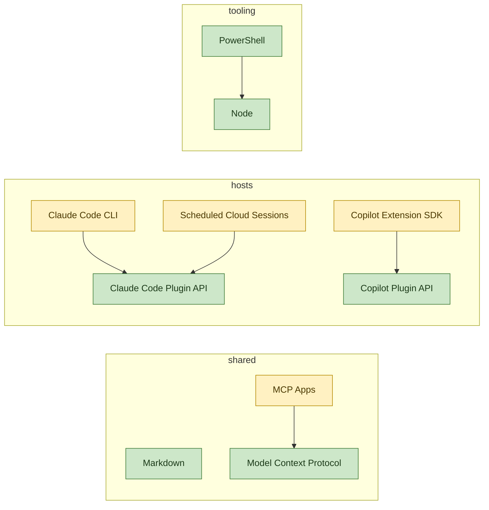

# Technology Graph

```meta
rating: adopted
index: root
```

This is everything this repository builds with. It has no runtime and no dependency manifest: the
assets are Markdown and JSON, and the platforms below read them. Each technology has one chapter
in its layer file; this file is the map.

**Layers**

| File | Covers |
| --- | --- |
| [shared.md](shared.md) | Cross-layer formats and protocols: Markdown, the Model Context Protocol, MCP Apps. |
| [hosts.md](hosts.md) | What reads or runs an asset: two plugin APIs, the Claude Code CLI, the scheduler, the Copilot extension SDK. |
| [tooling.md](tooling.md) | What the executable parts run on: Node, PowerShell. |

Three layers is the whole stack. A fourth appears only when a technology belongs to none of these,
and the change that adds its file registers it in this table.

**Graph**

Nodes are technologies, edges are `depends-on`, shading is `status`. Five edges is the honest
count: almost everything here is read by a host rather than built on another technology.



**How to Read It**

`status` rates a technology in this repository, on the radar ladder `candidate`, `trial`,
`adopted`, `hold`, `retired`. The four `trial` entries share one reason: nothing here has exercised
them yet, and each says what a first real run would test.

To add a technology:

1. Write its `##` chapter in its layer file, with `status`, `type`, and any `depends-on` edges.
2. Add its node and edges to the graph above in the same change.

To change a rating, change it in the chapter and in the `class` line here together. The generated
`_meta/graph.json` beside this file comes from the chapters, never from this diagram, so when the
two disagree the diagram is stale.
